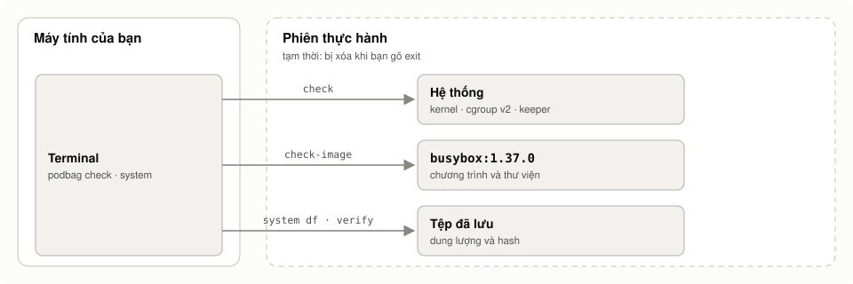

Podbag có các lệnh kiểm tra riêng. Chúng cho bạn biết hệ thống có chạy được container không, các chương trình trong image có chạy được không, và các tệp image đã lưu có còn nguyên vẹn không. Trong mô-đun này, bạn chạy từng lệnh kiểm tra một lần và đọc kết quả.

**Thời gian** 10 phút.



## Bắt đầu mô-đun

Mở **Training** trong Podbag Desktop và chọn **Kiểm tra hệ thống và các image**. Mô-đun mới xuất hiện sau khi chọn **Làm mới**. Hoặc chạy lệnh này trong terminal:

```sh
podbag lab start system-checks
```

Bạn cần bản Podbag có danh mục Training (sau v0.3.2). Tiếp tục tại dấu nhắc `training $`.

## Kiểm tra hệ thống

`podbag check` liệt kê những gì Podbag cần trên hệ thống này, mỗi mục một dòng. Ví dụ: nhân Linux, cgroup v2 và keeper. Keeper là tiến trình nhỏ theo dõi các container ở chế độ nền.

```sh
podbag check
```

Mỗi dòng bắt đầu bằng `ok`, `warn`, `fail` hoặc `n/a` (không áp dụng ở đây). Mỗi vấn đề đi kèm lệnh để sửa nó. Dòng cuối cho biết Podbag có chạy được container ở đây không. Podbag tìm dòng về `cgroup v2`.

## Kéo image

Phiên thực hành bắt đầu mà chưa có image nào. Hãy kéo một image nhỏ.

```sh
podbag pull docker.io/library/busybox:1.37.0
```

Podbag kiểm tra rằng image đã có.

## Kiểm tra các chương trình trong image

`podbag check-image` đọc mọi chương trình và thư viện trong image đã kéo. Lệnh này không chạy chúng. Nó báo các chương trình được build cho thư viện C khác hoặc CPU khác, và các thư viện bị thiếu.

```sh
podbag check-image docker.io/library/busybox:1.37.0
```

Kết quả cho biết số tệp đã kiểm tra và kết thúc bằng `no problems found`. Podbag tìm các từ này. Khi tìm thấy lỗi, lệnh thoát với mã `1`, để script build có thể dừng lại.

## Xem dung lượng ổ đĩa đã dùng

`podbag system df` cho biết image, tệp đã lưu và container dùng bao nhiêu dung lượng ổ đĩa.

```sh
podbag system df
```

Dòng **Objects** đếm các tệp đã lưu của mọi image. Các image dùng chung một tệp chỉ lưu tệp đó một lần. Podbag tìm từ `Objects`.

## Kiểm tra các tệp đã lưu

`podbag system verify` đọc mọi tệp đã lưu và kiểm tra hash của nó. Hash là một dấu vân tay ngắn của nội dung tệp. Tệp bị hỏng sẽ có hash khác.

```sh
podbag system verify
```

Kết quả kết thúc bằng `0 damaged`. Podbag tìm các từ này. Nếu một tệp bị hỏng, lệnh nêu tên các image dùng tệp đó và thoát với mã `1`. Khi đó, `podbag system verify --fix` xóa các image này, và bạn kéo lại chúng.

## Dọn dẹp và kết thúc

Xóa image. Sau đó kết thúc phiên.

```sh
podbag rmi docker.io/library/busybox:1.37.0
exit
```

Các tài nguyên thực hành tạm thời đã được xóa. Training hiển thị mô-đun đã hoàn thành.
