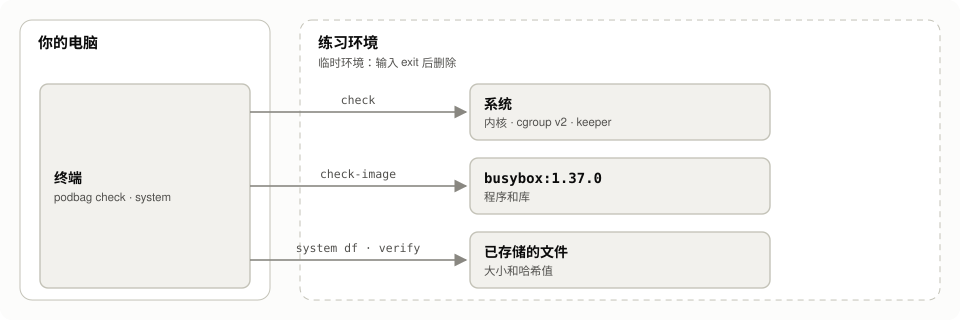

Podbag 有自己的检查命令。它们会告诉你系统能否运行容器、镜像中的程序能否运行，以及存储的镜像文件是否完整。在本模块中，你将把每项检查运行一次，并读懂它的结果。

**预计用时** 10 分钟。



## 开始模块

在 Podbag Desktop 中打开 **Training**，选择**检查系统和镜像**。点击**刷新**后会出现新模块。也可以在终端中运行以下命令：

```sh
podbag lab start system-checks
```

需要带有 Training 目录的 Podbag 版本（v0.3.2 之后）。出现 `training $` 提示符后继续。

要在 TUI 而不是 Podbag Desktop 中完成这些步骤，请加上 `--tui`。

```sh
podbag lab start system-checks --tui
```

在 TUI 中，按 `:` 打开 Training 终端来执行命令步骤，输入 `exit` 返回 TUI，按 `q` 结束实验。

## 检查系统

`podbag check` 列出 Podbag 在此系统上需要的条件，每项一行。例如内核、cgroup v2 和 keeper。keeper 是在后台监视容器的小型进程。

```sh
podbag check
```

每一行以 `ok`、`warn`、`fail` 或 `n/a`（此处不适用）开头。出现问题时，会同时给出修复命令。最后一行说明 Podbag 能否在这里运行容器。Podbag 会检查关于 `cgroup v2` 的那一行。

## 拉取镜像

练习环境开始时没有镜像。拉取一个小镜像。

```sh
podbag pull docker.io/library/busybox:1.37.0
```

- **在 Podbag Desktop 中：** 选择**实验容器 → 拉取 docker.io/library/busybox:1.37.0**。
- **在 TUI 中：** 打开**镜像**，按 `p`，输入 `docker.io/library/busybox:1.37.0` 并按 `Enter`。

Podbag 会检查镜像是否存在。

## 检查镜像中的程序

`podbag check-image` 读取已拉取镜像中的每个程序和库。它不会运行它们。它会报告为其他 C 库或其他 CPU 构建的程序，以及缺少的库。

```sh
podbag check-image docker.io/library/busybox:1.37.0
```

输出会说明检查了多少个文件，并以 `no problems found` 结尾。Podbag 会检查这些词。发现错误时，它以退出码 `1` 退出，这样构建脚本可以停止。

## 查看磁盘使用情况

`podbag system df` 显示镜像、已存储的文件和容器占用了多少磁盘空间。

```sh
podbag system df
```

**Objects** 行统计所有镜像已存储的文件数。多个镜像共用的文件只存储一次。Podbag 会检查是否有 `Objects` 这个词。

## 验证已存储的文件

`podbag system verify` 读取每个已存储的文件，并检查它的哈希值。哈希值是文件内容的简短指纹。损坏的文件会有不同的哈希值。

```sh
podbag system verify
```

输出以 `0 damaged` 结尾。Podbag 会检查这些词。如果有文件损坏，命令会列出使用该文件的镜像，并以退出码 `1` 退出。这时运行 `podbag system verify --fix` 删除这些镜像，然后重新拉取它们。

## 清理并结束

删除镜像。然后结束实验。

- **在 Podbag Desktop 中：** 选择**实验容器 → 删除镜像 docker.io/library/busybox:1.37.0**并确认。
- **在 TUI 中：** 在**镜像**中选择 `docker.io/library/busybox:1.37.0`，按 `d`，再按 `y`。

```sh
podbag rmi docker.io/library/busybox:1.37.0
exit
```

临时实验资源会被删除。Training 会显示该模块已完成。
