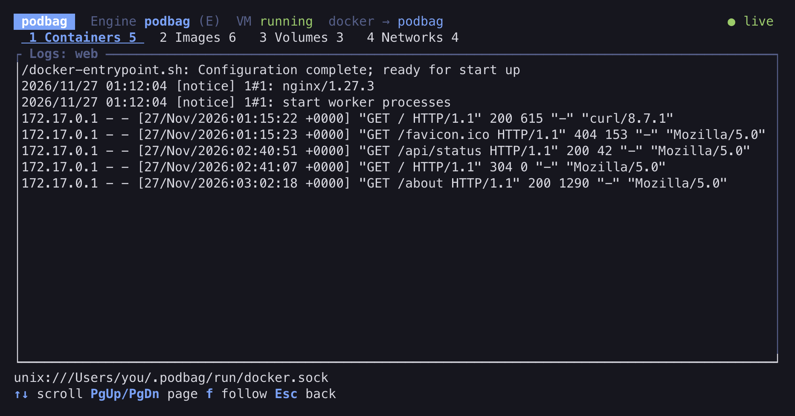
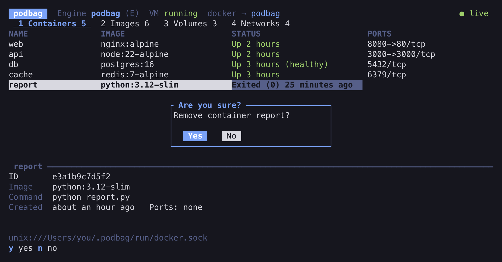

The Containers list shows every container: the running ones and the stopped ones. Press `1` to open it. Select a container, then press a key.

**Time** 5 minutes.

## Start, stop and restart

- `s` starts the selected container.
- `x` stops it.
- `r` restarts it.

The message line shows the result, and the status column changes. When the engine can pause and rename containers, `p` pauses or resumes the container and `n` renames it. The keys window (`?`) shows these keys only then.

## Read the logs

Press `l`. The TUI shows the last 1,000 lines of the container's output. Then it adds new lines as they come.



- `↑` `↓`, `PgUp` `PgDn` scroll the lines.
- `f` stops or starts following the new lines.
- `Esc` goes back to the list.

## Open a shell

Select a running container and press `e`. The TUI runs `sh` in the container, in the same terminal. It is the same as this command.

```sh
podbag exec -it web sh
```

Type `exit` to go back to the TUI. The message line shows how the shell ended. The container must have `sh`.

## Show all details

`Enter` or `i` shows all details of the container as JSON: its image, command, mounts and networks. For a running container, it also shows the processes and the resource use when the engine gives them. `Esc` goes back.

## Remove containers

`d` removes the selected container. The TUI asks first. A running container is stopped, then removed.



Press `y` or `Enter` to remove it. Press `n` or `Esc` to keep it.

`c` cleans up: it removes all stopped containers. The TUI also asks first.

## Next

[Pull and clean up images](../tui-images/) in the Images list.
