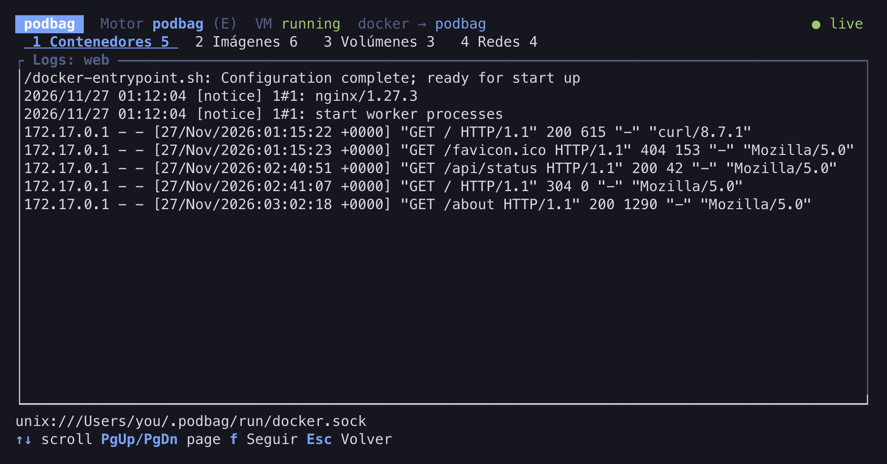
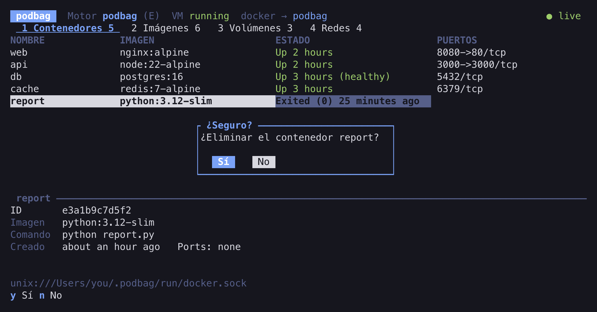

La lista Contenedores muestra todos los contenedores: los que están en ejecución y los detenidos. Pulsa `1` para abrirla. Selecciona un contenedor y pulsa una tecla.

**Tiempo** 5 minutos.

## Inicia, detén y reinicia

- `s` inicia el contenedor seleccionado.
- `x` lo detiene.
- `r` lo reinicia.

La línea de mensajes muestra el resultado y la columna de estado cambia. Si el motor puede pausar contenedores y cambiarles el nombre, `p` pausa o reanuda el contenedor y `n` le cambia el nombre. Solo en ese caso la ventana de teclas (`?`) muestra estas teclas.

## Lee los registros

Pulsa `l`. La TUI muestra las últimas 1.000 líneas de la salida del contenedor. Después añade las líneas nuevas a medida que llegan.



- `↑` `↓`, `PgUp` `PgDn` desplazan las líneas.
- `f` deja de seguir las líneas nuevas o vuelve a seguirlas.
- `Esc` vuelve a la lista.

## Abre un shell

Selecciona un contenedor en ejecución y pulsa `e`. La TUI ejecuta `sh` dentro del contenedor, en la misma terminal. Es lo mismo que este comando.

```sh
podbag exec -it web sh
```

Escribe `exit` para volver a la TUI. La línea de mensajes muestra cómo terminó el shell. El contenedor debe tener `sh`.

## Muestra todos los detalles

`Enter` o `i` muestra todos los detalles del contenedor en JSON: su imagen, su comando, sus montajes y sus redes. Si el contenedor está en ejecución, también muestra los procesos y el uso de recursos cuando el motor los da. `Esc` vuelve atrás.

## Elimina contenedores

`d` elimina el contenedor seleccionado. La TUI pregunta antes. Si el contenedor está en ejecución, primero lo detiene y luego lo elimina.



Pulsa `y` o `Enter` para eliminarlo. Pulsa `n` o `Esc` para conservarlo.

`c` limpia: elimina todos los contenedores detenidos. La TUI también pregunta antes.

## Siguiente

[Descarga y limpia imágenes](../tui-images/) en la lista Imágenes.
