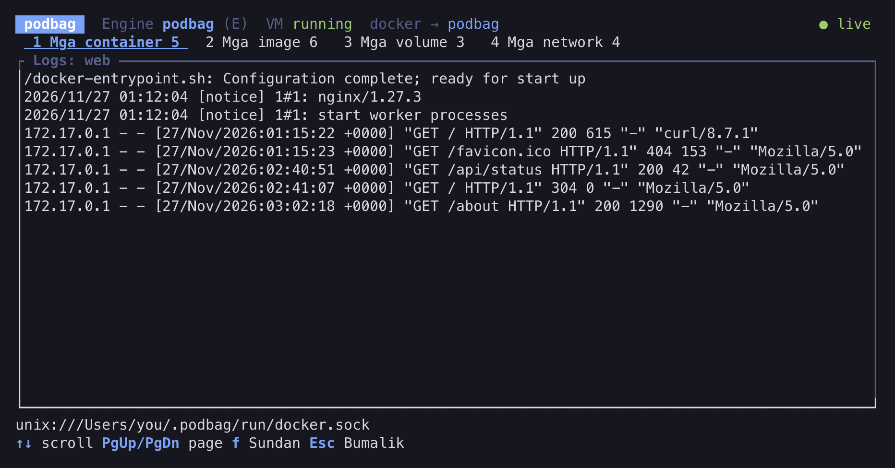
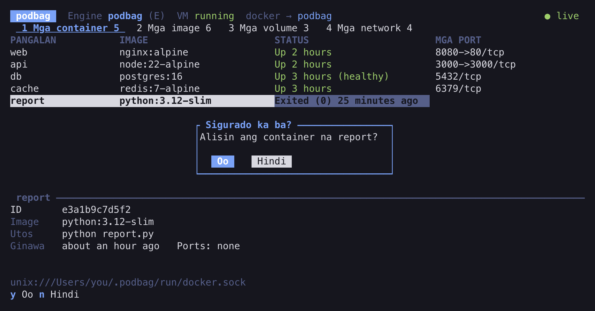

Ipinapakita ng listahan ng Mga container ang bawat container: ang mga tumatakbo at ang mga nakahinto. Pindutin ang `1` para buksan ito. Pumili ng container, saka pumindot ng key.

**Oras** 5 minuto.

## Simulan, ihinto at i-restart

- Sinisimulan ng `s` ang napiling container.
- Inihihinto ito ng `x`.
- Ini-restart ito ng `r`.

Ipinapakita ng linya ng mensahe ang resulta, at nagbabago ang column ng status. Kapag kaya ng engine na i-pause at palitan ang pangalan ng mga container, ipo-pause o itutuloy ng `p` ang container. Papalitan ng `n` ang pangalan nito. Saka lang ipinapakita ng window ng mga key (`?`) ang mga key na ito.

## Basahin ang mga log

Pindutin ang `l`. Ipinapakita ng TUI ang huling 1,000 linya ng output ng container. Pagkatapos, idinadagdag nito ang mga bagong linya habang dumarating ang mga ito.



- Nag-i-scroll sa mga linya ang `↑` `↓`, `PgUp` `PgDn`.
- Inihihinto o sinisimulan ng `f` ang pagsunod sa mga bagong linya.
- Bumabalik sa listahan ang `Esc`.

## Magbukas ng shell

Pumili ng tumatakbong container at pindutin ang `e`. Pinapatakbo ng TUI ang `sh` sa loob ng container, sa parehong terminal. Pareho ito ng command na ito.

```sh
podbag exec -it web sh
```

I-type ang `exit` para bumalik sa TUI. Ipinapakita ng linya ng mensahe kung paano natapos ang shell. Dapat may `sh` ang container.

## Ipakita ang lahat ng detalye

Ipinapakita ng `Enter` o `i` ang lahat ng detalye ng container bilang JSON: ang image, command, mga mount at mga network nito. Sa tumatakbong container, ipinapakita rin nito ang mga proseso at ang gamit ng resource kapag ibinibigay ng engine ang mga ito. Bumabalik ang `Esc`.

## Alisin ang mga container

Inaalis ng `d` ang napiling container. Nagtatanong muna ang TUI. Ang tumatakbong container ay ihihinto muna, saka aalisin.



Pindutin ang `y` o `Enter` para alisin ito. Pindutin ang `n` o `Esc` para panatilihin ito.

Naglilinis ang `c`: inaalis nito ang lahat ng nakahintong container. Nagtatanong din muna ang TUI.

## Susunod

[Kumuha at maglinis ng mga image](../tui-images/) sa listahan ng Mga image.
