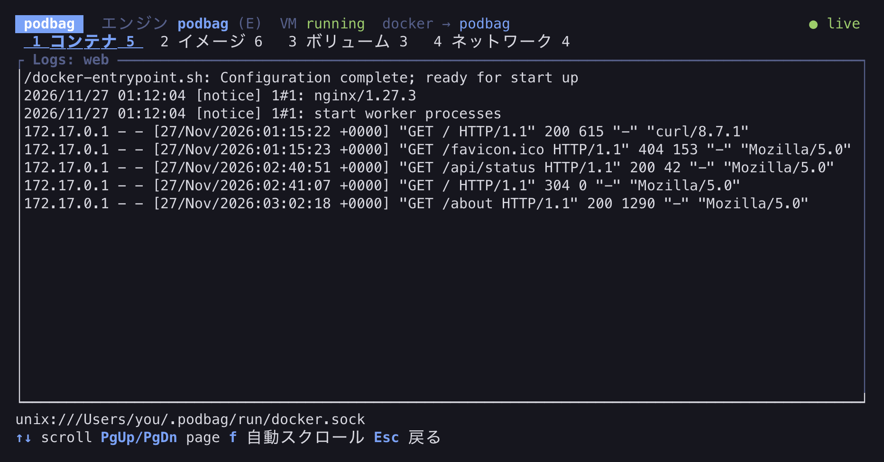
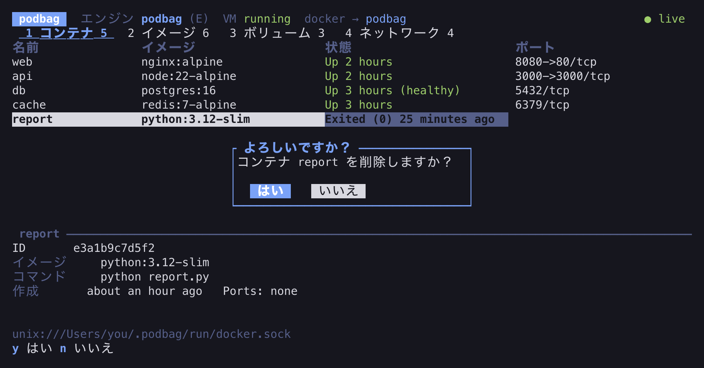

コンテナの一覧には、実行中のコンテナと停止中のコンテナがすべて表示されます。`1` を押すと開きます。コンテナを選択してから、キーを押します。

**所要時間** 5 分。

## 開始、停止、再起動

- `s` は、選択したコンテナを開始します。
- `x` は、停止します。
- `r` は、再起動します。

メッセージ行に結果が表示され、状態の列が変わります。エンジンが一時停止と名前の変更に対応している場合、`p` でコンテナを一時停止または再開し、`n` で名前を変更します。キーウィンドウ（`?`）にこれらのキーが表示されるのも、その場合だけです。

## ログを読む

`l` を押します。TUI はコンテナの出力の最後の 1,000 行を表示します。その後、新しい行が出るたびに追加します。



- `↑` `↓`、`PgUp` `PgDn` で行をスクロールします。
- `f` で、新しい行の自動スクロールを止めたり再開したりします。
- `Esc` で一覧に戻ります。

## シェルを開く

実行中のコンテナを選択して、`e` を押します。TUI は同じターミナルで、コンテナの中の `sh` を実行します。次のコマンドと同じです。

```sh
podbag exec -it web sh
```

`exit` と入力すると、TUI に戻ります。メッセージ行に、シェルがどう終わったかが表示されます。コンテナに `sh` が必要です。

## すべての詳細を表示する

`Enter` または `i` を押すと、コンテナのすべての詳細が JSON で表示されます。イメージ、コマンド、マウント、ネットワークがわかります。実行中のコンテナでは、エンジンが提供する場合、プロセスとリソースの使用量も表示されます。`Esc` で戻ります。

## コンテナを削除する

`d` は、選択したコンテナを削除します。TUI は先に確認します。実行中のコンテナは、停止してから削除します。



`y` または `Enter` を押すと削除します。`n` または `Esc` を押すと、そのまま残します。

`c` は整理です。停止中のコンテナをすべて削除します。このときも TUI は先に確認します。

## 次へ

イメージの一覧で[イメージを取得して整理する](../tui-images/)。
