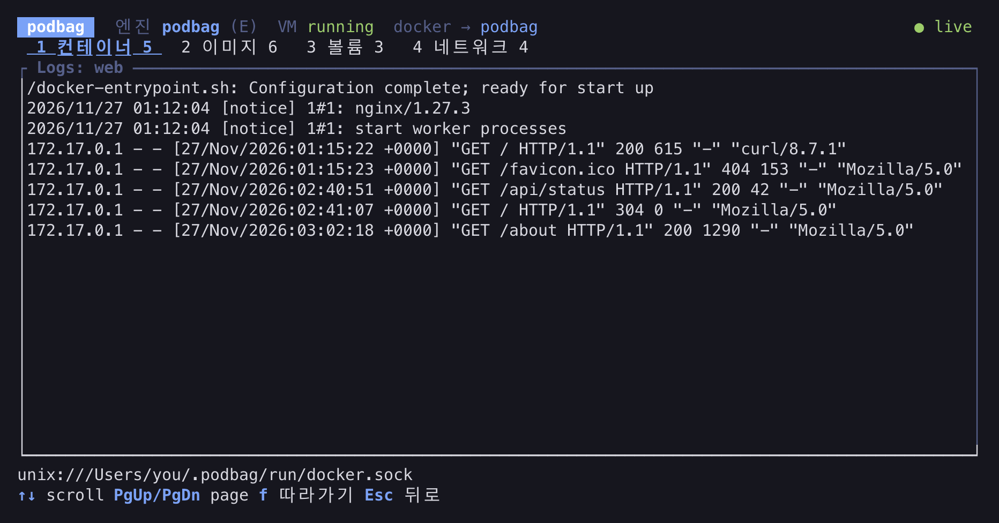
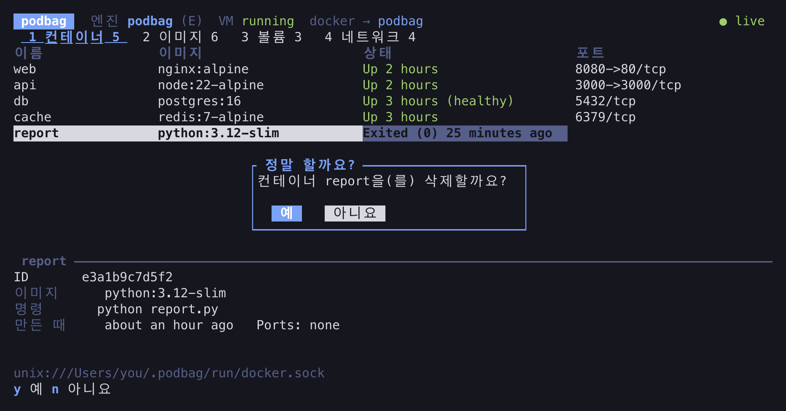

컨테이너 목록은 실행 중인 컨테이너와 멈춘 컨테이너를 모두 보여줍니다. `1`을 누르면 열립니다. 컨테이너를 선택한 뒤 키를 누릅니다.

**예상 시간** 5분.

## 시작, 중지, 재시작

- `s`는 선택한 컨테이너를 시작합니다.
- `x`는 중지합니다.
- `r`은 재시작합니다.

메시지 줄에 결과가 나오고 상태 열이 바뀝니다. 엔진이 일시 중지와 이름 바꾸기를 지원하면 `p`로 일시 중지하거나 다시 시작하고, `n`으로 이름을 바꿉니다. 이때만 단축키 창(`?`)에 이 키가 나옵니다.

## 로그 읽기

`l`을 누릅니다. TUI는 컨테이너 출력의 마지막 1,000줄을 보여줍니다. 그다음 새 줄이 생기는 대로 붙입니다.



- `↑` `↓`, `PgUp` `PgDn`으로 줄을 넘깁니다.
- `f`는 새 줄 따라가기를 멈추거나 다시 켭니다.
- `Esc`로 목록에 돌아갑니다.

## 셸 열기

실행 중인 컨테이너를 선택하고 `e`를 누릅니다. TUI가 같은 터미널에서 컨테이너 안의 `sh`를 실행합니다. 다음 명령과 같습니다.

```sh
podbag exec -it web sh
```

`exit`를 입력하면 TUI로 돌아갑니다. 메시지 줄에 셸이 어떻게 끝났는지 나옵니다. 컨테이너에 `sh`가 있어야 합니다.

## 모든 상세 정보 보기

`Enter` 또는 `i`를 누르면 컨테이너의 모든 정보가 JSON으로 나옵니다. 이미지, 명령, 마운트, 네트워크를 볼 수 있습니다. 실행 중인 컨테이너는 엔진이 알려주면 프로세스와 리소스 사용량도 나옵니다. `Esc`로 돌아갑니다.

## 컨테이너 삭제하기

`d`는 선택한 컨테이너를 삭제합니다. TUI가 먼저 묻습니다. 실행 중인 컨테이너는 중지한 뒤 삭제합니다.



`y`나 `Enter`를 누르면 삭제합니다. `n`이나 `Esc`를 누르면 그대로 둡니다.

`c`는 정리입니다. 멈춘 컨테이너를 모두 삭제합니다. 이때도 먼저 묻습니다.

## 다음 글

이미지 목록에서 [이미지 받기와 정리하기](../tui-images/).
