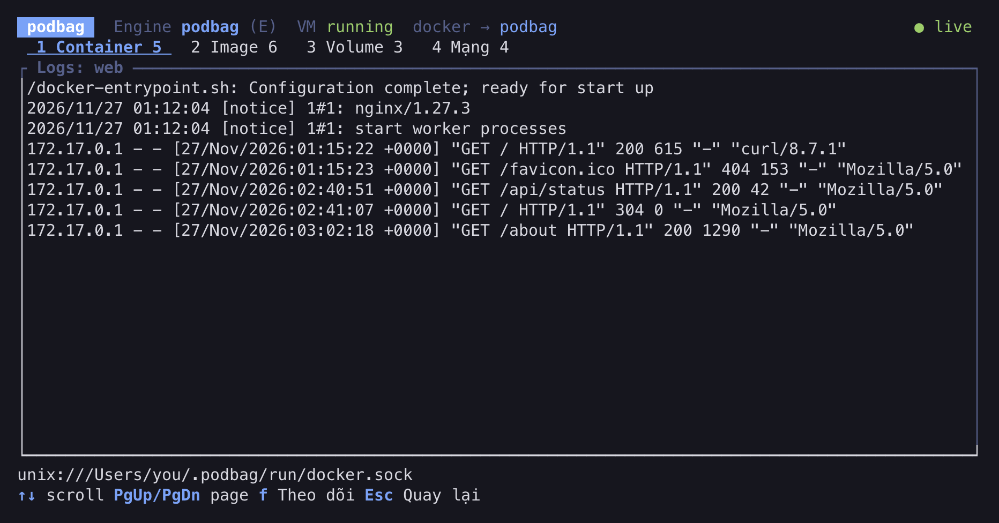
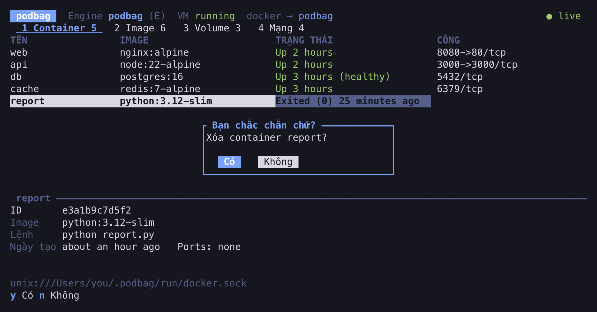

Danh sách Container hiện mọi container: cả container đang chạy và container đã dừng. Nhấn `1` để mở danh sách. Chọn một container, rồi nhấn một phím.

**Thời gian** 5 phút.

## Chạy, dừng và khởi động lại

- `s` chạy container đang chọn.
- `x` dừng container.
- `r` khởi động lại container.

Dòng thông báo hiện kết quả, và cột trạng thái thay đổi. Khi engine hỗ trợ tạm dừng và đổi tên container, `p` tạm dừng hoặc tiếp tục container, và `n` đổi tên container. Chỉ khi đó, cửa sổ Phím tắt (`?`) mới hiện các phím này.

## Đọc nhật ký

Nhấn `l`. TUI hiện 1.000 dòng cuối cùng trong đầu ra của container. Sau đó, TUI thêm các dòng mới khi chúng xuất hiện.



- `↑` `↓`, `PgUp` `PgDn` cuộn các dòng.
- `f` dừng hoặc bật lại việc theo dõi dòng mới.
- `Esc` quay lại danh sách.

## Mở shell

Chọn một container đang chạy và nhấn `e`. TUI chạy `sh` bên trong container, ngay trong terminal này. Việc này giống với lệnh sau.

```sh
podbag exec -it web sh
```

Gõ `exit` để quay lại TUI. Dòng thông báo cho biết shell đã kết thúc ra sao. Container phải có `sh`.

## Hiện tất cả chi tiết

`Enter` hoặc `i` hiện tất cả chi tiết của container dưới dạng JSON: image, lệnh, mount và mạng. Với container đang chạy, TUI cũng hiện các tiến trình và mức dùng tài nguyên nếu engine cung cấp. `Esc` để quay lại.

## Xóa container

`d` hoặc `Delete` xóa container đang chọn. TUI hỏi trước. Container đang chạy sẽ bị dừng, rồi bị xóa.



Nhấn `y` hoặc `Enter` để xóa. Nhấn `n` hoặc `Esc` để giữ lại.

`c` dọn dẹp: phím này xóa tất cả container đã dừng. TUI cũng hỏi trước.

## Tiếp theo

[Tải và dọn dẹp image](../tui-images/) trong danh sách Image.
