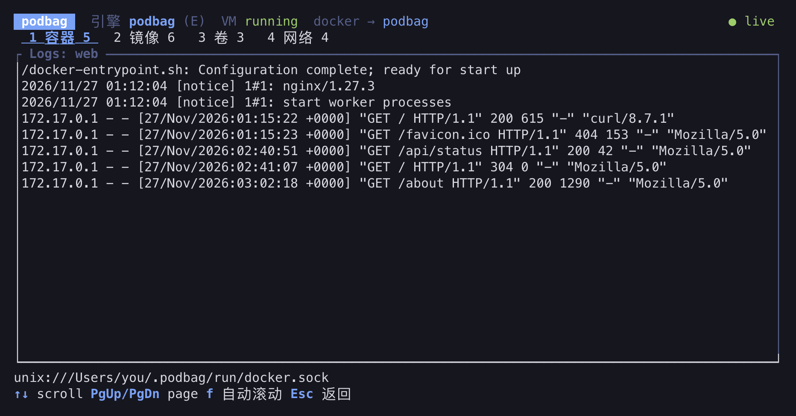
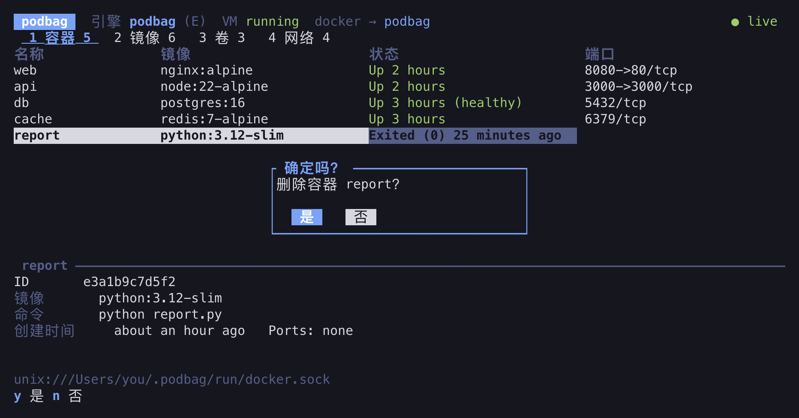

容器列表显示所有容器：正在运行的和已停止的。按 `1` 打开它。选中一个容器，然后按键。

**预计用时** 5 分钟。

## 启动、停止和重启

- `s` 启动选中的容器。
- `x` 停止它。
- `r` 重启它。

消息行会显示结果，状态列也会变化。如果引擎支持暂停和重命名容器，`p` 可以暂停或恢复容器，`n` 可以重命名容器。只有在这种情况下，快捷键窗口（`?`）才会显示这两个键。

## 读取日志

按 `l`。TUI 会显示容器输出的最后 1,000 行。之后有新行时，TUI 会接着显示。



- `↑` `↓`、`PgUp` `PgDn` 滚动日志。
- `f` 停止或重新开始跟随新行。
- `Esc` 返回列表。

## 打开 shell

选中一个正在运行的容器，按 `e`。TUI 会在同一个终端中，在容器内运行 `sh`。效果与下面的命令相同。

```sh
podbag exec -it web sh
```

输入 `exit` 返回 TUI。消息行会显示 shell 是如何结束的。容器中必须有 `sh`。

## 显示全部详情

`Enter` 或 `i` 以 JSON 格式显示容器的全部详情：镜像、命令、挂载和网络。对于正在运行的容器，如果引擎提供这些信息，还会显示进程和资源使用情况。`Esc` 返回。

## 删除容器

`d` 或 `Delete` 删除选中的容器。TUI 会先询问你。正在运行的容器会先停止，再删除。



按 `y` 或 `Enter` 删除。按 `n` 或 `Esc` 保留。

`c` 用于清理：它删除所有已停止的容器。TUI 同样会先询问你。

## 下一篇

在镜像列表中[拉取和清理镜像](../tui-images/)。
