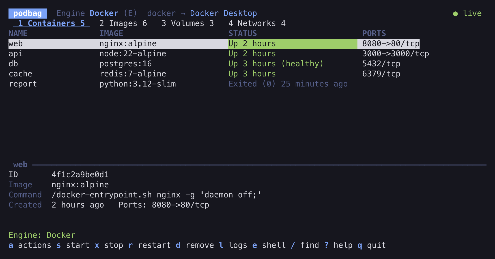
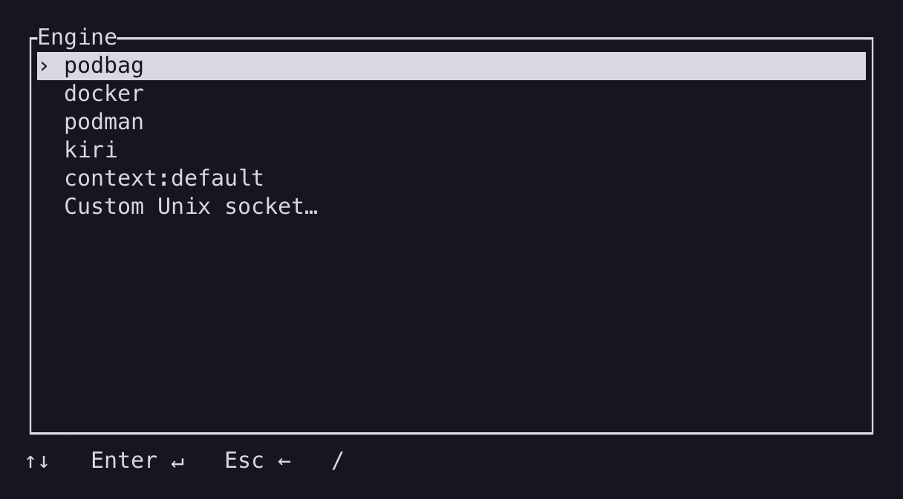
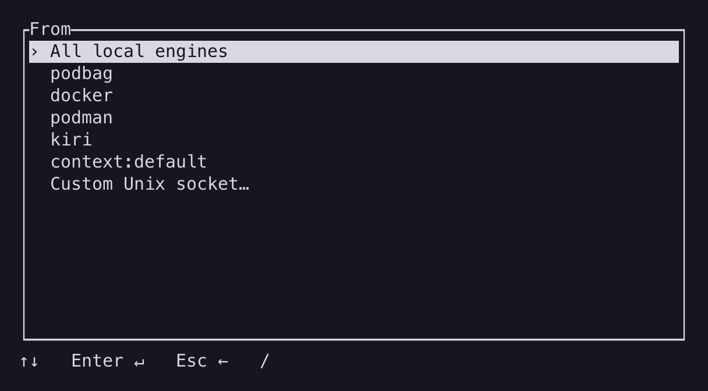

The TUI works with any engine that has the Docker API: podbag, Docker, Podman, Kiri, a Docker context or a Unix socket. The top line shows the engine that the TUI uses now.

**Time** 5 minutes.

## Which engine the TUI uses

The TUI takes the first of these:

1. The `--engine` option, for one run: `podbag tui --engine podman`.
2. The engine you chose in the TUI before. The TUI remembers it.
3. `DOCKER_HOST`, when it is a Unix socket (`unix://…`).
4. podbag.

The TUI never starts Docker. When an engine does not answer, the message line says so.

## Switch between podbag and Docker

Press `E`. The TUI switches from podbag to Docker, or from Docker to podbag. From any other engine, `E` goes to podbag. The lists load again, and the TUI remembers the choice. You can also click the engine name on the top line.

## Choose any engine

1. Press `F9` to open **Settings**.
2. Choose **Engine**, then **Connect**.
3. Choose the engine. **Custom Unix socket…** asks for a socket path.

**Settings → Engine → Details** shows the engine's version.

## Point the docker command at podbag

When the `docker` command is installed, the top line shows where it goes, for example `docker → Docker Desktop`. Press `D` to point it at podbag. The TUI asks first. Press `D` again to point it back.

## Copy to another engine

The migration copies containers, images and volumes from one engine to another. The source stays as it is.

1. Press `F7`, then choose **Engine**.
2. Under **From**, choose the source engine, or **All local engines**.
3. Choose the resource type: containers, images or volumes.
4. Choose the resource, then the engine under **To**.
5. Choose **Start migration**. The TUI shows the progress and checks the copy.

- Stop a container before you copy it.
- A container or a volume with the same name on the destination stops the copy.

The [usage guide](https://github.com/SteelCrab/podbag/blob/main/docs/usage.md) tells what is copied, and how to copy between Kubernetes clusters.

## Next

[Kubernetes and settings](../tui-kubernetes-settings/).
