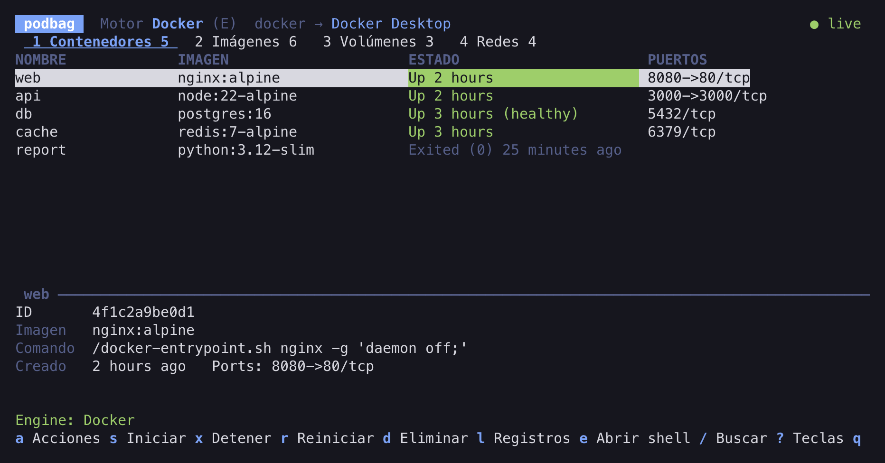
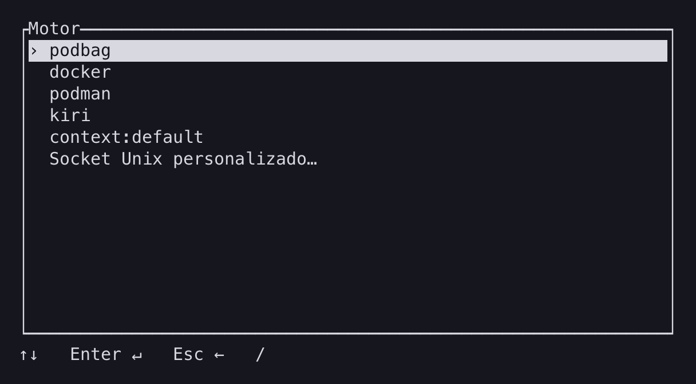
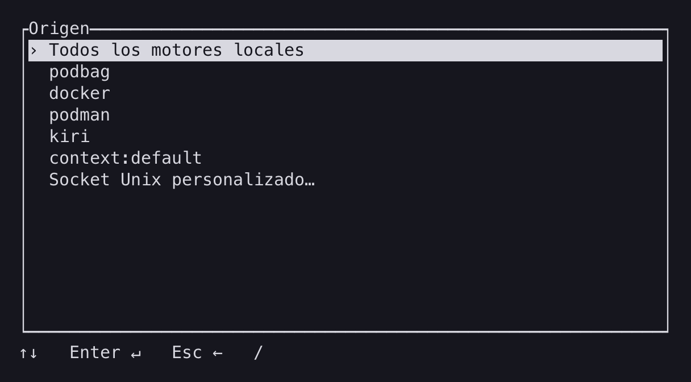

La TUI funciona con cualquier motor que tenga la API de Docker: podbag, Docker, Podman, Kiri, un contexto de Docker o un socket Unix. La línea superior muestra el motor que la TUI usa ahora.

**Tiempo** 5 minutos.

## Qué motor usa la TUI

La TUI toma el primero de esta lista:

1. La opción `--engine`, solo para esta ejecución: `podbag tui --engine podman`.
2. El motor que elegiste antes en la TUI. La TUI lo recuerda.
3. `DOCKER_HOST`, cuando es un socket Unix (`unix://…`).
4. podbag.

La TUI nunca inicia Docker. Si un motor no responde, la línea de mensajes lo indica.

## Cambia entre podbag y Docker

Pulsa `E`. La TUI cambia de podbag a Docker, o de Docker a podbag. Desde cualquier otro motor, `E` cambia a podbag. Las listas se vuelven a cargar y la TUI recuerda la elección. También puedes hacer clic en el nombre del motor en la línea superior.

## Elige cualquier motor

1. Pulsa `F9` para abrir **Ajustes**.
2. Elige **Motor** y luego **Conectar**.
3. Elige el motor. **Socket Unix personalizado…** pide la ruta de un socket.

**Ajustes → Motor → Detalles** muestra la versión del motor.

## Haz que el comando docker use podbag

Si el comando `docker` está instalado, la línea superior muestra adónde va, por ejemplo `docker → Docker Desktop`. Pulsa `D` para que use podbag. La TUI pregunta antes. Pulsa `D` otra vez para volver al motor anterior.

## Copia a otro motor

La migración copia contenedores, imágenes y volúmenes de un motor a otro. El origen no cambia.

1. Pulsa `F7` y elige **Motor**.
2. En **Origen**, elige el motor de origen o **Todos los motores locales**.
3. Elige el tipo de recurso: contenedores, imágenes o volúmenes.
4. Elige el recurso y luego el motor en **Destino**.
5. Elige **Iniciar migración**. La TUI muestra el progreso y comprueba la copia.

- Detén un contenedor antes de copiarlo.
- Si en el destino hay un contenedor o un volumen con el mismo nombre, la copia se detiene.

La [guía de uso](https://github.com/SteelCrab/podbag/blob/main/docs/usage.md) explica qué se copia y cómo copiar entre clústeres de Kubernetes.

## Siguiente

[Kubernetes y ajustes](../tui-kubernetes-settings/).
