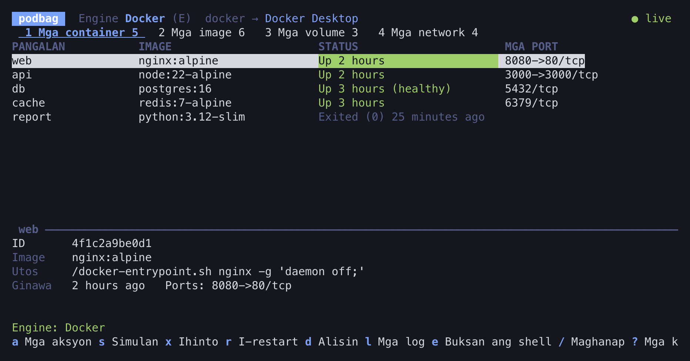
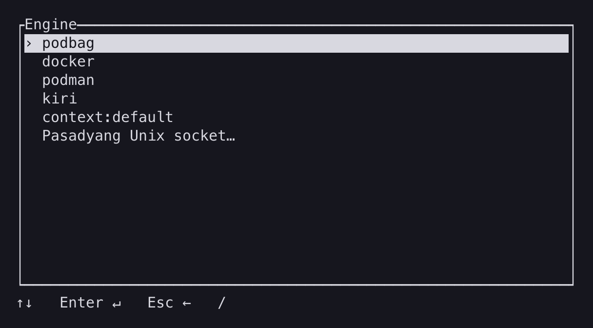
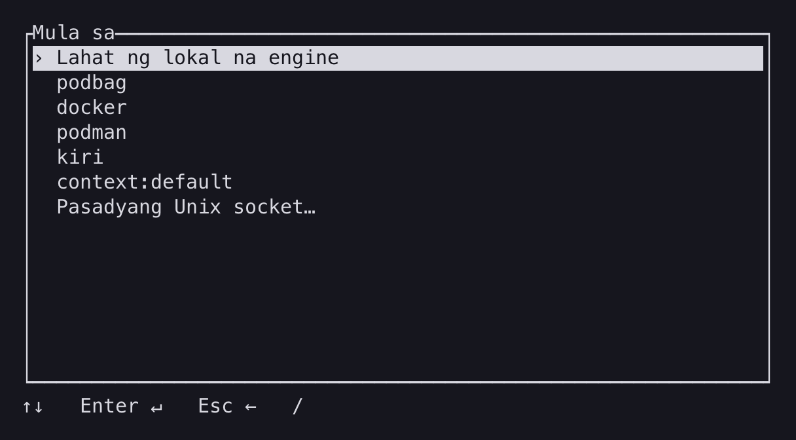

Gumagana ang TUI sa anumang engine na may Docker API: podbag, Docker, Podman, Kiri, isang Docker context o isang Unix socket. Ipinapakita ng itaas na linya ang engine na ginagamit ngayon ng TUI.

**Oras** 5 minuto.

## Aling engine ang ginagamit ng TUI

Kinukuha ng TUI ang una sa mga ito:

1. Ang option na `--engine`, para sa isang takbo: `podbag tui --engine podman`.
2. Ang engine na pinili mo dati sa TUI. Tinatandaan ito ng TUI.
3. Ang `DOCKER_HOST`, kapag Unix socket ito (`unix://…`).
4. podbag.

Hindi kailanman sinisimulan ng TUI ang Docker. Kapag hindi sumasagot ang engine, sinasabi ito ng linya ng mensahe.

## Magpalit sa pagitan ng podbag at Docker

Pindutin ang `E`. Lilipat ang TUI mula podbag papuntang Docker, o mula Docker papuntang podbag. Mula sa ibang engine, pupunta sa podbag ang `E`. Muling naglo-load ang mga listahan, at tinatandaan ng TUI ang pinili. Puwede mo ring i-click ang pangalan ng engine sa itaas na linya.

## Pumili ng kahit anong engine

1. Pindutin ang `F9` para buksan ang **Mga setting**.
2. Piliin ang **Engine**, saka ang **Kumonekta**.
3. Piliin ang engine. Humihingi ng path ng socket ang **Pasadyang Unix socket…**.

Ipinapakita ng **Mga setting → Engine → Mga detalye** ang bersyon ng engine.

## Ituro ang command na docker sa podbag

Kapag naka-install ang command na `docker`, ipinapakita ng itaas na linya kung saan ito pumupunta, halimbawa `docker → Docker Desktop`. Pindutin ang `D` para ituro ito sa podbag. Nagtatanong muna ang TUI. Pindutin ulit ang `D` para ibalik ito.

## Kopyahin sa ibang engine

Kinokopya ng paglilipat ang mga container, image at volume mula sa isang engine papunta sa iba. Hindi nagbabago ang pinagmulan.

1. Pindutin ang `F7`, saka piliin ang **Engine**.
2. Sa **Mula sa**, piliin ang engine na pinagmulan, o ang **Lahat ng lokal na engine**.
3. Piliin ang uri ng resource: mga container, image o volume.
4. Piliin ang resource, saka ang engine sa **Patungo sa**.
5. Piliin ang **Simulan ang paglilipat**. Ipinapakita ng TUI ang progreso at sinusuri nito ang kopya.

- Ihinto ang container bago mo ito kopyahin.
- Hindi itutuloy ang pagkopya kapag may container o volume na may parehong pangalan sa destinasyon.

Sinasabi ng [gabay sa paggamit](https://github.com/SteelCrab/podbag/blob/main/docs/usage.md) kung ano ang kinokopya, at kung paano kumopya sa pagitan ng mga Kubernetes cluster.

## Susunod

[Kubernetes at mga setting](../tui-kubernetes-settings/).
