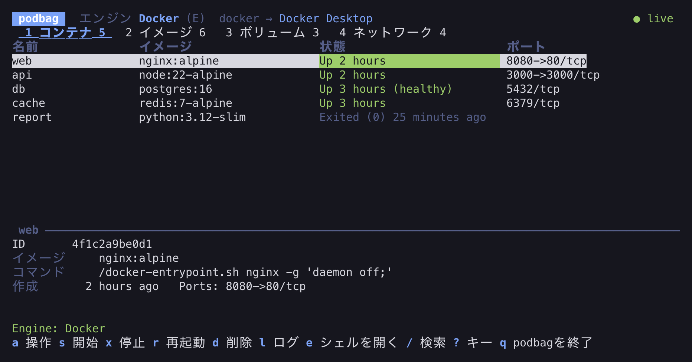
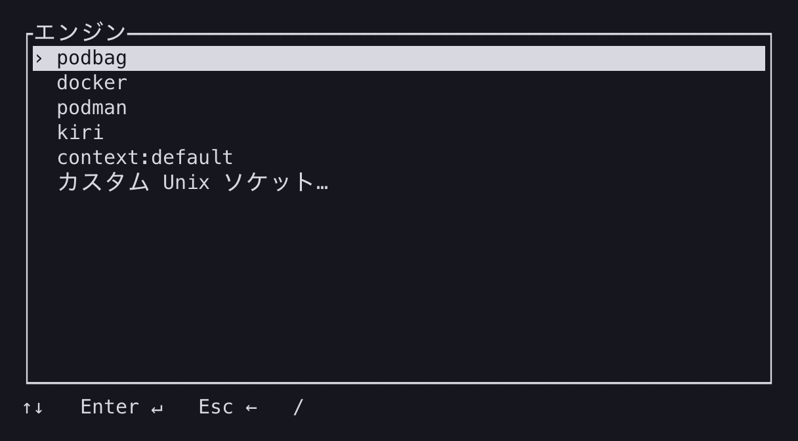
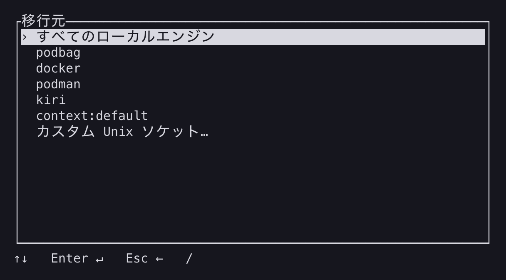

TUI は、Docker API を持つエンジンならどれでも使えます。podbag、Docker、Podman、Kiri、Docker コンテキスト、Unix ソケットです。一番上の行に、TUI がいま使っているエンジンが表示されます。

**所要時間** 5 分。

## TUI が使うエンジン

TUI は、次の順で最初に見つかったものを使います。

1. `--engine` オプション。今回の実行だけに使います: `podbag tui --engine podman`。
2. 以前に TUI で選んだエンジン。TUI が覚えています。
3. `DOCKER_HOST` が Unix ソケット（`unix://…`）のときは、そのソケット。
4. podbag。

TUI が Docker を起動することはありません。エンジンが応答しないときは、メッセージ行に表示されます。

## podbag と Docker を切り替える

`E` を押します。podbag なら Docker に、Docker なら podbag に切り替わります。ほかのエンジンからは、`E` で podbag に切り替わります。一覧が読み直され、TUI はこの選択を覚えます。一番上の行のエンジン名をクリックしても切り替えられます。

## 好きなエンジンを選ぶ

1. `F9` を押して、**設定**を開きます。
2. **エンジン**を選び、**接続**を選びます。
3. エンジンを選びます。**カスタム Unix ソケット…** を選ぶと、ソケットのパスを尋ねます。

**設定 → エンジン → 詳細**で、エンジンのバージョンが表示されます。

## docker コマンドの行き先を podbag にする

`docker` コマンドがインストールされていると、一番上の行に行き先が表示されます。例: `docker → Docker Desktop`。`D` を押すと、`docker` コマンドが podbag を使うようになります。TUI は先に確認します。もう一度 `D` を押すと、元に戻ります。

## 別のエンジンにコピーする

移行は、あるエンジンのコンテナ、イメージ、ボリュームを、別のエンジンにコピーします。移行元はそのまま残ります。

1. `F7` を押し、**エンジン**を選びます。
2. **移行元**で、コピー元のエンジンを選びます。**すべてのローカルエンジン**も選べます。
3. リソースの種類を選びます。コンテナ、イメージ、ボリュームのどれかです。
4. リソースを選び、**移行先**でエンジンを選びます。
5. **移行を開始**を選びます。TUI は進行状況を表示し、コピーを確認します。

- コンテナは、コピーする前に停止します。
- 移行先に同じ名前のコンテナやボリュームがあると、コピーは止まります。

何がコピーされるか、Kubernetes クラスタ間でどうコピーするかは、[使い方ガイド](https://github.com/SteelCrab/podbag/blob/main/docs/usage.md)にあります。

## 次へ

[Kubernetes と設定](../tui-kubernetes-settings/)。
