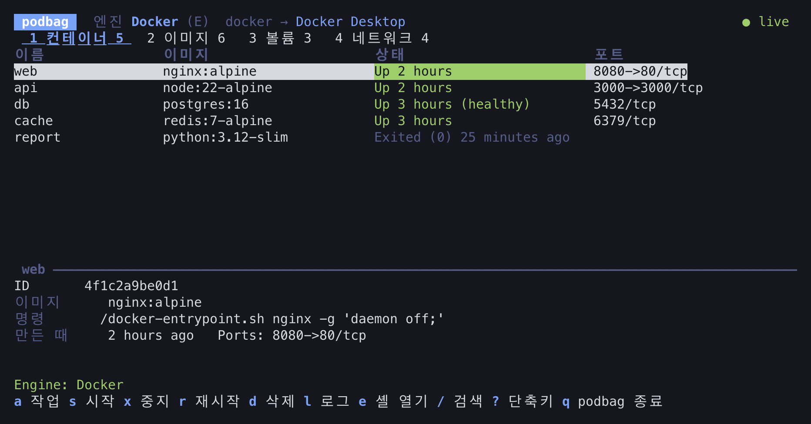
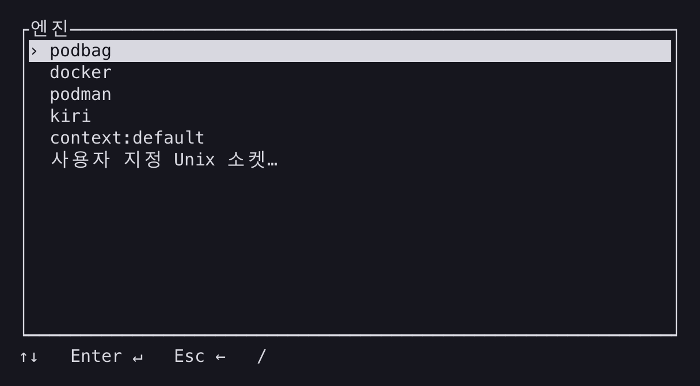
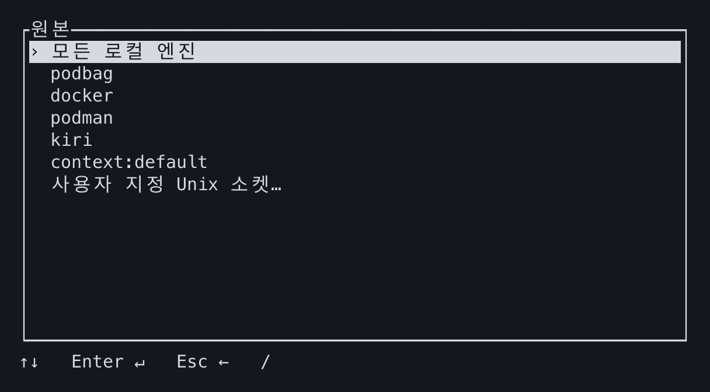

TUI는 Docker API가 있는 엔진이면 모두 씁니다: podbag, Docker, Podman, Kiri, Docker 컨텍스트, Unix 소켓. 맨 윗줄에 지금 쓰는 엔진이 나옵니다.

**예상 시간** 5분.

## TUI가 쓰는 엔진

TUI는 다음 순서에서 처음 찾은 엔진을 씁니다.

1. `--engine` 옵션. 이번 실행에만 씁니다: `podbag tui --engine podman`.
2. 전에 TUI에서 고른 엔진. TUI가 기억합니다.
3. `DOCKER_HOST`가 Unix 소켓(`unix://…`)일 때 그 소켓.
4. podbag.

TUI는 Docker를 직접 시작하지 않습니다. 엔진이 응답하지 않으면 메시지 줄에 알려줍니다.

## podbag과 Docker 사이에서 바꾸기

`E`를 누릅니다. podbag이면 Docker로, Docker면 podbag으로 바뀝니다. 다른 엔진에서는 podbag으로 바뀝니다. 목록을 다시 읽고, TUI가 이 선택을 기억합니다. 맨 윗줄의 엔진 이름을 눌러도 됩니다.

## 원하는 엔진 고르기

1. `F9`를 눌러 **설정**을 엽니다.
2. **엔진**을 고르고 **연결**을 고릅니다.
3. 엔진을 고릅니다. **사용자 지정 Unix 소켓…**은 소켓 경로를 묻습니다.

**설정 → 엔진 → 자세히**는 엔진의 버전을 보여줍니다.

## docker 명령을 podbag으로 돌리기

`docker` 명령이 설치되어 있으면 맨 윗줄에 명령이 가는 곳이 나옵니다. 예: `docker → Docker Desktop`. `D`를 누르면 `docker` 명령이 podbag을 씁니다. TUI가 먼저 묻습니다. `D`를 다시 누르면 원래대로 돌아갑니다.

## 다른 엔진으로 복사하기

마이그레이션은 한 엔진의 컨테이너, 이미지, 볼륨을 다른 엔진으로 복사합니다. 원본은 그대로 남습니다.

1. `F7`을 누르고 **엔진**을 고릅니다.
2. **원본**에서 복사할 엔진을 고릅니다. **모든 로컬 엔진**을 골라도 됩니다.
3. 리소스 종류를 고릅니다: 컨테이너, 이미지, 볼륨.
4. 리소스를 고르고, **대상**에서 엔진을 고릅니다.
5. **마이그레이션 시작**을 고릅니다. TUI가 진행 상황을 보여주고 복사본을 확인합니다.

- 컨테이너는 복사하기 전에 중지합니다.
- 대상 엔진에 이름이 같은 컨테이너나 볼륨이 있으면 복사하지 않습니다.

무엇이 복사되는지, Kubernetes 클러스터 사이에서 복사하는 방법은 [사용 안내서](https://github.com/SteelCrab/podbag/blob/main/docs/usage.md)에 있습니다.

## 다음 글

[쿠버네티스와 설정](../tui-kubernetes-settings/).
