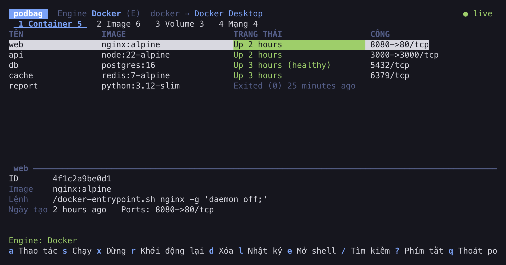
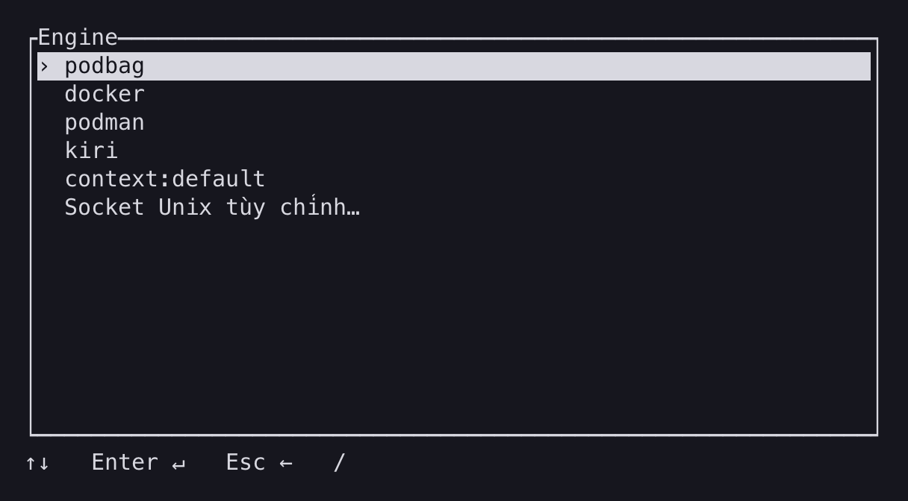
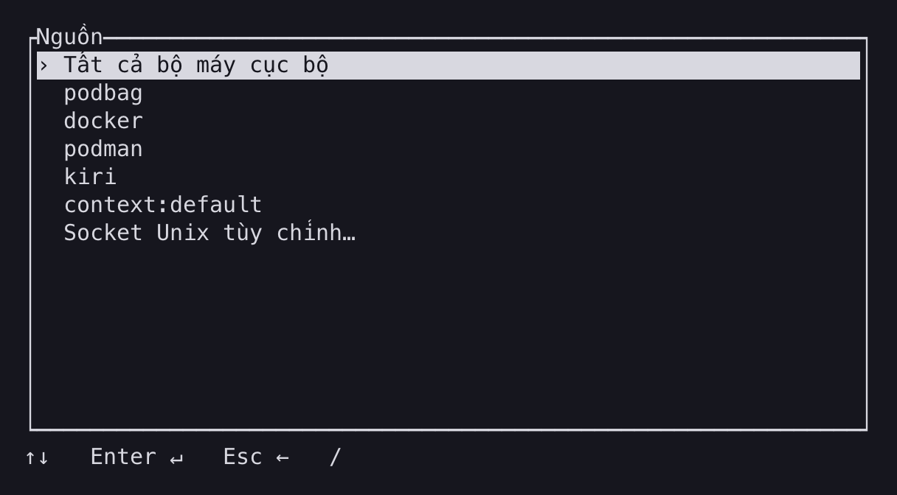

TUI làm việc với mọi engine có Docker API: podbag, Docker, Podman, Kiri, một Docker context hoặc một socket Unix. Dòng trên cùng hiện engine mà TUI đang dùng.

**Thời gian** 5 phút.

## TUI dùng engine nào

TUI dùng mục đầu tiên có được trong danh sách sau:

1. Tùy chọn `--engine`, cho một lần chạy: `podbag tui --engine podman`.
2. Engine bạn đã chọn trong TUI trước đó. TUI nhớ engine này.
3. `DOCKER_HOST`, khi biến này là một socket Unix (`unix://…`).
4. podbag.

TUI không bao giờ tự khởi động Docker. Khi một engine không phản hồi, dòng thông báo sẽ cho biết.

## Đổi giữa podbag và Docker

Nhấn `E`. TUI đổi từ podbag sang Docker, hoặc từ Docker sang podbag. Từ bất kỳ engine nào khác, `E` chuyển sang podbag. Các danh sách tải lại, và TUI nhớ lựa chọn này. Bạn cũng có thể bấm vào tên engine trên dòng trên cùng.

## Chọn engine bất kỳ

1. Nhấn `F9` để mở **Cài đặt**.
2. Chọn **Engine**, rồi chọn **Kết nối**.
3. Chọn engine. **Socket Unix tùy chỉnh…** sẽ hỏi đường dẫn socket.

**Cài đặt → Engine → Chi tiết** hiện phiên bản của engine.

## Trỏ lệnh docker về podbag

Khi lệnh `docker` đã được cài, dòng trên cùng hiện nơi lệnh này gửi tới, ví dụ `docker → Docker Desktop`. Nhấn `D` để trỏ lệnh về podbag. TUI hỏi trước. Nhấn `D` lần nữa để trỏ lệnh về như cũ.

## Sao chép sang engine khác

Tính năng di chuyển sao chép container, image và volume từ một engine sang engine khác. Nguồn được giữ nguyên.

1. Nhấn `F7`, rồi chọn **Engine**.
2. Trong **Nguồn**, chọn engine nguồn, hoặc chọn **Tất cả bộ máy cục bộ**.
3. Chọn loại tài nguyên: container, image hoặc volume.
4. Chọn tài nguyên, rồi chọn engine trong **Đích**.
5. Chọn **Bắt đầu di chuyển**. TUI hiện tiến độ và kiểm tra bản sao.

- Hãy dừng container trước khi sao chép.
- Nếu ở đích đã có container hoặc volume cùng tên, việc sao chép sẽ dừng.

[Tài liệu sử dụng](https://github.com/SteelCrab/podbag/blob/main/docs/usage.md) cho biết những gì được sao chép, và cách sao chép giữa các cụm Kubernetes.

## Tiếp theo

[Kubernetes và cài đặt](../tui-kubernetes-settings/).
