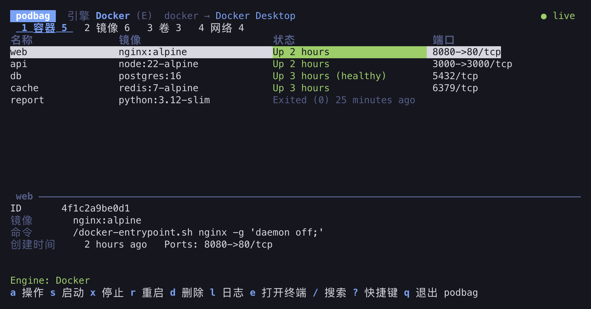
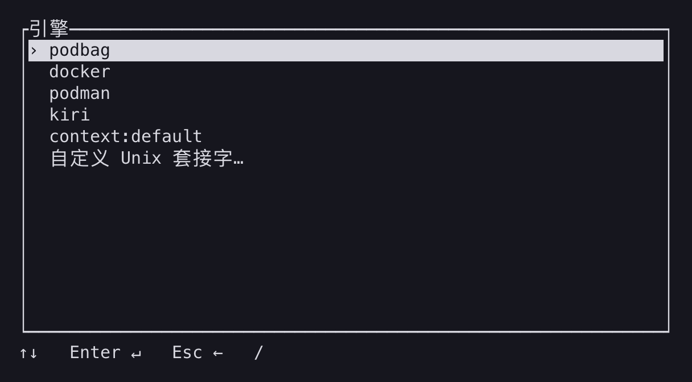
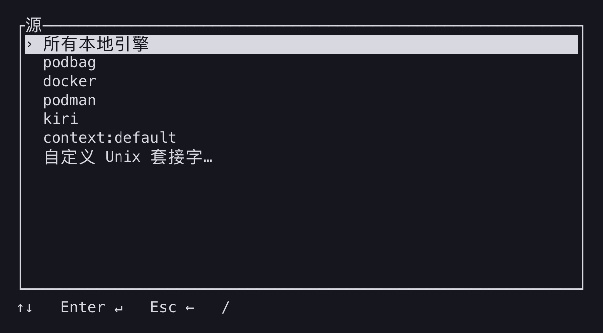

TUI 可以使用任何提供 Docker API 的引擎：podbag、Docker、Podman、Kiri、Docker 上下文或 Unix 套接字。顶部行显示 TUI 当前使用的引擎。

**预计用时** 5 分钟。

## TUI 使用哪个引擎

TUI 按以下顺序，使用第一个找到的引擎：

1. `--engine` 选项，只用于这一次运行：`podbag tui --engine podman`。
2. 你之前在 TUI 中选择的引擎。TUI 会记住它。
3. `DOCKER_HOST`，当它是 Unix 套接字（`unix://…`）时。
4. podbag。

TUI 从不启动 Docker。如果引擎没有响应，消息行会提示你。

## 在 podbag 和 Docker 之间切换

按 `E`。TUI 会从 podbag 切换到 Docker，或从 Docker 切换到 podbag。如果当前是其他引擎，`E` 会切换到 podbag。列表会重新加载，TUI 也会记住这个选择。你也可以点击顶部行中的引擎名称。

## 选择任意引擎

1. 按 `F9` 打开**设置**。
2. 选择**引擎**，然后选择**连接**。
3. 选择引擎。**自定义 Unix 套接字…**会询问套接字路径。

**设置 → 引擎 → 详情**显示引擎的版本。

## 让 docker 命令指向 podbag

如果安装了 `docker` 命令，顶部行会显示它连到哪里，例如 `docker → Docker Desktop`。按 `D` 让它指向 podbag。TUI 会先询问你。再按一次 `D` 可以改回原来的设置。

## 复制到其他引擎

迁移会把容器、镜像和卷从一个引擎复制到另一个引擎。源保持不变。

1. 按 `F7`，然后选择**引擎**。
2. 在**源**中选择源引擎，或选择**所有本地引擎**。
3. 选择资源类型：容器、镜像或卷。
4. 选择资源，然后在**目标**中选择引擎。
5. 选择**开始迁移**。TUI 会显示进度，并检查复制结果。

- 复制容器之前，请先停止它。
- 如果目标引擎中已有同名的容器或卷，复制会停止。

[使用指南](https://github.com/SteelCrab/podbag/blob/main/docs/usage.md)说明了会复制哪些内容，以及如何在 Kubernetes 集群之间复制。

## 下一篇

[Kubernetes 和设置](../tui-kubernetes-settings/)。
