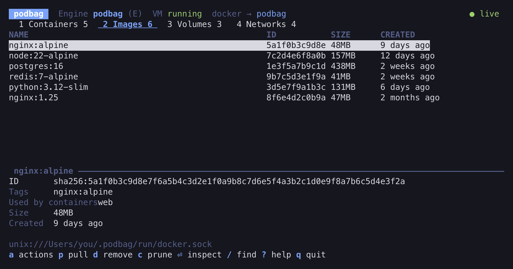
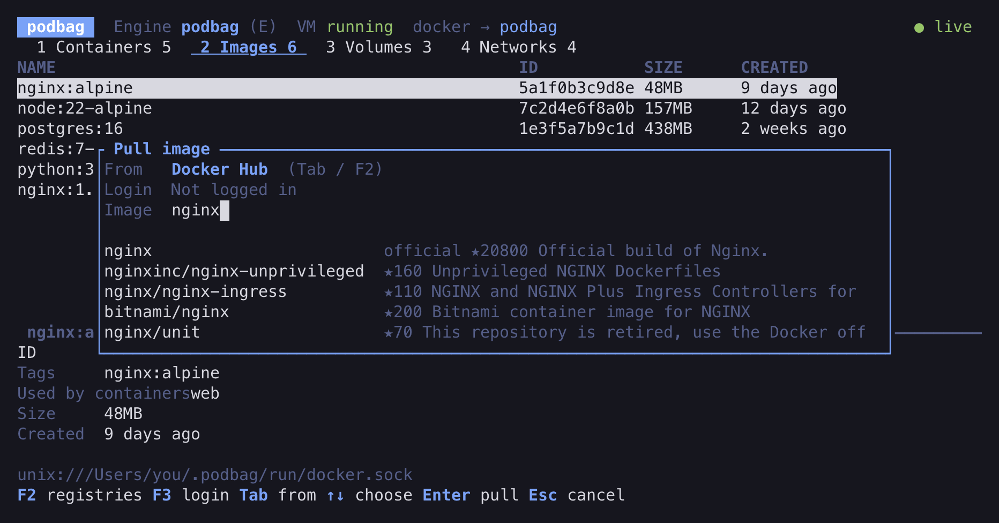

Press `2` to open the Images list. It shows each image's name, ID, size and age. The details show its tags and the containers that use it.

**Time** 5 minutes.

## Pull an image

1. Press `p`. The **Pull image** window opens.
2. Type a name, for example `nginx`. On Docker Hub, the results show after two letters.
3. Choose a result with `↑` `↓` and press `Enter`. The TUI asks for the tag. Leave it empty for `latest`.

You can also type the full name with its tag, for example `nginx:alpine`, and press `Enter`. The message line shows the progress, then `Pulled nginx:alpine`.

## Pull from another registry

- `Tab` changes where you pull from: Docker Hub, GitHub, Amazon ECR, Quay.io, Google Artifact Registry, GitLab, Azure Container Registry or another registry.
- `F2` opens the list of registries. Type to filter it.
- Some registries need a host, for example your Amazon ECR address. The window then shows a host line.
- `F3` logs in to the registry.

The search works on Docker Hub only. For the other registries, type the image name.

## Remove images

- `d` removes the selected image. The TUI asks first.
- `c` cleans up: it removes the images that no container uses. The TUI asks first.

## Copy images from Docker

When the engine is podbag, the actions menu (`a`) has **Import from Docker**. It lists Docker's images. Choose them with `Space` and press `Enter`. The TUI copies them into podbag.

## Next

[Manage volumes and networks](../tui-volumes-networks/).
