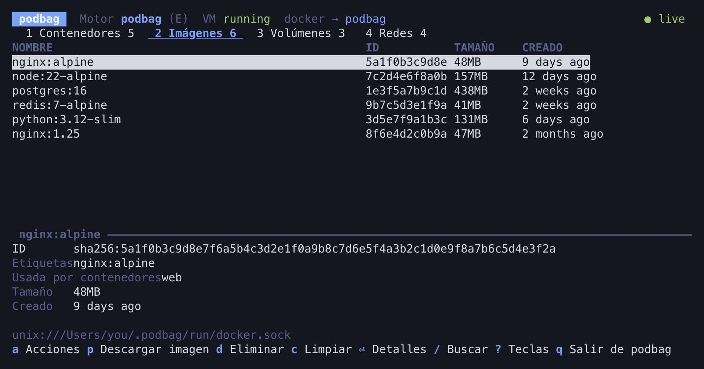
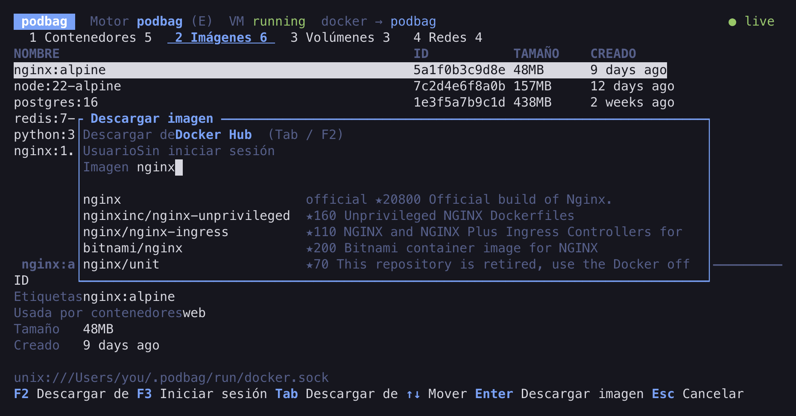

Pulsa `2` para abrir la lista Imágenes. Muestra el nombre, el ID, el tamaño y la antigüedad de cada imagen. Los detalles muestran sus etiquetas y los contenedores que la usan.

**Tiempo** 5 minutos.

## Descarga una imagen

1. Pulsa `p`. Se abre la ventana **Descargar imagen**. En cualquier lista, `Ctrl+Shift+P` también la abre.
2. Escribe un nombre, por ejemplo `nginx`. En Docker Hub, los resultados aparecen después de dos letras.
3. Elige un resultado con `↑` `↓` y pulsa `Enter`. La TUI pide la etiqueta. Déjala vacía para usar `latest`.

También puedes escribir el nombre completo con su etiqueta, por ejemplo `nginx:alpine`, y pulsar `Enter`. La línea de mensajes muestra el progreso y luego `Pulled nginx:alpine`.

## Descarga de otro registro

- `Tab` cambia el lugar de descarga: Docker Hub, GitHub, Amazon ECR, Quay.io, Google Artifact Registry, GitLab, Azure Container Registry u otro registro.
- `F2` abre la lista de registros. Escribe para filtrarla.
- Algunos registros necesitan un host, por ejemplo tu dirección de Amazon ECR. En ese caso, la ventana muestra una línea para el host.
- `F3` inicia sesión en el registro. El menú **Acciones** (`a`) también tiene **Iniciar sesión**: elige un registro e inicia sesión antes de descargar.

La búsqueda solo funciona en Docker Hub. Para los otros registros, escribe el nombre de la imagen.

## Elimina imágenes

- `d` elimina la imagen seleccionada. La TUI pregunta antes.
- `c` limpia: elimina las imágenes que ningún contenedor usa. La TUI pregunta antes.

## Copia imágenes desde Docker

Cuando el motor es podbag, el menú **Acciones** (`a`) tiene **Importar de Docker**. Muestra las imágenes de Docker. Elígelas con `Space` y pulsa `Enter`. La TUI las copia a podbag.

## Siguiente

[Gestiona volúmenes y redes](../tui-volumes-networks/).
