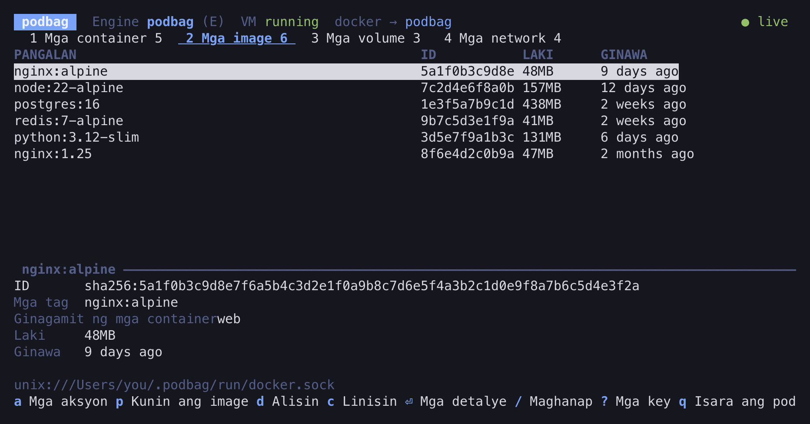
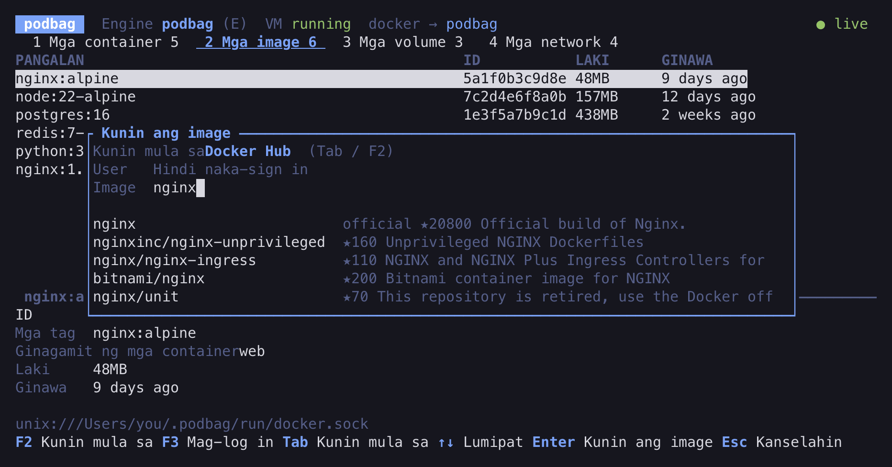

Pindutin ang `2` para buksan ang listahan ng Mga image. Ipinapakita nito ang pangalan, ID, laki at edad ng bawat image. Ipinapakita ng mga detalye ang mga tag nito at ang mga container na gumagamit nito.

**Oras** 5 minuto.

## Kumuha ng image

1. Pindutin ang `p`. Bubukas ang window na **Kunin ang image**.
2. Mag-type ng pangalan, halimbawa `nginx`. Sa Docker Hub, lumalabas ang mga resulta pagkatapos ng dalawang letra.
3. Pumili ng resulta gamit ang `↑` `↓` at pindutin ang `Enter`. Itatanong ng TUI ang tag. Iwanan itong walang laman para sa `latest`.

Puwede mo ring i-type ang buong pangalan kasama ang tag, halimbawa `nginx:alpine`, at pindutin ang `Enter`. Ipinapakita ng linya ng mensahe ang progreso, saka ang `Pulled nginx:alpine`.

## Kumuha mula sa ibang registry

- Pinapalitan ng `Tab` kung saan ka kukuha: Docker Hub, GitHub, Amazon ECR, Quay.io, Google Artifact Registry, GitLab, Azure Container Registry o ibang registry.
- Binubuksan ng `F2` ang listahan ng mga registry. Mag-type para salain ito.
- May mga registry na kailangan ng host, halimbawa ang address ng iyong Amazon ECR. Kung gayon, may linya ng host sa window.
- Nagla-log in ang `F3` sa registry.

Sa Docker Hub lang gumagana ang paghahanap. Sa ibang mga registry, i-type ang pangalan ng image.

## Alisin ang mga image

- Inaalis ng `d` ang napiling image. Nagtatanong muna ang TUI.
- Naglilinis ang `c`: inaalis nito ang mga image na hindi ginagamit ng anumang container. Nagtatanong muna ang TUI.

## Kopyahin ang mga image mula sa Docker

Kapag podbag ang engine, may **Mag-import mula sa Docker** ang menu ng mga aksyon (`a`). Inililista nito ang mga image ng Docker. Piliin ang mga ito gamit ang `Space` at pindutin ang `Enter`. Kokopyahin ng TUI ang mga ito sa podbag.

## Susunod

[Pamahalaan ang mga volume at network](../tui-volumes-networks/).
