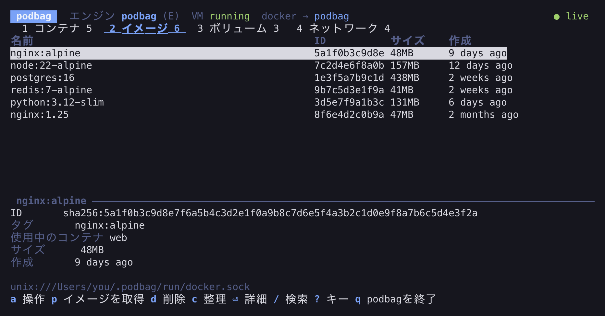
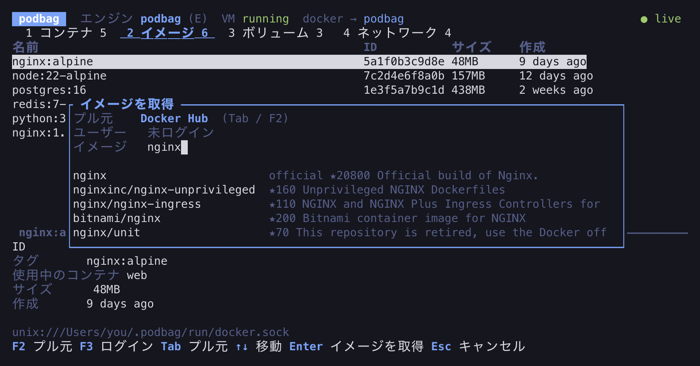

`2` を押すと、イメージの一覧が開きます。イメージごとに、名前、ID、サイズ、作成からの時間が表示されます。詳細には、タグと、そのイメージを使うコンテナが表示されます。

**所要時間** 5 分。

## イメージを取得する

1. `p` を押します。**イメージを取得**ウィンドウが開きます。どの一覧でも、`Ctrl+Shift+P` で開くこともできます。
2. 名前を入力します。例: `nginx`。Docker Hub では、2 文字入力すると結果が表示されます。
3. `↑` `↓` で結果を選び、`Enter` を押します。TUI がタグを尋ねます。空のままにすると `latest` になります。

`nginx:alpine` のようにタグまで入力して、`Enter` を押すこともできます。メッセージ行に進行状況が表示され、終わると `Pulled nginx:alpine` が表示されます。

## 別のレジストリから取得する

- `Tab` で取得元を切り替えます。Docker Hub、GitHub、Amazon ECR、Quay.io、Google Artifact Registry、GitLab、Azure Container Registry、その他のレジストリから選べます。
- `F2` を押すと、レジストリの一覧が開きます。入力すると絞り込めます。
- Amazon ECR のアドレスのように、ホストが必要なレジストリがあります。その場合、ウィンドウにホストの行が表示されます。
- `F3` でレジストリにログインします。操作メニュー（`a`）にも**ログイン**があります。取得する前に、レジストリを選んでログインします。

検索は Docker Hub でのみ使えます。ほかのレジストリでは、イメージ名を入力します。

## イメージを削除する

- `d` は、選択したイメージを削除します。TUI は先に確認します。
- `c` は整理です。どのコンテナも使っていないイメージを削除します。TUI は先に確認します。

## Docker からイメージをコピーする

エンジンが podbag のとき、操作メニュー（`a`）に **Docker から取り込む**があります。Docker のイメージが一覧で表示されます。`Space` でイメージを選び、`Enter` を押します。TUI がイメージを podbag にコピーします。

## 次へ

[ボリュームとネットワークを管理する](../tui-volumes-networks/)。
