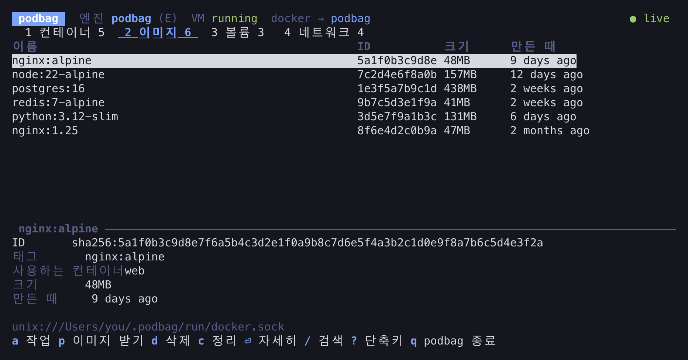
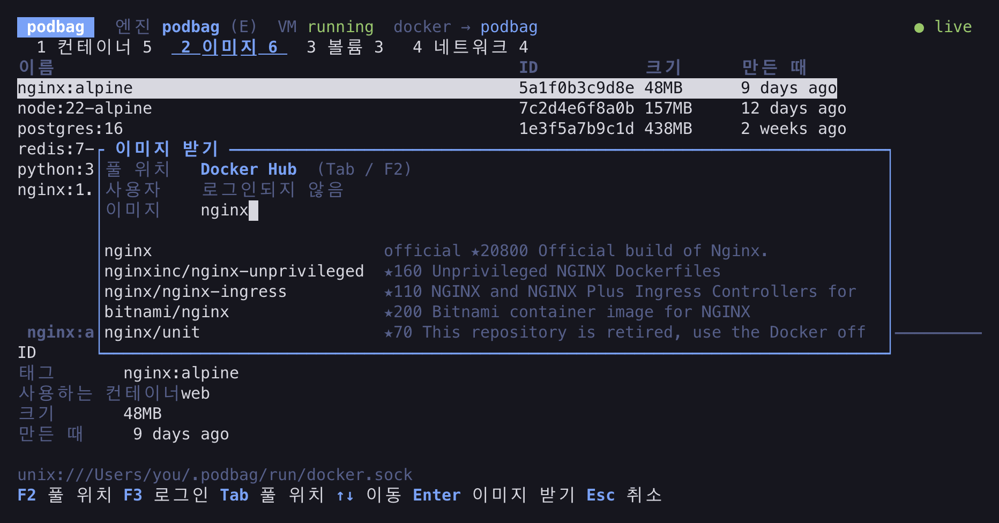

`2`를 누르면 이미지 목록이 열립니다. 이미지마다 이름, ID, 크기, 만든 때가 나옵니다. 상세 정보에는 태그와 이 이미지를 쓰는 컨테이너가 나옵니다.

**예상 시간** 5분.

## 이미지 받기

1. `p`를 누릅니다. **이미지 받기** 창이 열립니다.
2. 이름을 입력합니다. 예: `nginx`. Docker Hub에서는 두 글자부터 검색 결과가 나옵니다.
3. `↑` `↓`로 결과를 고르고 `Enter`를 누릅니다. TUI가 태그를 묻습니다. 비워 두면 `latest`입니다.

`nginx:alpine`처럼 태그까지 입력하고 `Enter`를 눌러도 됩니다. 메시지 줄에 진행 상황이 나오고, 끝나면 `Pulled nginx:alpine`이 나옵니다.

## 다른 레지스트리에서 받기

- `Tab`으로 받을 곳을 바꿉니다: Docker Hub, GitHub, Amazon ECR, Quay.io, Google Artifact Registry, GitLab, Azure Container Registry, 다른 레지스트리.
- `F2`를 누르면 레지스트리 목록이 열립니다. 입력해서 걸러 볼 수 있습니다.
- Amazon ECR 주소처럼 호스트가 필요한 레지스트리는 창에 호스트 줄이 나옵니다.
- `F3`으로 레지스트리에 로그인합니다.

검색은 Docker Hub에서만 됩니다. 다른 레지스트리는 이미지 이름을 직접 입력합니다.

## 이미지 삭제하기

- `d`는 선택한 이미지를 삭제합니다. TUI가 먼저 묻습니다.
- `c`는 정리입니다. 어떤 컨테이너도 쓰지 않는 이미지를 삭제합니다. 먼저 묻습니다.

## Docker에서 이미지 가져오기

엔진이 podbag이면 작업 메뉴(`a`)에 **Docker에서 가져오기**가 있습니다. Docker의 이미지 목록이 나옵니다. `Space`로 이미지를 고르고 `Enter`를 누르면 TUI가 podbag으로 복사합니다.

## 다음 글

[볼륨과 네트워크 다루기](../tui-volumes-networks/).
