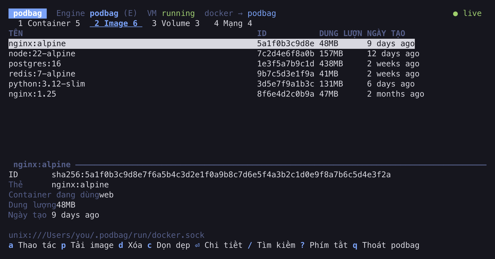
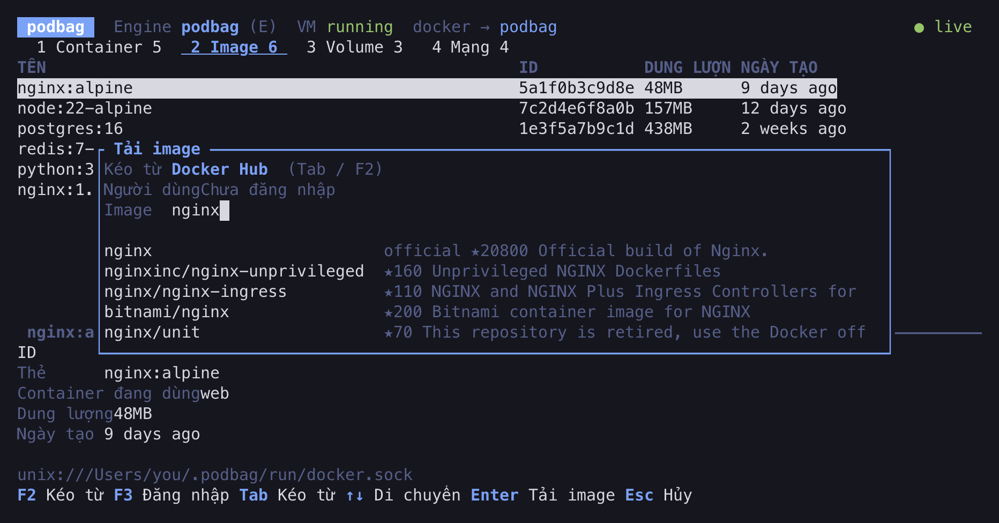

Nhấn `2` để mở danh sách Image. Danh sách hiện tên, ID, dung lượng và ngày tạo của mỗi image. Phần chi tiết hiện tag của image và các container đang dùng image đó.

**Thời gian** 5 phút.

## Tải image

1. Nhấn `p`. Cửa sổ **Tải image** mở ra. Ở bất kỳ danh sách nào, `Ctrl+Shift+P` cũng mở cửa sổ này.
2. Gõ một tên, ví dụ `nginx`. Với Docker Hub, kết quả hiện sau khi bạn gõ hai chữ cái.
3. Chọn một kết quả bằng `↑` `↓` và nhấn `Enter`. TUI hỏi tag. Để trống để dùng `latest`.

Bạn cũng có thể gõ tên đầy đủ kèm tag, ví dụ `nginx:alpine`, rồi nhấn `Enter`. Dòng thông báo hiện tiến độ, rồi hiện `Pulled nginx:alpine`.

## Tải từ registry khác

- `Tab` đổi nơi tải image: Docker Hub, GitHub, Amazon ECR, Quay.io, Google Artifact Registry, GitLab, Azure Container Registry hoặc một registry khác.
- `F2` mở danh sách registry. Gõ chữ để lọc danh sách.
- Một số registry cần host, ví dụ địa chỉ Amazon ECR của bạn. Khi đó, cửa sổ hiện thêm một dòng host.
- `F3` đăng nhập vào registry. Menu Thao tác (`a`) cũng có mục **Đăng nhập**: chọn một registry và đăng nhập trước khi tải image.

Tìm kiếm chỉ hoạt động với Docker Hub. Với các registry khác, hãy gõ tên image.

## Xóa image

- `d` xóa image đang chọn. TUI hỏi trước.
- `c` dọn dẹp: phím này xóa các image không có container nào dùng. TUI hỏi trước.

## Sao chép image từ Docker

Khi engine là podbag, menu Thao tác (`a`) có mục **Nhập từ Docker**. Mục này liệt kê các image của Docker. Chọn image bằng `Space` và nhấn `Enter`. TUI sao chép các image đó vào podbag.

## Tiếp theo

[Quản lý volume và mạng](../tui-volumes-networks/).
