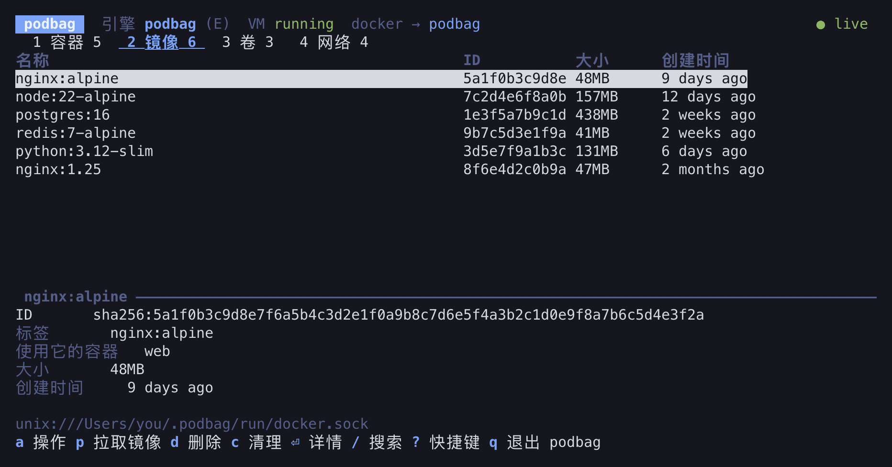
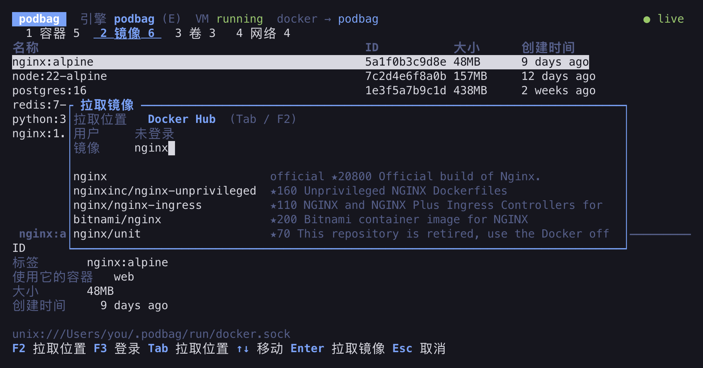

按 `2` 打开镜像列表。列表显示每个镜像的名称、ID、大小和创建时间。详情中显示镜像的标签和使用它的容器。

**预计用时** 5 分钟。

## 拉取镜像

1. 按 `p`。**拉取镜像**窗口会打开。在任意列表中按 `Ctrl+Shift+P` 也能打开它。
2. 输入名称，例如 `nginx`。在 Docker Hub 上，输入两个字符后就会显示结果。
3. 用 `↑` `↓` 选择一个结果，然后按 `Enter`。TUI 会询问标签。留空表示使用 `latest`。

你也可以输入带标签的完整名称，例如 `nginx:alpine`，然后按 `Enter`。消息行会显示进度，完成后显示 `Pulled nginx:alpine`。

## 从其他镜像仓库拉取

- `Tab` 切换拉取位置：Docker Hub、GitHub、Amazon ECR、Quay.io、Google Artifact Registry、GitLab、Azure Container Registry 或其他镜像仓库。
- `F2` 打开镜像仓库列表。输入文字可以筛选列表。
- 有些镜像仓库需要主机地址，例如你的 Amazon ECR 地址。这时窗口中会显示一行主机地址。
- `F3` 登录镜像仓库。操作菜单（`a`）中也有**登录**：拉取之前，先选择镜像仓库并登录。

搜索只适用于 Docker Hub。对于其他镜像仓库，请直接输入镜像名称。

## 删除镜像

- `d` 删除选中的镜像。TUI 会先询问你。
- `c` 用于清理：它删除没有任何容器使用的镜像。TUI 会先询问你。

## 从 Docker 复制镜像

当引擎是 podbag 时，操作菜单（`a`）中有**从 Docker 导入**。它会列出 Docker 中的镜像。用 `Space` 选择镜像，然后按 `Enter`。TUI 会把它们复制到 podbag。

## 下一篇

[管理卷和网络](../tui-volumes-networks/)。
