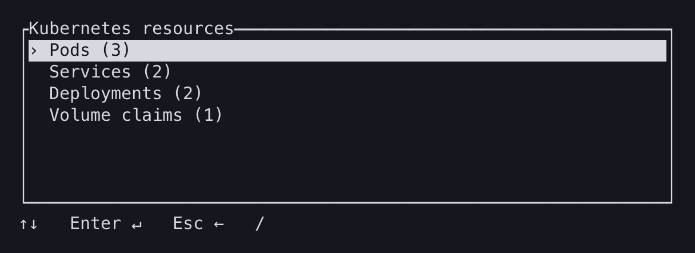
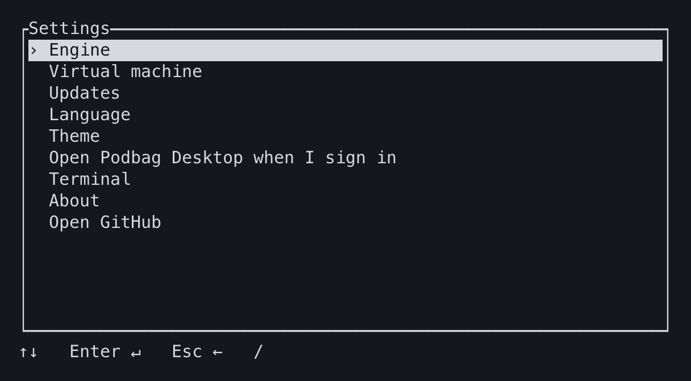

The TUI shows the resources of a Kubernetes cluster, and its **Settings** page changes how podbag and the TUI work.

**Time** 5 minutes.

## Look at a Kubernetes cluster

The TUI uses `kubectl` and its contexts. Install `kubectl` first.

1. Press `F6`.
2. Choose the cluster context: **Current context** or a context by its name.
3. Choose the namespace: the context's namespace or **All namespaces**.
4. Choose the resource type. Each type shows its count.

The list shows each resource as `namespace/name`. Press `Enter` to see it as JSON. **Refresh** reads the list again. The TUI only reads the cluster. It does not change it.

On an OpenShift cluster, **Routes** is also a resource type. The TUI shows it only when the cluster's API serves Routes. A Route shows its host and path, its Service and its TLS mode, for example `default/shop   shop.example.com/cart  frontend  edge`.

## Run a lab in Tutorials

Press `F8`. **Tutorials** installs a lesson file and runs its exercises in a practice lab.

1. Download a lesson file, for example `volume-api.podbag` from [the volume API lab](../volume-api-lab/).
2. Choose **Choose file** and enter the file's path.
3. Choose **Install module**.
4. Choose **Start lab**.

**Remove module** removes the lesson. For the hands-on modules of Podbag Desktop and the CLI, see [GUI practice](/training/).

## Change the settings

Press `F9`.

- **Engine:** connect to another engine, or see the engine's version.
- **Virtual machine:** with podbag on macOS and Windows. See the VM, start, stop or restart it. **Apply** changes the CPUs, the memory and the idle time. It asks if the change starts now or at the next start.
- **Updates:** see the version, look for an update and update podbag.
- **Language:** the language of the system, or one of seven languages.
- **Theme:** the system's colors, light or dark.
- **Open Podbag Desktop when I sign in:** turn this on or off.
- **Terminal:** open your shell. Type `exit` to go back to the TUI.
- **About** and **Open GitHub.**

The TUI saves the language, the theme and the sidebar in `terminal.json`. The folder is `~/.podbag` on macOS, `~/.config/podbag` on Linux and `%LOCALAPPDATA%\podbag` on Windows.

## Use the menus

These pages are menus. `↑` `↓` choose, typing filters the menu, `Enter` opens and `Esc` goes back.

## More

The [podbag usage guide](https://github.com/SteelCrab/podbag/blob/main/docs/usage.md) has all the TUI's keys and options. Back to [how to use the TUI](/training/tui/).
