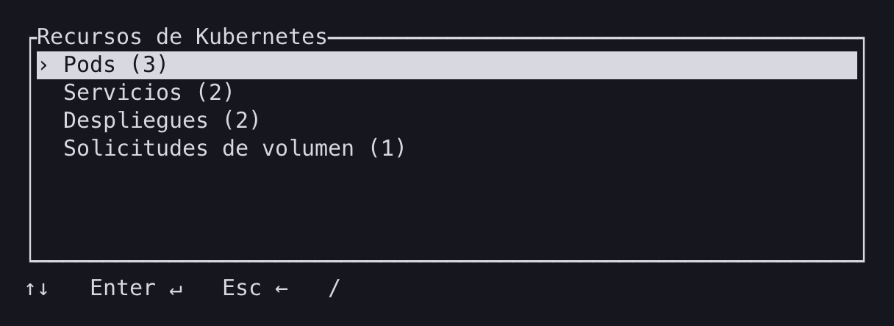
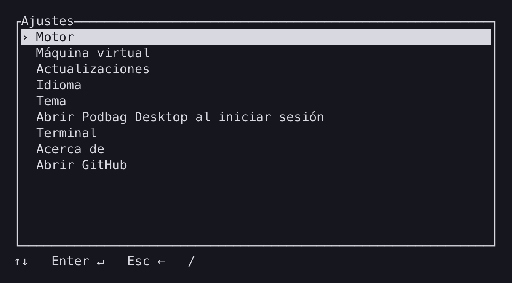

La TUI muestra los recursos de un clúster de Kubernetes. Su página **Ajustes** cambia cómo funcionan podbag y la TUI.

**Tiempo** 5 minutos.

## Mira un clúster de Kubernetes

La TUI usa `kubectl` y sus contextos. Instala `kubectl` primero.

1. Pulsa `F6`.
2. Elige el contexto del clúster: **Contexto actual** o un contexto por su nombre.
3. Elige el espacio de nombres: el del contexto o **Todos los espacios de nombres**.
4. Elige el tipo de recurso. Cada tipo muestra su número de elementos.

La lista muestra cada recurso como `namespace/nombre`. Pulsa `Enter` para verlo en JSON. **Actualizar** vuelve a leer la lista. La TUI solo lee el clúster. No lo cambia.

En un clúster de OpenShift, **Routes** es también un tipo de recurso. La TUI lo muestra solo cuando la API del clúster ofrece Routes. Un Route muestra su host y su ruta, su Servicio y su modo de TLS, por ejemplo `default/shop   shop.example.com/cart  frontend  edge`.

## Haz una práctica en Tutoriales

Pulsa `F8`. **Tutoriales** instala un archivo de lección y ejecuta sus ejercicios en un entorno de práctica.

1. Descarga un archivo de lección, por ejemplo `volume-api.podbag` de [Práctica · Leer por HTTP el JSON de un volumen](../volume-api-lab/).
2. Elige **Elegir archivo** y escribe la ruta del archivo.
3. Elige **Instalar módulo**.
4. Elige **Iniciar práctica**.

**Eliminar módulo** elimina la lección. Para los módulos prácticos de Podbag Desktop y la CLI, consulta [Práctica con GUI](/es/training/).

## Cambia los ajustes

Pulsa `F9`.

- **Motor:** conéctate a otro motor o mira la versión del motor.
- **Máquina virtual:** con podbag en macOS y Windows. Mira la VM, iníciala, detenla o reiníciala. **Aplicar** cambia las CPU, la memoria y el tiempo de inactividad. Pregunta si el cambio se aplica ahora o en el próximo inicio.
- **Actualizaciones:** mira la versión, busca una actualización y actualiza podbag.
- **Idioma:** el idioma del sistema o uno de siete idiomas.
- **Tema:** los colores del sistema, claro u oscuro.
- **Abrir Podbag Desktop al iniciar sesión:** actívalo o desactívalo.
- **Terminal:** abre tu shell. Escribe `exit` para volver a la TUI.
- **Acerca de** y **Abrir GitHub.**

La TUI guarda el idioma, el tema y la barra lateral en `terminal.json`. La carpeta es `~/.podbag` en macOS, `~/.config/podbag` en Linux y `%LOCALAPPDATA%\podbag` en Windows.

## Usa los menús

Estas páginas son menús. `↑` `↓` eligen, al escribir se filtra el menú, `Enter` abre y `Esc` vuelve atrás.

## Más

La [guía de uso de podbag](https://github.com/SteelCrab/podbag/blob/main/docs/usage.md) tiene todas las teclas y opciones de la TUI. Vuelve a [cómo usar la TUI](/es/training/tui/).
