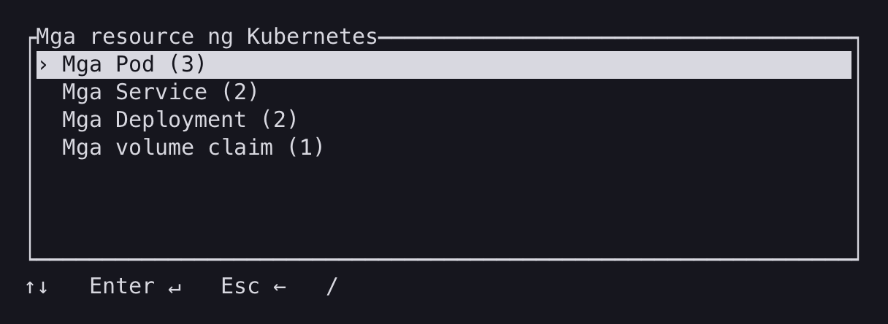
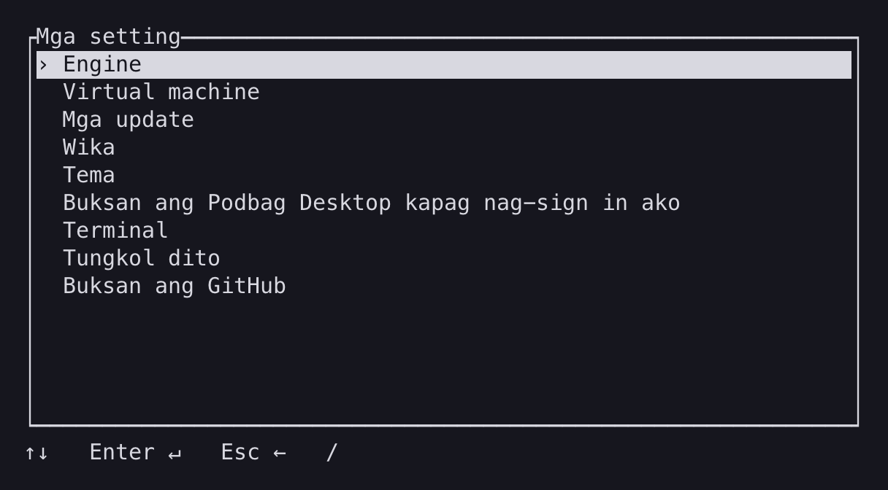

Ipinapakita ng TUI ang mga resource ng isang Kubernetes cluster. Binabago ng page nitong **Mga setting** kung paano gumagana ang podbag at ang TUI.

**Oras** 5 minuto.

## Tingnan ang isang Kubernetes cluster

Ginagamit ng TUI ang `kubectl` at ang mga context nito. I-install muna ang `kubectl`.

1. Pindutin ang `F6`.
2. Piliin ang context ng cluster: **Kasalukuyang context** o isang context ayon sa pangalan nito.
3. Piliin ang namespace: ang namespace ng context o **Lahat ng namespace**.
4. Piliin ang uri ng resource. May bilang ang bawat uri.

Ipinapakita ng listahan ang bawat resource bilang `namespace/name`. Pindutin ang `Enter` para makita ito bilang JSON. Binabasa ulit ng **I-refresh** ang listahan. Binabasa lang ng TUI ang cluster. Hindi nito binabago ang cluster.

## Magpatakbo ng lab sa Mga tutorial

Pindutin ang `F8`. Nag-i-install ang **Mga tutorial** ng lesson file at pinapatakbo nito ang mga exercise ng file sa isang practice lab.

1. Mag-download ng lesson file, halimbawa ang `volume-api.podbag` mula sa [Basahin ang JSON mula sa volume gamit ang HTTP](../volume-api-lab/).
2. Piliin ang **Pumili ng file** at ilagay ang path ng file.
3. Piliin ang **I-install ang module**.
4. Piliin ang **Simulan ang lab**.

Inaalis ng **Alisin ang module** ang lesson. Para sa mga hands-on module ng Podbag Desktop at ng CLI, tingnan ang [Pagsasanay sa GUI](/fil/training/).

## Baguhin ang mga setting

Pindutin ang `F9`.

- **Engine:** kumonekta sa ibang engine, o tingnan ang bersyon ng engine.
- **Virtual machine:** para sa podbag sa macOS at Windows. Tingnan ang VM. Simulan, ihinto o i-restart ito. Binabago ng **Ilapat** ang mga CPU, ang memory at ang idle time. Itinatanong nito kung ngayon na o sa susunod na simula ilalapat ang pagbabago.
- **Mga update:** tingnan ang bersyon, maghanap ng update at i-update ang podbag.
- **Wika:** ang wika ng system, o isa sa pitong wika.
- **Tema:** ang mga kulay ng system, maliwanag o madilim.
- **Buksan ang Podbag Desktop kapag nag-sign in ako:** i-on o i-off ito.
- **Terminal:** buksan ang iyong shell. I-type ang `exit` para bumalik sa TUI.
- **Tungkol dito** at **Buksan ang GitHub.**

Sine-save ng TUI ang wika, ang tema at ang sidebar sa `terminal.json`. Ang folder ay `~/.podbag` sa macOS, `~/.config/podbag` sa Linux at `%LOCALAPPDATA%\podbag` sa Windows.

## Gamitin ang mga menu

Mga menu ang mga page na ito. Pumipili ang `↑` `↓`. Sinasala ng pag-type ang menu. Nagbubukas ang `Enter` at bumabalik ang `Esc`.

## Iba pa

Nasa [gabay sa paggamit ng podbag](https://github.com/SteelCrab/podbag/blob/main/docs/usage.md) ang lahat ng key at option ng TUI. Bumalik sa [paano gamitin ang TUI](/fil/training/tui/).
