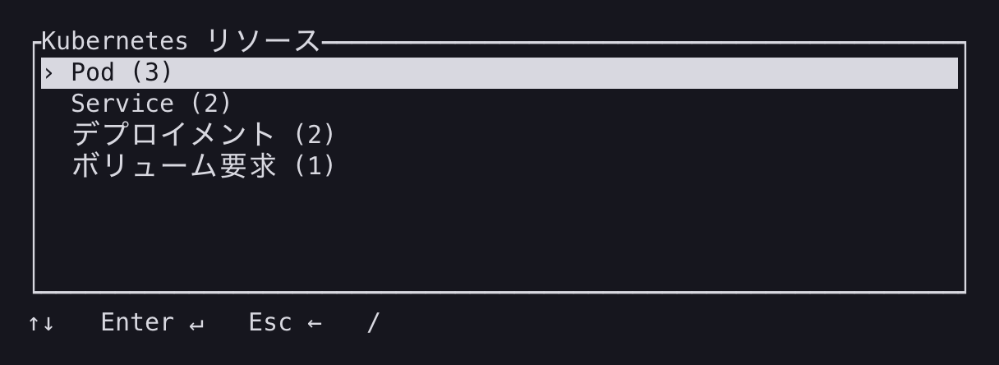
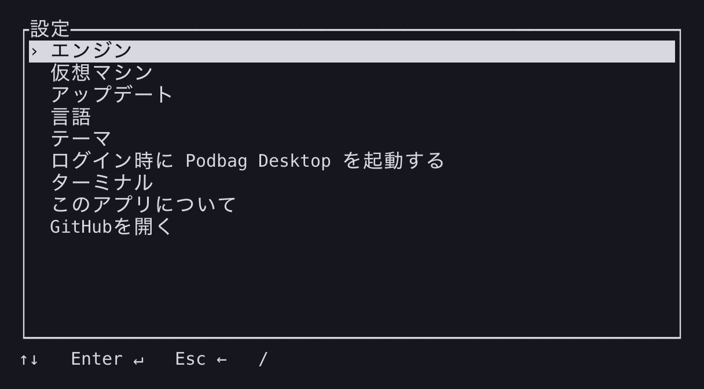

TUI は、Kubernetes クラスタのリソースを表示します。**設定**ページでは、podbag と TUI の動作を変更します。

**所要時間** 5 分。

## Kubernetes クラスタを見る

TUI は `kubectl` とそのコンテキストを使います。先に `kubectl` をインストールします。

1. `F6` を押します。
2. クラスタのコンテキストを選びます。**現在のコンテキスト**か、名前の付いたコンテキストです。
3. 名前空間を選びます。コンテキストの名前空間か、**すべての名前空間**です。
4. リソースの種類を選びます。種類ごとに数が表示されます。

一覧には、リソースが `namespace/name` の形で表示されます。`Enter` を押すと JSON で表示されます。**更新**で一覧を読み直します。TUI はクラスタを読むだけです。クラスタを変更しません。

## チュートリアルで実習する

`F8` を押します。**チュートリアル**は、レッスンファイルをインストールし、その演習を実習環境で実行します。

1. レッスンファイルをダウンロードします。例: [実習 · Podbag ボリュームの JSON を HTTP で読む](../volume-api-lab/)の `volume-api.podbag`。
2. **ファイルを選択**を選び、ファイルのパスを入力します。
3. **モジュールをインストール**を選びます。
4. **実習を開始**を選びます。

**モジュールを削除**は、レッスンを削除します。Podbag Desktop と CLI の実習モジュールについては、[GUI 実習](/ja/training/)を参照してください。

## 設定を変更する

`F9` を押します。

- **エンジン:** 別のエンジンに接続するか、エンジンのバージョンを見ます。
- **仮想マシン:** macOS と Windows で podbag を使うときに表示されます。VM の状態を見て、開始、停止、再起動します。**適用**で、CPU 数、メモリ、アイドル時間を変更します。すぐに反映するか、次の起動で反映するかを尋ねます。
- **アップデート:** バージョンを見て、アップデートを確認し、podbag をアップデートします。
- **言語:** システムの言語か、7 つの言語のどれかです。
- **テーマ:** システムの色、ライト、ダークから選びます。
- **ログイン時に Podbag Desktop を起動する:** オンまたはオフにします。
- **ターミナル:** 自分のシェルを開きます。`exit` と入力すると、TUI に戻ります。
- **このアプリについて**と**GitHubを開く**。

TUI は、言語、テーマ、サイドバーを `terminal.json` に保存します。フォルダーは、macOS では `~/.podbag`、Linux では `~/.config/podbag`、Windows では `%LOCALAPPDATA%\podbag` です。

## メニューを使う

これらのページはメニューです。`↑` `↓` で選び、文字を入力するとメニューを絞り込みます。`Enter` で開き、`Esc` で戻ります。

## さらに詳しく

TUI のすべてのキーとオプションは、[podbag 使い方ガイド](https://github.com/SteelCrab/podbag/blob/main/docs/usage.md)にあります。[TUI の使い方](/ja/training/tui/)に戻ります。
