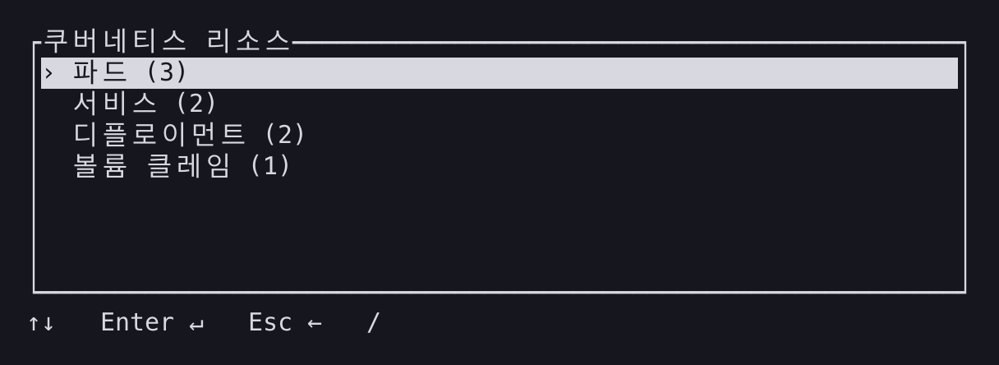
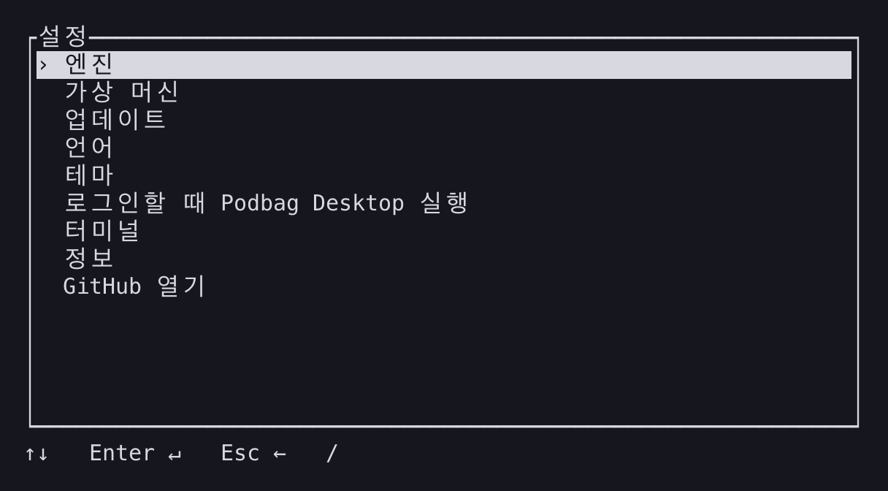

TUI는 Kubernetes 클러스터의 리소스를 보여줍니다. **설정** 페이지에서는 podbag과 TUI가 동작하는 방식을 바꿉니다.

**예상 시간** 5분.

## Kubernetes 클러스터 보기

TUI는 `kubectl`과 그 컨텍스트를 씁니다. 먼저 `kubectl`을 설치합니다.

1. `F6`을 누릅니다.
2. 클러스터 컨텍스트를 고릅니다: **현재 컨텍스트** 또는 이름이 있는 컨텍스트.
3. 네임스페이스를 고릅니다: 컨텍스트의 네임스페이스 또는 **모든 네임스페이스**.
4. 리소스 종류를 고릅니다. 종류마다 개수가 나옵니다.

목록에는 리소스가 `네임스페이스/이름`으로 나옵니다. `Enter`를 누르면 JSON으로 봅니다. **새로 고침**은 목록을 다시 읽습니다. TUI는 클러스터를 읽기만 하고 바꾸지 않습니다.

OpenShift 클러스터에서는 **라우트**도 리소스 종류에 나옵니다. 클러스터의 API가 라우트를 제공할 때만 TUI가 보여줍니다. 라우트는 호스트와 경로, 서비스, TLS 방식 순서로 나옵니다. 예: `default/shop   shop.example.com/cart  frontend  edge`.

## 튜토리얼에서 실습하기

`F8`을 누릅니다. **튜토리얼**은 레슨 파일을 설치하고 그 연습 문제를 실습 환경에서 실행합니다.

1. 레슨 파일을 받습니다. 예: [볼륨 API 실습](../volume-api-lab/)의 `volume-api.podbag`.
2. **파일 선택**을 고르고 파일 경로를 입력합니다.
3. **모듈 설치**를 고릅니다.
4. **실습 시작**을 고릅니다.

**모듈 삭제**는 레슨을 지웁니다. Podbag Desktop과 CLI의 실습 모듈은 [GUI 실습](/ko/training/)을 참고합니다.

## 설정 바꾸기

`F9`를 누릅니다.

- **엔진:** 다른 엔진에 연결하거나 엔진의 버전을 봅니다.
- **가상 머신:** macOS와 Windows에서 podbag을 쓸 때 나옵니다. VM 상태를 보고, 시작, 중지, 다시 시작합니다. **적용**은 CPU 수, 메모리, 유휴 시간을 바꿉니다. 바로 적용할지, 다음 시작 때 적용할지 묻습니다.
- **업데이트:** 버전을 보고, 업데이트를 확인하고, podbag을 업데이트합니다.
- **언어:** 시스템 언어 또는 7개 언어 중 하나.
- **테마:** 시스템 색, 밝게, 어둡게.
- **로그인할 때 Podbag Desktop 실행:** 켜거나 끕니다.
- **터미널:** 내 셸을 엽니다. `exit`를 입력하면 TUI로 돌아갑니다.
- **정보**와 **GitHub 열기.**

TUI는 언어, 테마, 사이드바를 `terminal.json`에 저장합니다. 폴더는 macOS에서 `~/.podbag`, Linux에서 `~/.config/podbag`, Windows에서 `%LOCALAPPDATA%\podbag`입니다.

## 메뉴 쓰기

이 페이지들은 메뉴입니다. `↑` `↓`로 고르고, 글자를 입력하면 메뉴를 걸러 봅니다. `Enter`로 열고 `Esc`로 돌아갑니다.

## 더 보기

TUI의 모든 키와 옵션은 [podbag 사용 안내서](https://github.com/SteelCrab/podbag/blob/main/docs/usage.md)에 있습니다. [TUI 사용법](/ko/training/tui/)으로 돌아갑니다.
