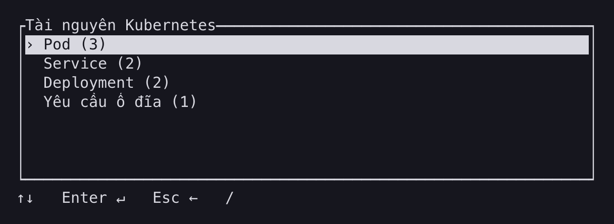
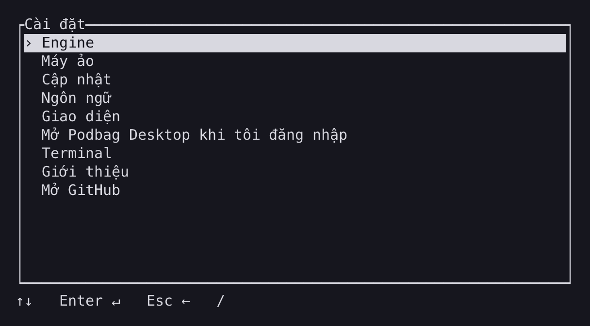

TUI hiện các tài nguyên của một cụm (cluster) Kubernetes. Trang **Cài đặt** thay đổi cách podbag và TUI hoạt động.

**Thời gian** 5 phút.

## Xem một cụm Kubernetes

TUI dùng `kubectl` và các ngữ cảnh (context) của nó. Hãy cài `kubectl` trước.

1. Nhấn `F6`.
2. Chọn ngữ cảnh cụm: **Ngữ cảnh hiện tại** hoặc một ngữ cảnh theo tên.
3. Chọn namespace: namespace của ngữ cảnh hoặc **Tất cả namespace**.
4. Chọn loại tài nguyên. Mỗi loại hiện số lượng của nó.

Danh sách hiện mỗi tài nguyên dưới dạng `namespace/name`. Nhấn `Enter` để xem tài nguyên dưới dạng JSON. **Làm mới** đọc lại danh sách. TUI chỉ đọc cụm. TUI không thay đổi cụm.

## Thực hành trong Hướng dẫn

Nhấn `F8`. **Hướng dẫn** cài một tệp bài học và chạy các bài tập của nó trong một môi trường thực hành.

1. Tải một tệp bài học, ví dụ `volume-api.podbag` từ bài [Đọc JSON từ volume qua HTTP](../volume-api-lab/).
2. Chọn **Chọn tệp** và nhập đường dẫn của tệp.
3. Chọn **Cài mô-đun**.
4. Chọn **Bắt đầu thực hành**.

**Gỡ mô-đun** gỡ bài học. Để xem các mô-đun thực hành của Podbag Desktop và CLI, hãy xem [Thực hành GUI](/vi/training/).

## Thay đổi cài đặt

Nhấn `F9`.

- **Engine:** kết nối với engine khác, hoặc xem phiên bản của engine.
- **Máy ảo:** có khi dùng podbag trên macOS và Windows. Xem VM, bật, dừng hoặc khởi động lại VM. **Áp dụng** thay đổi số CPU, bộ nhớ và thời gian chờ. TUI hỏi thay đổi có hiệu lực ngay hay ở lần khởi động sau.
- **Cập nhật:** xem phiên bản, kiểm tra bản cập nhật và cập nhật podbag.
- **Ngôn ngữ:** ngôn ngữ của hệ thống, hoặc một trong bảy ngôn ngữ.
- **Giao diện:** màu của hệ thống, sáng hoặc tối.
- **Mở Podbag Desktop khi tôi đăng nhập:** bật hoặc tắt mục này.
- **Terminal:** mở shell của bạn. Gõ `exit` để quay lại TUI.
- **Giới thiệu** và **Mở GitHub.**

TUI lưu ngôn ngữ, giao diện và thanh bên trong `terminal.json`. Thư mục là `~/.podbag` trên macOS, `~/.config/podbag` trên Linux và `%LOCALAPPDATA%\podbag` trên Windows.

## Dùng menu

Các trang này là menu. `↑` `↓` để chọn, gõ chữ để lọc menu, `Enter` để mở và `Esc` để quay lại.

## Xem thêm

[Tài liệu sử dụng podbag](https://github.com/SteelCrab/podbag/blob/main/docs/usage.md) có tất cả phím và tùy chọn của TUI. Quay lại [cách dùng TUI](/vi/training/tui/).
