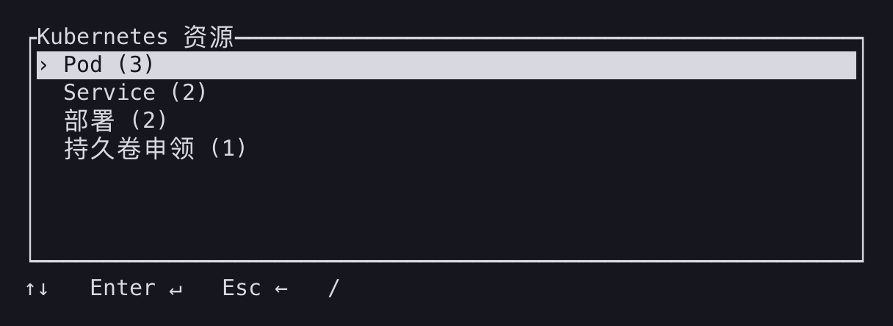
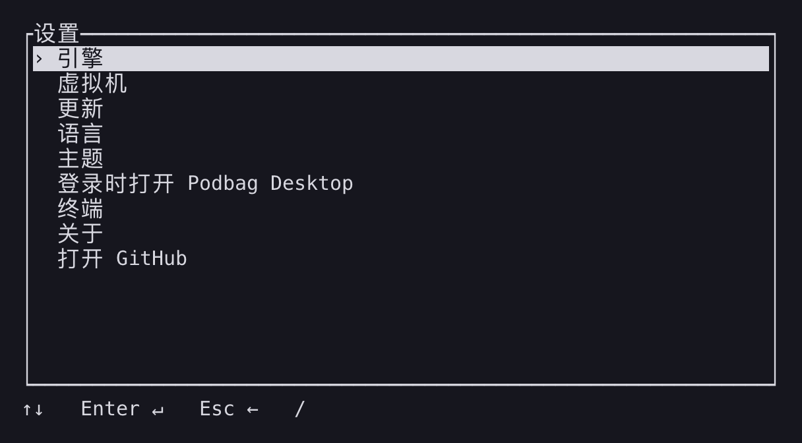

TUI 可以显示 Kubernetes 集群中的资源。它的**设置**页面可以更改 podbag 和 TUI 的工作方式。

**预计用时** 5 分钟。

## 查看 Kubernetes 集群

TUI 使用 `kubectl` 及其上下文。请先安装 `kubectl`。

1. 按 `F6`。
2. 选择集群上下文：**当前上下文**或某个上下文的名称。
3. 选择命名空间：上下文的命名空间或**所有命名空间**。
4. 选择资源类型。每种类型都会显示数量。

列表以 `namespace/name` 的形式显示每个资源。按 `Enter` 以 JSON 格式查看它。**刷新**会重新读取列表。TUI 只读取集群，不会更改集群。

在 OpenShift 集群上，**Route** 也是一种资源类型。只有当集群的 API 提供 Route 时，TUI 才会显示它。Route 依次显示主机和路径、Service 以及 TLS 模式，例如 `default/shop   shop.example.com/cart  frontend  edge`。

## 在教程中运行实验

按 `F8`。**教程**会安装课程文件，并在练习环境中运行其中的练习。

1. 下载课程文件，例如[实验 · 通过 HTTP 读取 Podbag 卷中的 JSON](../volume-api-lab/)中的 `volume-api.podbag`。
2. 选择**选择文件**，然后输入文件的路径。
3. 选择**安装模块**。
4. 选择**开始实验**。

**移除模块**会移除课程。关于 Podbag Desktop 和 CLI 的实操模块，请参见 [GUI 实训](/zh-CN/training/)。

## 更改设置

按 `F9`。

- **引擎：** 连接其他引擎，或查看引擎的版本。
- **虚拟机：** 在 macOS 和 Windows 上使用 podbag 时显示。查看 VM，启动、停止或重启它。**应用**会更改 CPU 数、内存和空闲时间。它会询问是现在生效还是下次启动时生效。
- **更新：** 查看版本，检查更新，并更新 podbag。
- **语言：** 跟随系统语言，或选择七种语言之一。
- **主题：** 跟随系统颜色，或选择浅色或深色。
- **登录时打开 Podbag Desktop：** 开启或关闭此项。
- **终端：** 打开你的 shell。输入 `exit` 返回 TUI。
- **关于**和**打开 GitHub**。

TUI 把语言、主题和侧边栏的设置保存在 `terminal.json` 中。该文件夹在 macOS 上是 `~/.podbag`，在 Linux 上是 `~/.config/podbag`，在 Windows 上是 `%LOCALAPPDATA%\podbag`。

## 使用菜单

这些页面都是菜单。`↑` `↓` 选择，输入文字可以筛选菜单，`Enter` 打开，`Esc` 返回。

## 更多

[podbag 使用指南](https://github.com/SteelCrab/podbag/blob/main/docs/usage.md)列出了 TUI 的所有按键和选项。返回 [TUI 使用方法](/zh-CN/training/tui/)。
