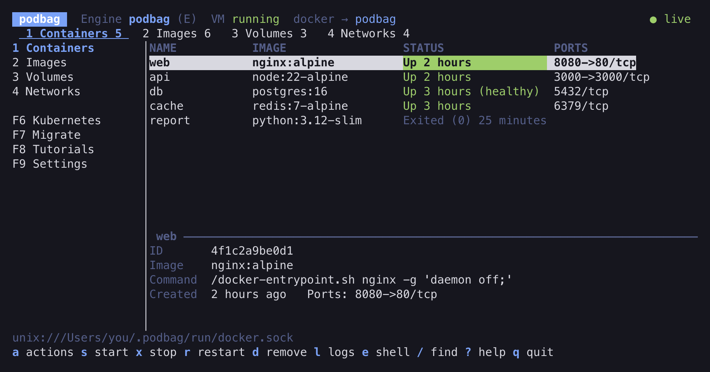
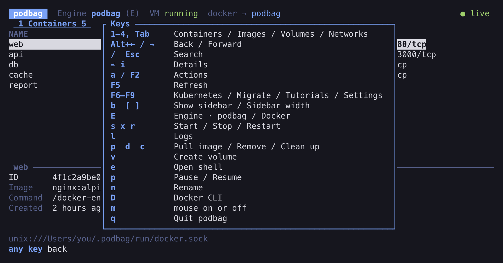

`podbag tui` is a dashboard in the terminal. It shows your containers, images, volumes and networks, and you work with them by key. It needs no window, so it also works over SSH.

**Time** 5 minutes.

## Start the TUI

Run this command in a terminal.

```sh
podbag tui
```

The TUI connects to podbag's engine. On macOS, it starts the VM when the VM is off. To use another engine for one run, add `--engine`. The values are `podbag`, `docker`, `podman`, `kiri`, `context:NAME` and `unix:///path`.

```sh
podbag tui --engine docker
```

The TUI fits a terminal of 80×24.

## Read the screen



- **Top line:** the engine (press `E` to switch it), the VM state on macOS, and where the `docker` command goes (`docker → podbag`). At the right, `● live` means that the TUI gets the engine's events. `○ polling` means that it reads the lists every 2 seconds.
- **Tabs:** Containers, Images, Volumes and Networks, each with its count.
- **List:** the rows of the open tab. The selected row is highlighted. In Containers, the status is green when the container runs.
- **Details:** the selected row, under the list. They show when the terminal has 18 rows or more.
- **Message line:** the result of the last action, an error, or the engine's address.
- **Key line:** the keys of this screen. You can click them.

## Move around

| Key | What it does |
|---|---|
| `1`–`4`, `Tab`, `←` `→` | Open another list |
| `↑` `↓` or `k` `j` | Move one row |
| `PgUp` `PgDn` | Move ten rows |
| `Home` `End` or `g` `G` | Go to the first or the last row |
| `Alt+←` `Alt+→` | Go back or forward through the lists you opened |
| `/` | Search the list. `Enter` keeps the search, `Esc` clears it |
| `Enter` or `i` | Show all details. `Esc` goes back |
| `F5` | Refresh |

The search looks at the names, the other columns and the IDs.

## Show the sidebar

Press `b`. The sidebar shows the four lists and the pages: **F6** Kubernetes, **F7** Migrate, **F8** Tutorials and **F9** Settings. `[` and `]` make it narrower or wider. The TUI remembers your choice. The sidebar needs a terminal that is 56 columns wide or more.

## Use the mouse

The mouse is on when the TUI starts. Click a tab, a row, a sidebar item or a key in the key line. Double-click a row to show all its details. The wheel moves the selection. Press `m` to turn the mouse off or on, or start the TUI with `podbag tui --no-mouse`.

## Show the keys and quit

Press `?` to show the keys. Any key closes this window.



Press `q` to quit. `Ctrl+C` also quits.

## Next

[Manage containers](../tui-containers/) with the keys of the Containers list.
