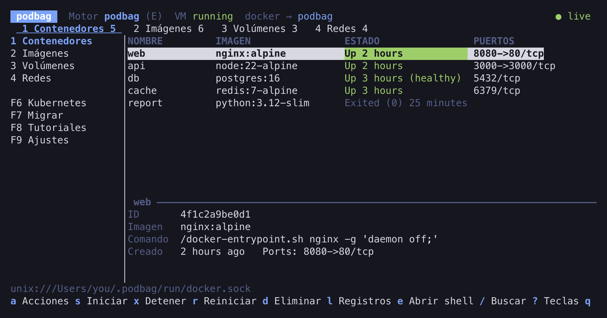
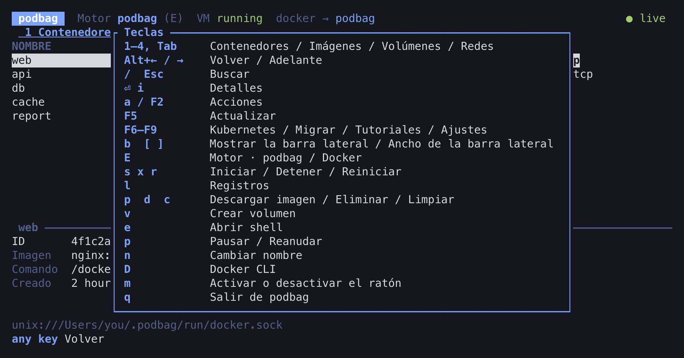

`podbag tui` es un panel que funciona en la terminal. Muestra tus contenedores, imágenes, volúmenes y redes. Trabajas con ellos mediante teclas. No necesita ventana, así que también funciona por SSH.

**Tiempo** 5 minutos.

## Inicia la TUI

Ejecuta este comando en una terminal.

```sh
podbag tui
```

La TUI se conecta al motor de podbag. En macOS, inicia la VM si está apagada. Para usar otro motor solo en esta ejecución, añade `--engine`. Los valores son `podbag`, `docker`, `podman`, `kiri`, `context:NOMBRE` y `unix:///ruta`.

```sh
podbag tui --engine docker
```

La TUI cabe en una terminal de 80×24.

## Lee la pantalla



- **Línea superior:** el motor (pulsa `E` para cambiarlo), el estado de la VM en macOS y adónde va el comando `docker` (`docker → podbag`). A la derecha, `● live` significa que la TUI recibe los eventos del motor. `○ polling` significa que vuelve a leer las listas cada 2 segundos.
- **Pestañas:** Contenedores, Imágenes, Volúmenes y Redes, cada una con su número de elementos.
- **Lista:** las filas de la pestaña abierta. La fila seleccionada aparece resaltada. En Contenedores, el estado está en verde cuando el contenedor está en ejecución.
- **Detalles:** la fila seleccionada, debajo de la lista. Aparecen cuando la terminal tiene 18 filas o más.
- **Línea de mensajes:** el resultado de la última acción, un error o la dirección del motor.
- **Línea de teclas:** las teclas de esta pantalla. Puedes hacer clic en ellas.

## Muévete

| Tecla | Qué hace |
|---|---|
| `1`–`4`, `Tab`, `←` `→` | Abre otra lista |
| `↑` `↓` o `k` `j` | Mueve una fila |
| `PgUp` `PgDn` | Mueve diez filas |
| `Home` `End` o `g` `G` | Va a la primera o a la última fila |
| `Alt+←` `Alt+→` | Vuelve atrás o adelante por las listas que abriste |
| `/`, `Ctrl+F` o `Ctrl+K` | Busca en la lista. `Enter` mantiene la búsqueda y `Esc` la borra |
| `Enter` o `i` | Muestra todos los detalles. `Esc` vuelve atrás |
| `F5` | Actualiza |

La búsqueda mira los nombres, las otras columnas y los ID.

## Muestra la barra lateral

Pulsa `b`. La barra lateral muestra las cuatro listas y las páginas: **F6** Kubernetes, **F7** Migrar, **F8** Tutoriales y **F9** Ajustes. `[` y `]` la hacen más estrecha o más ancha. La TUI recuerda tu elección. La barra lateral necesita una terminal de 56 columnas o más.

## Usa el ratón

El ratón está activado cuando se inicia la TUI. Haz clic en una pestaña, una fila, un elemento de la barra lateral o una tecla de la línea de teclas. Haz doble clic en una fila para ver todos sus detalles. La rueda mueve la selección. Pulsa `m` para desactivar o activar el ratón. También puedes iniciar la TUI con `podbag tui --no-mouse`.

## Muestra las teclas y sal

Pulsa `?` para ver las teclas. Cualquier tecla cierra esta ventana.



Pulsa `q` para salir. `Ctrl+C` también sale.

## Siguiente

[Gestiona contenedores](../tui-containers/) con las teclas de la lista Contenedores.
