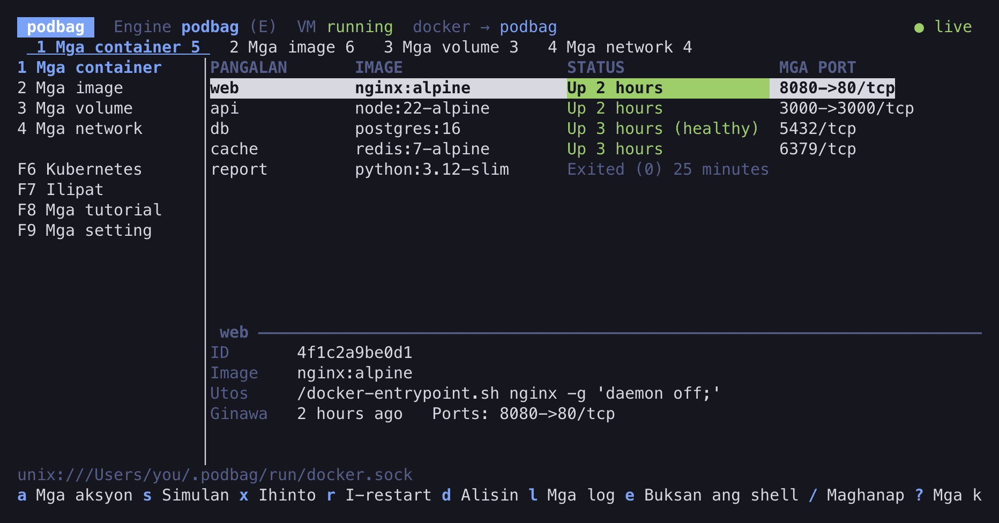
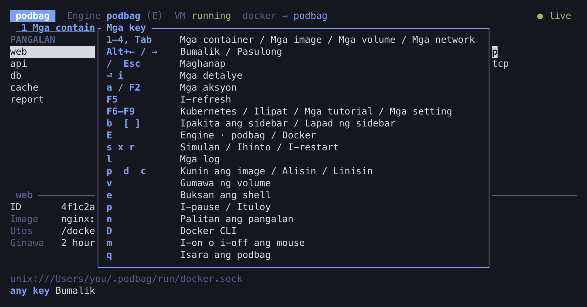

Ang `podbag tui` ay dashboard sa terminal. Ipinapakita nito ang iyong mga container, image, volume at network. Gumagamit ka ng mga key para gumawa sa mga ito. Hindi nito kailangan ng window, kaya gumagana rin ito sa SSH.

**Oras** 5 minuto.

## Simulan ang TUI

Patakbuhin ang command na ito sa terminal.

```sh
podbag tui
```

Kumokonekta ang TUI sa engine ng podbag. Sa macOS, sinisimulan nito ang VM kapag nakapatay ang VM. Para gumamit ng ibang engine sa isang takbo lang, idagdag ang `--engine`. Ang mga value ay `podbag`, `docker`, `podman`, `kiri`, `context:NAME` at `unix:///path`.

```sh
podbag tui --engine docker
```

Kasya ang TUI sa terminal na 80×24.

## Basahin ang screen



- **Itaas na linya:** ang engine (pindutin ang `E` para palitan ito), ang estado ng VM sa macOS, at kung saan pumupunta ang command na `docker` (`docker → podbag`). Sa kanan, ang `● live` ay nangangahulugang natatanggap ng TUI ang mga event ng engine. Ang `○ polling` ay nangangahulugang binabasa nito ang mga listahan bawat 2 segundo.
- **Mga tab:** Mga container, Mga image, Mga volume at Mga network. May bilang ang bawat isa.
- **Listahan:** ang mga row ng bukas na tab. Naka-highlight ang napiling row. Sa Mga container, berde ang status kapag tumatakbo ang container.
- **Mga detalye:** ang napiling row, sa ilalim ng listahan. Lumalabas ang mga ito kapag may 18 row o higit pa ang terminal.
- **Linya ng mensahe:** ang resulta ng huling aksyon, isang error, o ang address ng engine.
- **Linya ng mga key:** ang mga key ng screen na ito. Puwede mo itong i-click.

## Gumalaw sa screen

| Key | Ano ang ginagawa nito |
|---|---|
| `1`–`4`, `Tab`, `←` `→` | Magbukas ng ibang listahan |
| `↑` `↓` o `k` `j` | Lumipat nang isang row |
| `PgUp` `PgDn` | Lumipat nang sampung row |
| `Home` `End` o `g` `G` | Pumunta sa una o sa huling row |
| `Alt+←` `Alt+→` | Bumalik o umabante sa mga listahang binuksan mo |
| `/`, `Ctrl+F` o `Ctrl+K` | Maghanap sa listahan. Pinapanatili ng `Enter` ang paghahanap. Binubura ito ng `Esc` |
| `Enter` o `i` | Ipakita ang lahat ng detalye. Bumabalik ang `Esc` |
| `F5` | I-refresh |

Tumitingin ang paghahanap sa mga pangalan, sa ibang mga column at sa mga ID.

## Ipakita ang sidebar

Pindutin ang `b`. Ipinapakita ng sidebar ang apat na listahan at ang mga page: **F6** Kubernetes, **F7** Ilipat, **F8** Mga tutorial at **F9** Mga setting. Pinapakitid o pinapalapad ito ng `[` at `]`. Tinatandaan ng TUI ang pinili mo. Kailangan ng sidebar ang terminal na may lapad na 56 column o higit pa.

## Gamitin ang mouse

Naka-on ang mouse kapag nagsimula ang TUI. Mag-click ng tab, row, item sa sidebar o key sa linya ng mga key. Mag-double-click ng row para ipakita ang lahat ng detalye nito. Inililipat ng wheel ang napili. Pindutin ang `m` para i-off o i-on ang mouse. O simulan ang TUI gamit ang `podbag tui --no-mouse`.

## Ipakita ang mga key at umalis

Pindutin ang `?` para ipakita ang mga key. Isinasara ng kahit anong key ang window na ito.



Pindutin ang `q` para umalis. Umaalis din ang `Ctrl+C`.

## Susunod

[Pamahalaan ang mga container](../tui-containers/) gamit ang mga key ng listahan ng Mga container.
