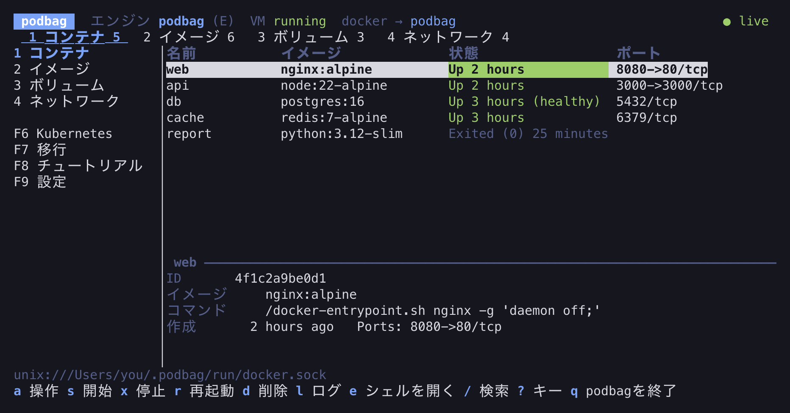
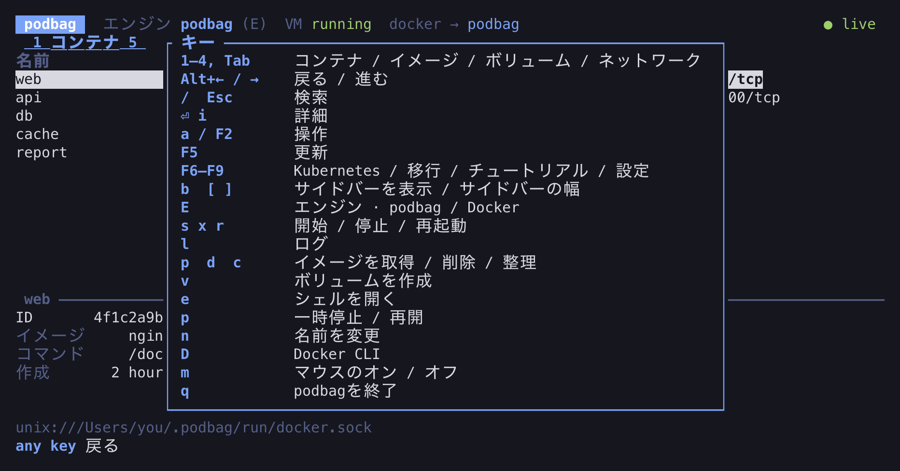

`podbag tui` は、ターミナルで使うダッシュボードです。コンテナ、イメージ、ボリューム、ネットワークを表示し、キーで操作します。ウィンドウが要らないので、SSH で接続したサーバーでも使えます。

**所要時間** 5 分。

## TUI を起動する

ターミナルで次のコマンドを実行します。

```sh
podbag tui
```

TUI は podbag のエンジンに接続します。macOS では、VM が止まっていると VM を起動します。今回の実行だけ別のエンジンを使うには、`--engine` を付けます。値は `podbag`、`docker`、`podman`、`kiri`、`context:名前`、`unix:///パス` です。

```sh
podbag tui --engine docker
```

TUI は 80×24 のターミナルに収まります。

## 画面を読む



- **一番上の行:** 使用中のエンジン（`E` で切り替え）、macOS の VM の状態、`docker` コマンドの行き先（`docker → podbag`）が表示されます。右端の `● live` は、エンジンのイベントを受け取っているという意味です。`○ polling` は、2 秒ごとに一覧を読み直すという意味です。
- **タブ:** コンテナ、イメージ、ボリューム、ネットワークと、それぞれの数です。
- **一覧:** 開いているタブの行です。選択した行は強調表示されます。コンテナの一覧では、実行中のコンテナの状態が緑色になります。
- **詳細:** 一覧の下に、選択した行の情報が表示されます。ターミナルが 18 行以上のときに表示されます。
- **メッセージ行:** 最後の操作の結果、エラー、またはエンジンのアドレスが表示されます。
- **キー行:** この画面で使えるキーです。クリックもできます。

## 移動する

| キー | 動作 |
|---|---|
| `1`–`4`、`Tab`、`←` `→` | 別の一覧を開きます |
| `↑` `↓` または `k` `j` | 1 行移動します |
| `PgUp` `PgDn` | 10 行移動します |
| `Home` `End` または `g` `G` | 最初の行または最後の行に移動します |
| `Alt+←` `Alt+→` | 開いた一覧の間を戻る、または進みます |
| `/` | 一覧を検索します。`Enter` で検索を残し、`Esc` で消します |
| `Enter` または `i` | すべての詳細を表示します。`Esc` で戻ります |
| `F5` | 更新します |

検索は、名前、ほかの列、ID を対象にします。

## サイドバーを表示する

`b` を押します。サイドバーに 4 つの一覧とページが表示されます。**F6** Kubernetes、**F7** 移行、**F8** チュートリアル、**F9** 設定です。`[` と `]` でサイドバーを狭くしたり広くしたりします。TUI はこの選択を覚えます。サイドバーには、幅が 56 列以上のターミナルが必要です。

## マウスを使う

TUI を起動すると、マウスはオンになっています。タブ、行、サイドバーの項目、キー行のキーをクリックできます。行をダブルクリックすると、すべての詳細が表示されます。ホイールで選択が移動します。`m` を押すと、マウスをオフまたはオンにします。`podbag tui --no-mouse` で起動することもできます。

## キーを表示して終了する

`?` を押すと、キーの一覧が表示されます。どれかキーを押すと、このウィンドウが閉じます。



`q` を押すと終了します。`Ctrl+C` でも終了します。

## 次へ

コンテナの一覧のキーで[コンテナを管理する](../tui-containers/)。
