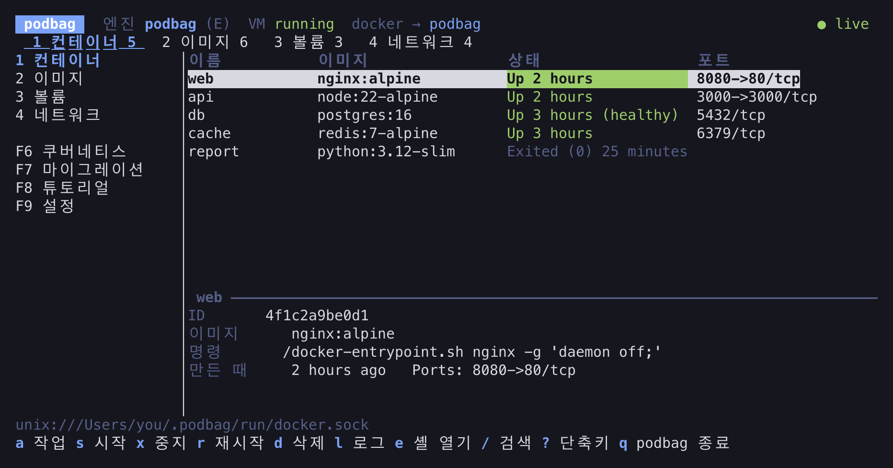
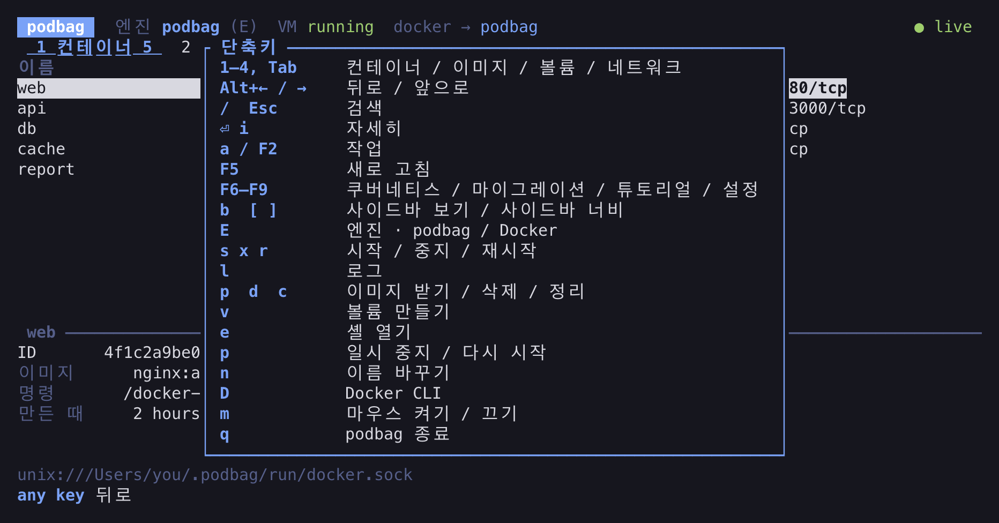

`podbag tui`는 터미널에서 쓰는 대시보드입니다. 컨테이너, 이미지, 볼륨, 네트워크를 보여주고, 키로 다룹니다. 창이 필요 없어서 SSH로 접속한 서버에서도 쓸 수 있습니다.

**예상 시간** 5분.

## TUI 시작하기

터미널에서 다음 명령을 실행합니다.

```sh
podbag tui
```

TUI는 podbag 엔진에 연결합니다. macOS에서는 VM이 꺼져 있으면 VM을 시작합니다. 이번 실행에만 다른 엔진을 쓰려면 `--engine`을 붙입니다. 값은 `podbag`, `docker`, `podman`, `kiri`, `context:이름`, `unix:///경로`입니다.

```sh
podbag tui --engine docker
```

TUI는 80×24 크기의 터미널에 맞습니다.

## 화면 읽기



- **맨 윗줄:** 사용 중인 엔진(`E`로 바꿈), macOS의 VM 상태, `docker` 명령이 가는 곳(`docker → podbag`)이 나옵니다. 오른쪽의 `● live`는 엔진의 이벤트를 받고 있다는 뜻입니다. `○ polling`은 2초마다 목록을 다시 읽는다는 뜻입니다.
- **탭:** 컨테이너, 이미지, 볼륨, 네트워크와 각각의 개수입니다.
- **목록:** 열린 탭의 항목입니다. 선택한 줄이 강조됩니다. 컨테이너 목록에서 실행 중인 컨테이너는 상태가 초록색입니다.
- **상세 정보:** 목록 아래에 선택한 항목의 정보가 나옵니다. 터미널이 18줄 이상일 때 보입니다.
- **메시지 줄:** 마지막 작업의 결과, 오류, 또는 엔진 주소가 나옵니다.
- **키 줄:** 이 화면에서 쓰는 키입니다. 마우스로 눌러도 됩니다.

## 이동하기

| 키 | 하는 일 |
|---|---|
| `1`–`4`, `Tab`, `←` `→` | 다른 목록을 엽니다 |
| `↑` `↓` 또는 `k` `j` | 한 줄 이동합니다 |
| `PgUp` `PgDn` | 열 줄 이동합니다 |
| `Home` `End` 또는 `g` `G` | 첫 줄이나 마지막 줄로 갑니다 |
| `Alt+←` `Alt+→` | 열었던 목록 사이에서 뒤로, 앞으로 갑니다 |
| `/`, `Ctrl+F` 또는 `Ctrl+K` | 목록을 검색합니다. `Enter`는 검색을 유지하고, `Esc`는 지웁니다 |
| `Enter` 또는 `i` | 모든 상세 정보를 봅니다. `Esc`로 돌아갑니다 |
| `F5` | 새로 고칩니다 |

검색은 이름, 다른 열, ID에서 찾습니다.

## 사이드바 보기

`b`를 누릅니다. 사이드바에 네 목록과 페이지가 나옵니다: **F6** 쿠버네티스, **F7** 마이그레이션, **F8** 튜토리얼, **F9** 설정. `[`와 `]`로 사이드바를 좁히거나 넓힙니다. TUI는 이 선택을 기억합니다. 사이드바는 터미널 너비가 56칸 이상일 때 보입니다.

## 마우스 쓰기

TUI를 시작하면 마우스가 켜져 있습니다. 탭, 줄, 사이드바 항목, 키 줄의 키를 누를 수 있습니다. 줄을 두 번 누르면 모든 상세 정보가 나옵니다. 휠은 선택한 줄을 옮깁니다. `m`으로 마우스를 끄거나 켭니다. `podbag tui --no-mouse`로 시작해도 됩니다.

## 단축키 보기와 끝내기

`?`를 누르면 단축키가 나옵니다. 아무 키나 누르면 닫힙니다.



`q`를 누르면 TUI가 끝납니다. `Ctrl+C`로도 끝납니다.

## 다음 글

[컨테이너 다루기](../tui-containers/)에서 컨테이너 목록의 키를 씁니다.
