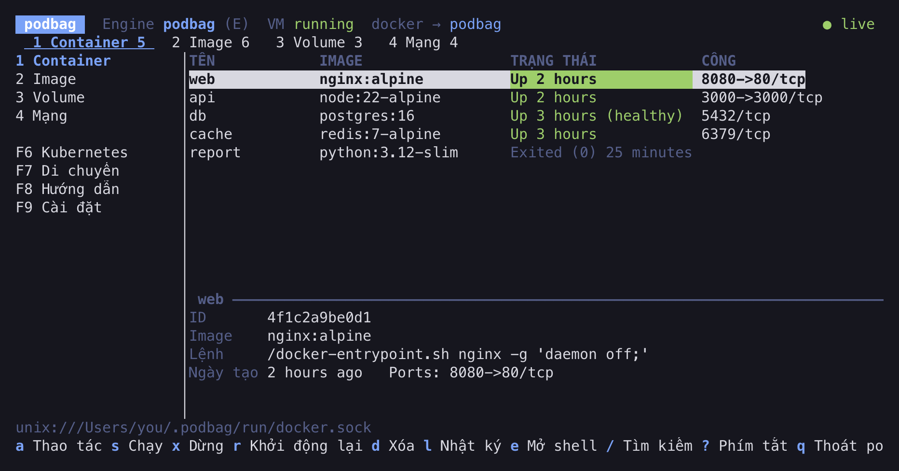
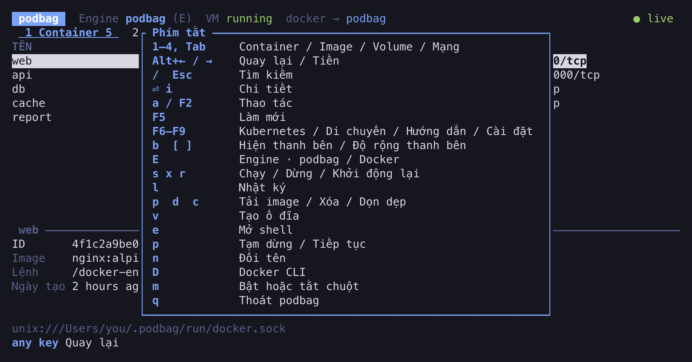

`podbag tui` là một bảng điều khiển trong terminal. Nó hiện container, image, volume và mạng của bạn. Bạn thao tác với chúng bằng phím. TUI không cần cửa sổ, nên nó cũng chạy được qua SSH.

**Thời gian** 5 phút.

## Khởi động TUI

Chạy lệnh này trong terminal.

```sh
podbag tui
```

TUI kết nối với engine của podbag. Trên macOS, TUI bật VM khi VM đang tắt. Để dùng engine khác cho một lần chạy, hãy thêm `--engine`. Các giá trị là `podbag`, `docker`, `podman`, `kiri`, `context:NAME` và `unix:///path`.

```sh
podbag tui --engine docker
```

TUI vừa với terminal có kích thước 80×24.

## Đọc màn hình



- **Dòng trên cùng:** engine đang dùng (nhấn `E` để đổi), trạng thái VM trên macOS, và nơi lệnh `docker` gửi tới (`docker → podbag`). Ở bên phải, `● live` nghĩa là TUI nhận sự kiện từ engine. `○ polling` nghĩa là TUI đọc lại các danh sách mỗi 2 giây.
- **Tab:** Container, Image, Volume và Mạng, kèm số lượng của mỗi loại.
- **Danh sách:** các dòng của tab đang mở. Dòng đang chọn được tô sáng. Trong danh sách Container, trạng thái có màu xanh lá khi container đang chạy.
- **Chi tiết:** thông tin của dòng đang chọn, nằm dưới danh sách. Phần này hiện khi terminal có từ 18 dòng trở lên.
- **Dòng thông báo:** kết quả của thao tác cuối cùng, một lỗi, hoặc địa chỉ của engine.
- **Dòng phím:** các phím của màn hình này. Bạn có thể bấm chuột vào chúng.

## Di chuyển

| Phím | Tác dụng |
|---|---|
| `1`–`4`, `Tab`, `←` `→` | Mở danh sách khác |
| `↑` `↓` hoặc `k` `j` | Di chuyển một dòng |
| `PgUp` `PgDn` | Di chuyển mười dòng |
| `Home` `End` hoặc `g` `G` | Đến dòng đầu hoặc dòng cuối |
| `Alt+←` `Alt+→` | Quay lại hoặc tiến tới giữa các danh sách bạn đã mở |
| `/`, `Ctrl+F` hoặc `Ctrl+K` | Tìm trong danh sách. `Enter` giữ kết quả tìm, `Esc` xóa nó |
| `Enter` hoặc `i` | Hiện tất cả chi tiết. `Esc` để quay lại |
| `F5` | Làm mới |

Tìm kiếm xét tên, các cột khác và ID.

## Hiện thanh bên

Nhấn `b`. Thanh bên hiện bốn danh sách và các trang: **F6** Kubernetes, **F7** Di chuyển, **F8** Hướng dẫn và **F9** Cài đặt. `[` và `]` làm thanh bên hẹp hơn hoặc rộng hơn. TUI nhớ lựa chọn của bạn. Thanh bên cần terminal rộng từ 56 cột trở lên.

## Dùng chuột

Chuột được bật khi TUI khởi động. Bấm vào một tab, một dòng, một mục ở thanh bên hoặc một phím trong dòng phím. Bấm đúp vào một dòng để hiện tất cả chi tiết của dòng đó. Con lăn di chuyển dòng đang chọn. Nhấn `m` để tắt hoặc bật chuột, hoặc khởi động TUI bằng `podbag tui --no-mouse`.

## Xem phím tắt và thoát

Nhấn `?` để hiện các phím tắt. Nhấn phím bất kỳ để đóng cửa sổ này.



Nhấn `q` để thoát. `Ctrl+C` cũng thoát.

## Tiếp theo

[Quản lý container](../tui-containers/) bằng các phím của danh sách Container.
