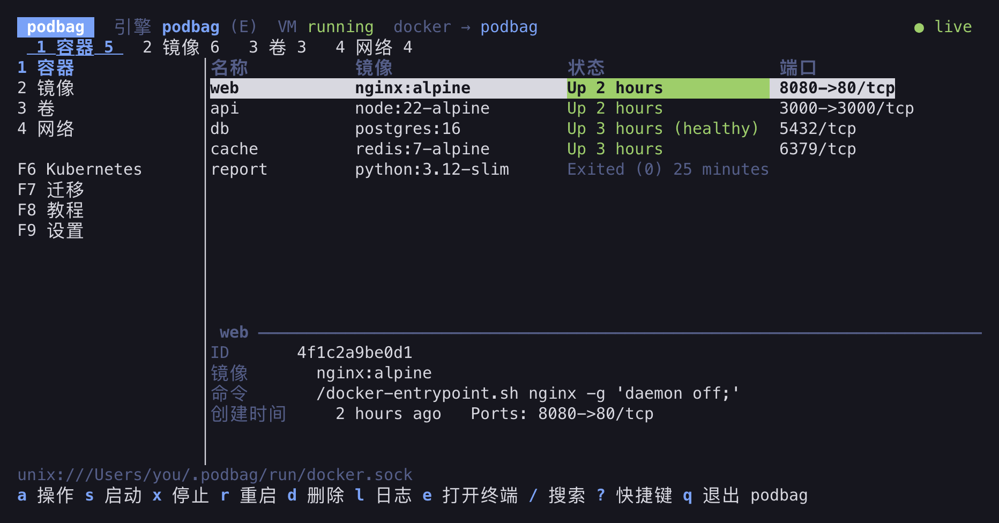
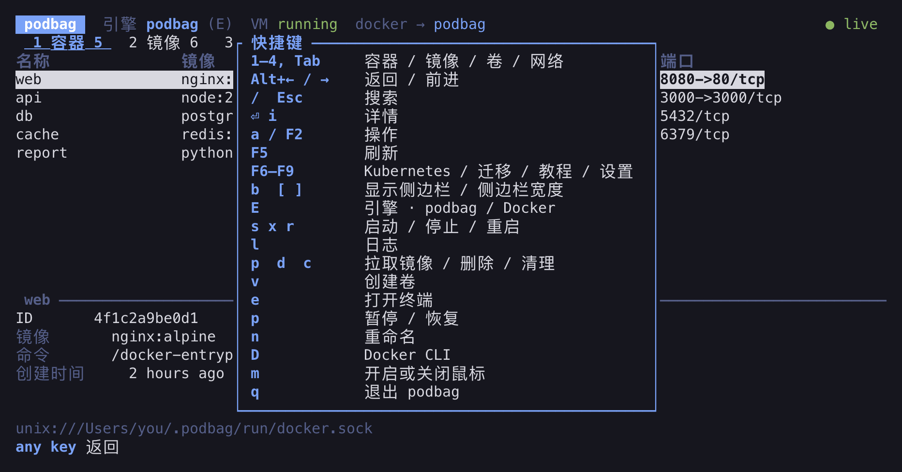

`podbag tui` 是在终端里使用的仪表盘。它显示你的容器、镜像、卷和网络，你用按键来操作它们。它不需要窗口，所以通过 SSH 连接时也能用。

**预计用时** 5 分钟。

## 启动 TUI

在终端中运行以下命令。

```sh
podbag tui
```

TUI 会连接 podbag 的引擎。在 macOS 上，如果 VM 没有运行，TUI 会启动 VM。如果只想在这一次运行中使用其他引擎，请加上 `--engine`。可用的值有 `podbag`、`docker`、`podman`、`kiri`、`context:NAME` 和 `unix:///path`。

```sh
podbag tui --engine docker
```

TUI 适合 80×24 的终端。

## 读懂屏幕



- **顶部行：** 显示当前引擎（按 `E` 切换）、macOS 上的 VM 状态，以及 `docker` 命令连到哪里（`docker → podbag`）。右侧的 `● live` 表示 TUI 正在接收引擎的事件。`○ polling` 表示 TUI 每 2 秒重新读取一次列表。
- **标签页：** 容器、镜像、卷和网络，每个都带有数量。
- **列表：** 当前标签页中的各行。选中的行会高亮显示。在容器列表中，正在运行的容器状态显示为绿色。
- **详情：** 列表下方显示选中行的信息。终端有 18 行或更多时才会显示。
- **消息行：** 显示上一次操作的结果、错误或引擎的地址。
- **按键行：** 显示当前屏幕可用的按键。你也可以用鼠标点击它们。

## 移动

| 按键 | 作用 |
|---|---|
| `1`–`4`、`Tab`、`←` `→` | 打开其他列表 |
| `↑` `↓` 或 `k` `j` | 移动一行 |
| `PgUp` `PgDn` | 移动十行 |
| `Home` `End` 或 `g` `G` | 跳到第一行或最后一行 |
| `Alt+←` `Alt+→` | 在打开过的列表之间后退或前进 |
| `/` | 搜索列表。`Enter` 保留搜索，`Esc` 清除搜索 |
| `Enter` 或 `i` | 显示全部详情。`Esc` 返回 |
| `F5` | 刷新 |

搜索会查找名称、其他列和 ID。

## 显示侧边栏

按 `b`。侧边栏显示四个列表和几个页面：**F6** Kubernetes、**F7** 迁移、**F8** 教程和 **F9** 设置。`[` 和 `]` 可以让侧边栏变窄或变宽。TUI 会记住你的选择。终端宽度至少为 56 列时才会显示侧边栏。

## 使用鼠标

TUI 启动时鼠标就已开启。你可以点击标签页、行、侧边栏项目或按键行中的按键。双击一行可以显示它的全部详情。滚轮会移动选中的行。按 `m` 关闭或开启鼠标，也可以用 `podbag tui --no-mouse` 启动 TUI。

## 查看快捷键并退出

按 `?` 显示快捷键。按任意键关闭这个窗口。



按 `q` 退出。`Ctrl+C` 也可以退出。

## 下一篇

用容器列表的按键来[管理容器](../tui-containers/)。
