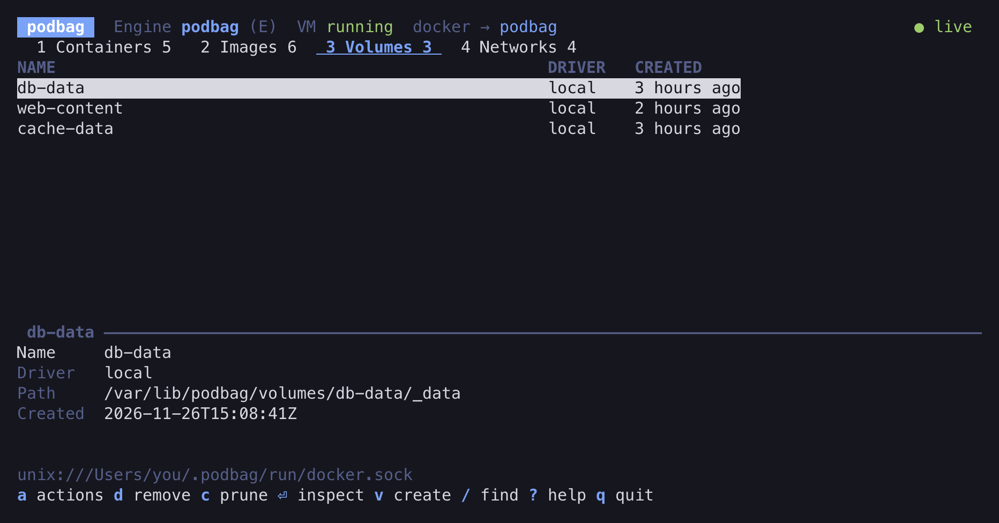
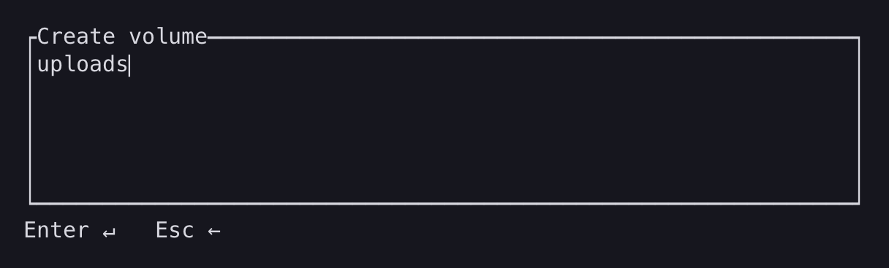
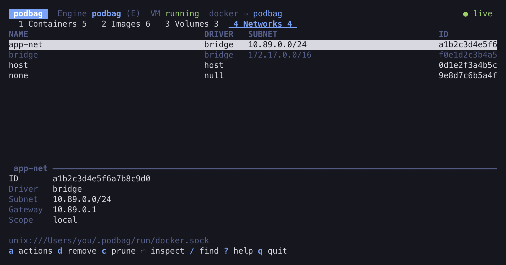

A volume keeps files outside a container. A network connects containers. The TUI has a list for each.

**Time** 5 minutes.

## See the volumes

Press `3`. The Volumes list shows each volume's name, driver and age. The details show the path where the volume keeps its files.



## Create a volume

1. In the Volumes list, press `v`. The actions menu (`a`) also has **Create volume**.
2. Type the name, for example `uploads`.
3. Press `Enter`.



The new volume shows in the list.

## Remove volumes

- `d` removes the selected volume. The TUI asks first. The files in the volume are deleted too.
- `c` cleans up: it removes the volumes that no container uses. The TUI asks first.

## See the networks

Press `4`. The Networks list shows each network's name, driver, subnet and ID. The details show its gateway and scope.



The networks `bridge`, `host` and `none` come with the engine. They are grey, and you cannot remove them.

## Remove networks

- `d` removes the selected network. The TUI asks first.
- `c` cleans up: it removes the networks that no container uses.

To create a network, use the CLI.

```sh
podbag network create app-net
```

## Next

[Switch engines and migrate](../tui-engines/).
