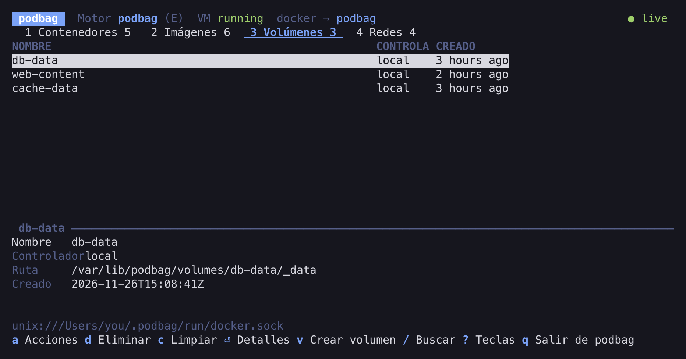
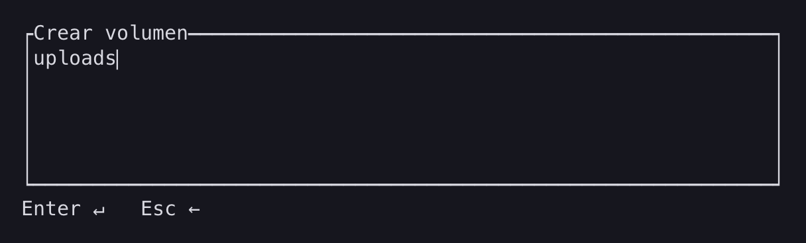
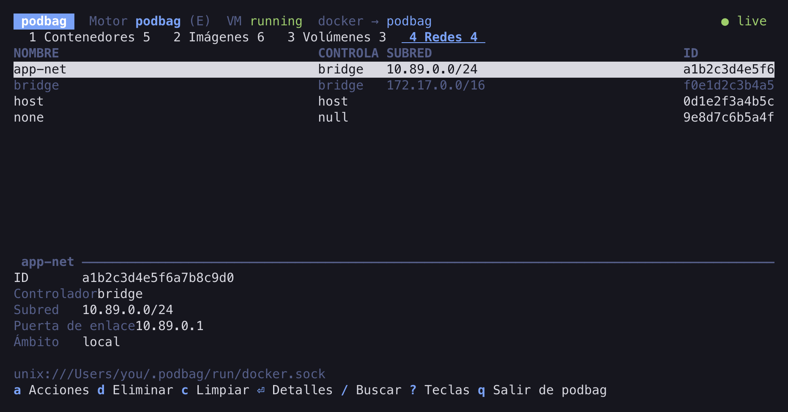

Un volumen guarda archivos fuera de un contenedor. Una red conecta contenedores. La TUI tiene una lista para cada uno.

**Tiempo** 5 minutos.

## Mira los volúmenes

Pulsa `3`. La lista Volúmenes muestra el nombre, el controlador y la antigüedad de cada volumen. Los detalles muestran la ruta donde el volumen guarda sus archivos.



## Crea un volumen

1. En la lista Volúmenes, pulsa `v`. El menú **Acciones** (`a`) también tiene **Crear volumen**.
2. Escribe el nombre, por ejemplo `uploads`.
3. Pulsa `Enter`.



El volumen nuevo aparece en la lista.

## Elimina volúmenes

- `d` elimina el volumen seleccionado. La TUI pregunta antes. Los archivos del volumen también se borran.
- `c` limpia: elimina los volúmenes que ningún contenedor usa. La TUI pregunta antes.

## Mira las redes

Pulsa `4`. La lista Redes muestra el nombre, el controlador, la subred y el ID de cada red. Los detalles muestran su puerta de enlace y su ámbito.



Las redes `bridge`, `host` y `none` vienen con el motor. Aparecen en gris y no puedes eliminarlas.

## Elimina redes

- `d` elimina la red seleccionada. La TUI pregunta antes.
- `c` limpia: elimina las redes que ningún contenedor usa.

Para crear una red, usa la CLI.

```sh
podbag network create app-net
```

## Siguiente

[Cambia de motor y migra](../tui-engines/).
