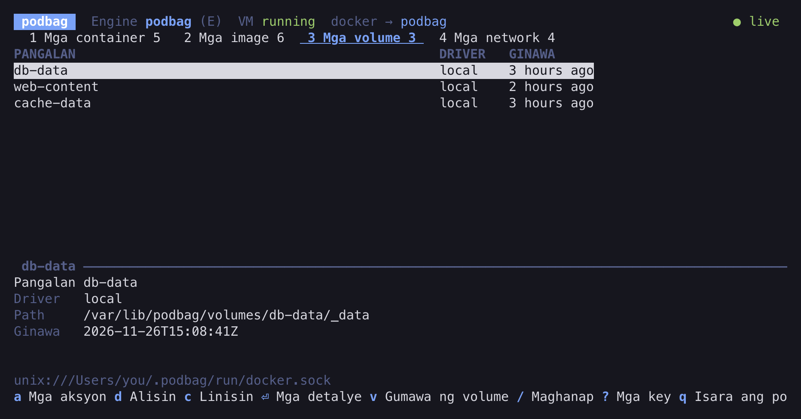
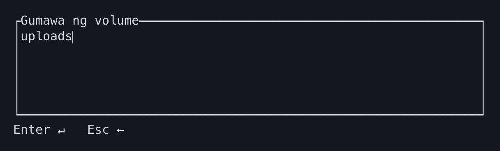
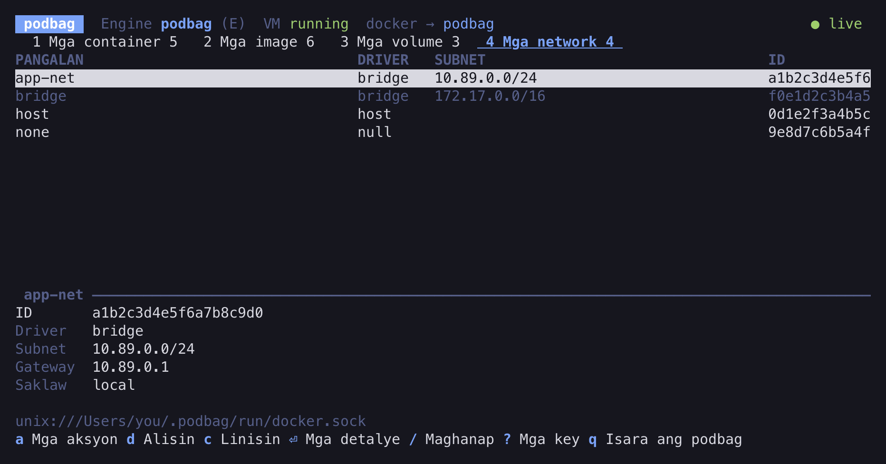

Iniingatan ng volume ang mga file sa labas ng container. Pinagkokonekta ng network ang mga container. May listahan ang TUI para sa bawat isa.

**Oras** 5 minuto.

## Tingnan ang mga volume

Pindutin ang `3`. Ipinapakita ng listahan ng Mga volume ang pangalan, driver at edad ng bawat volume. Ipinapakita ng mga detalye ang path kung saan iniingatan ng volume ang mga file nito.



## Gumawa ng volume

1. Sa listahan ng Mga volume, pindutin ang `v`. May **Gumawa ng volume** din ang menu ng mga aksyon (`a`).
2. I-type ang pangalan, halimbawa `uploads`.
3. Pindutin ang `Enter`.



Lalabas sa listahan ang bagong volume.

## Alisin ang mga volume

- Inaalis ng `d` ang napiling volume. Nagtatanong muna ang TUI. Mabubura rin ang mga file sa volume.
- Naglilinis ang `c`: inaalis nito ang mga volume na hindi ginagamit ng anumang container. Nagtatanong muna ang TUI.

## Tingnan ang mga network

Pindutin ang `4`. Ipinapakita ng listahan ng Mga network ang pangalan, driver, subnet at ID ng bawat network. Ipinapakita ng mga detalye ang gateway at saklaw nito.



Kasama na sa engine ang mga network na `bridge`, `host` at `none`. Kulay abo ang mga ito, at hindi mo maaalis ang mga ito.

## Alisin ang mga network

- Inaalis ng `d` ang napiling network. Nagtatanong muna ang TUI.
- Naglilinis ang `c`: inaalis nito ang mga network na hindi ginagamit ng anumang container.

Para gumawa ng network, gamitin ang CLI.

```sh
podbag network create app-net
```

## Susunod

[Magpalit ng engine at maglipat](../tui-engines/).
