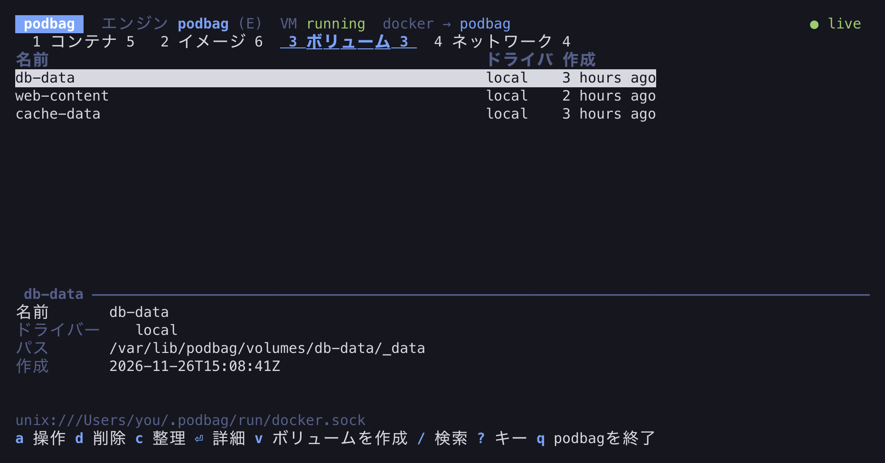
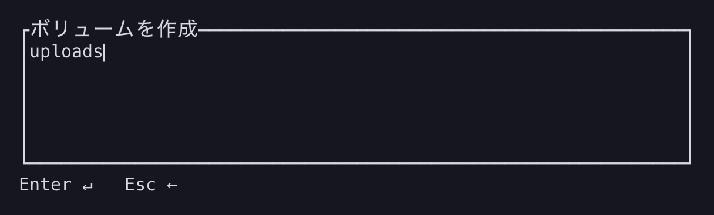
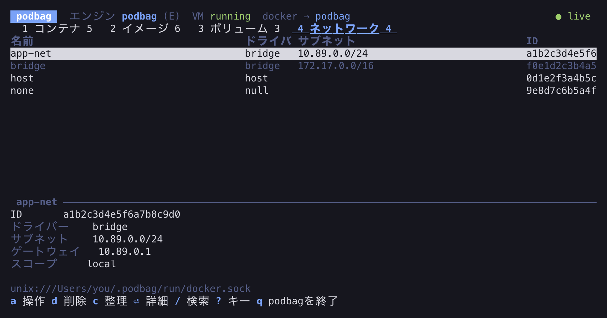

ボリュームは、コンテナの外にファイルを保存します。ネットワークは、コンテナどうしをつなぎます。TUI には、それぞれの一覧があります。

**所要時間** 5 分。

## ボリュームを見る

`3` を押します。ボリュームの一覧に、名前、ドライバー、作成からの時間が表示されます。詳細には、ボリュームがファイルを保存するパスが表示されます。



## ボリュームを作成する

1. ボリュームの一覧で `v` を押します。操作メニュー（`a`）の**ボリュームを作成**でも同じです。
2. 名前を入力します。例: `uploads`。
3. `Enter` を押します。



新しいボリュームが一覧に表示されます。

## ボリュームを削除する

- `d` は、選択したボリュームを削除します。TUI は先に確認します。ボリュームの中のファイルも削除されます。
- `c` は整理です。どのコンテナも使っていないボリュームを削除します。TUI は先に確認します。

## ネットワークを見る

`4` を押します。ネットワークの一覧に、名前、ドライバー、サブネット、ID が表示されます。詳細には、ゲートウェイとスコープが表示されます。



`bridge`、`host`、`none` は、エンジンに最初からあるネットワークです。灰色で表示され、削除できません。

## ネットワークを削除する

- `d` は、選択したネットワークを削除します。TUI は先に確認します。
- `c` は整理です。どのコンテナも使っていないネットワークを削除します。

ネットワークを作成するには、CLI を使います。

```sh
podbag network create app-net
```

## 次へ

[エンジンを切り替えて移行する](../tui-engines/)。
