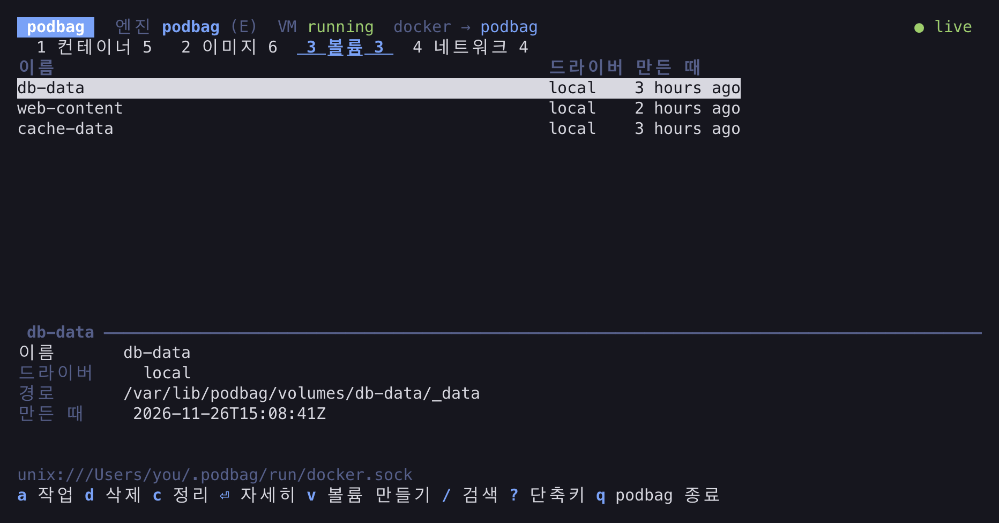
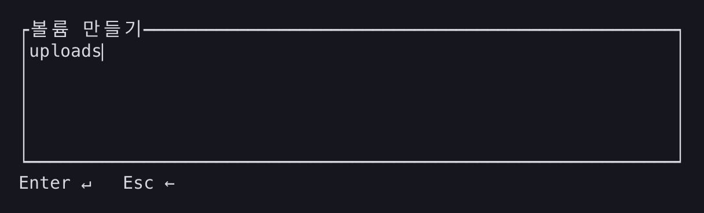
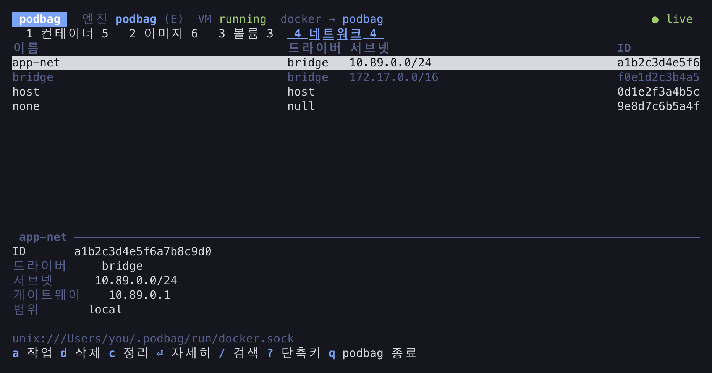

볼륨은 컨테이너 밖에 파일을 보관합니다. 네트워크는 컨테이너끼리 연결합니다. TUI에는 각각의 목록이 있습니다.

**예상 시간** 5분.

## 볼륨 보기

`3`을 누릅니다. 볼륨 목록에 이름, 드라이버, 만든 때가 나옵니다. 상세 정보에는 볼륨이 파일을 저장하는 경로가 나옵니다.



## 볼륨 만들기

1. 볼륨 목록에서 `v`를 누릅니다. 작업 메뉴(`a`)의 **볼륨 만들기**도 같습니다.
2. 이름을 입력합니다. 예: `uploads`.
3. `Enter`를 누릅니다.



새 볼륨이 목록에 나옵니다.

## 볼륨 삭제하기

- `d`는 선택한 볼륨을 삭제합니다. TUI가 먼저 묻습니다. 볼륨 안의 파일도 함께 삭제됩니다.
- `c`는 정리입니다. 어떤 컨테이너도 쓰지 않는 볼륨을 삭제합니다. 먼저 묻습니다.

## 네트워크 보기

`4`를 누릅니다. 네트워크 목록에 이름, 드라이버, 서브넷, ID가 나옵니다. 상세 정보에는 게이트웨이와 범위가 나옵니다.



`bridge`, `host`, `none`은 엔진에 원래 있는 네트워크입니다. 회색으로 나오고 삭제할 수 없습니다.

## 네트워크 삭제하기

- `d`는 선택한 네트워크를 삭제합니다. TUI가 먼저 묻습니다.
- `c`는 정리입니다. 어떤 컨테이너도 쓰지 않는 네트워크를 삭제합니다.

네트워크는 CLI로 만듭니다.

```sh
podbag network create app-net
```

## 다음 글

[엔진 바꾸기와 마이그레이션](../tui-engines/).
