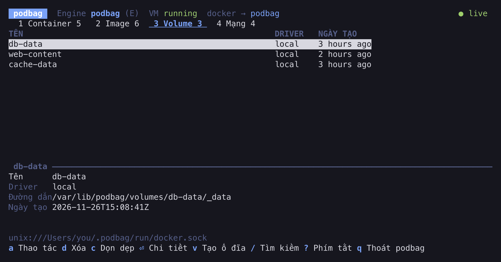
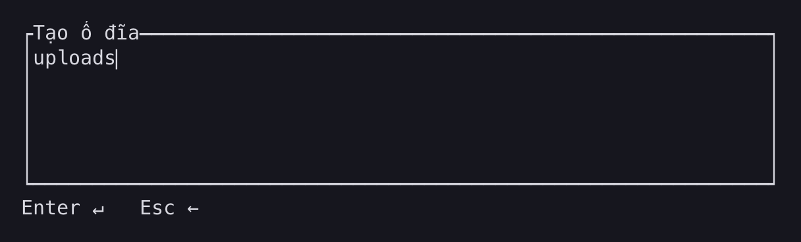
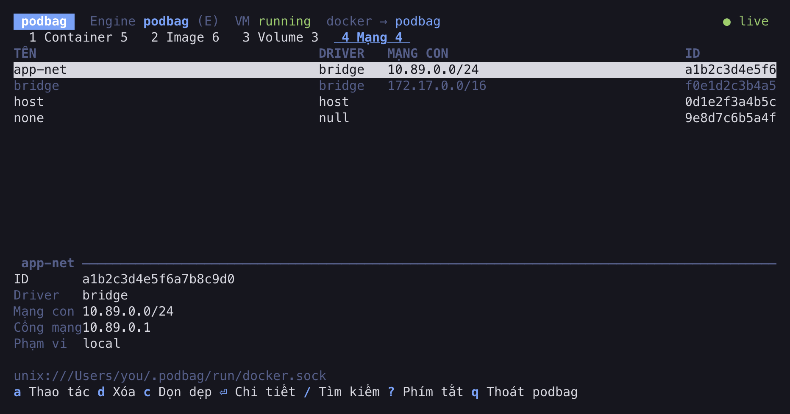

Volume giữ tệp bên ngoài container. Mạng kết nối các container với nhau. TUI có một danh sách cho mỗi loại.

**Thời gian** 5 phút.

## Xem volume

Nhấn `3`. Danh sách Volume hiện tên, driver và ngày tạo của mỗi volume. Phần chi tiết hiện đường dẫn nơi volume lưu tệp.



## Tạo volume

1. Trong danh sách Volume, nhấn `v`. Menu Thao tác (`a`) cũng có mục **Tạo ổ đĩa**.
2. Gõ tên, ví dụ `uploads`.
3. Nhấn `Enter`.



Volume mới hiện trong danh sách.

## Xóa volume

- `d` xóa volume đang chọn. TUI hỏi trước. Các tệp trong volume cũng bị xóa.
- `c` dọn dẹp: phím này xóa các volume không có container nào dùng. TUI hỏi trước.

## Xem mạng

Nhấn `4`. Danh sách Mạng hiện tên, driver, mạng con (subnet) và ID của mỗi mạng. Phần chi tiết hiện cổng mạng (gateway) và phạm vi của mạng.



Các mạng `bridge`, `host` và `none` có sẵn trong engine. Chúng có màu xám, và bạn không thể xóa chúng.

## Xóa mạng

- `d` xóa mạng đang chọn. TUI hỏi trước.
- `c` dọn dẹp: phím này xóa các mạng không có container nào dùng.

Để tạo mạng, hãy dùng CLI.

```sh
podbag network create app-net
```

## Tiếp theo

[Đổi engine và di chuyển](../tui-engines/).
