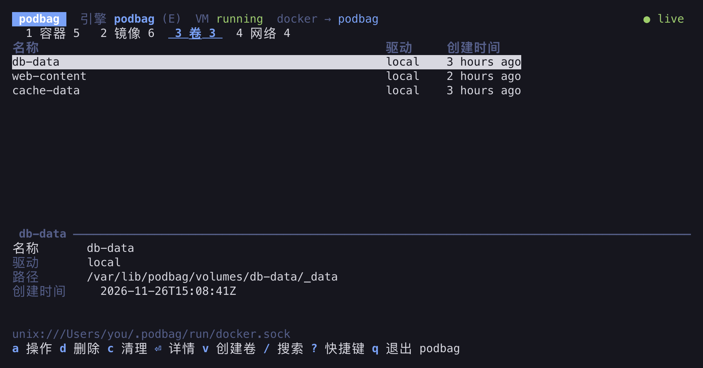
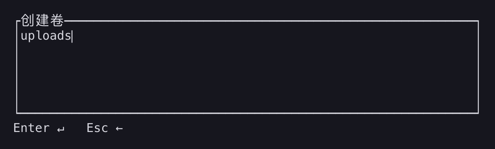
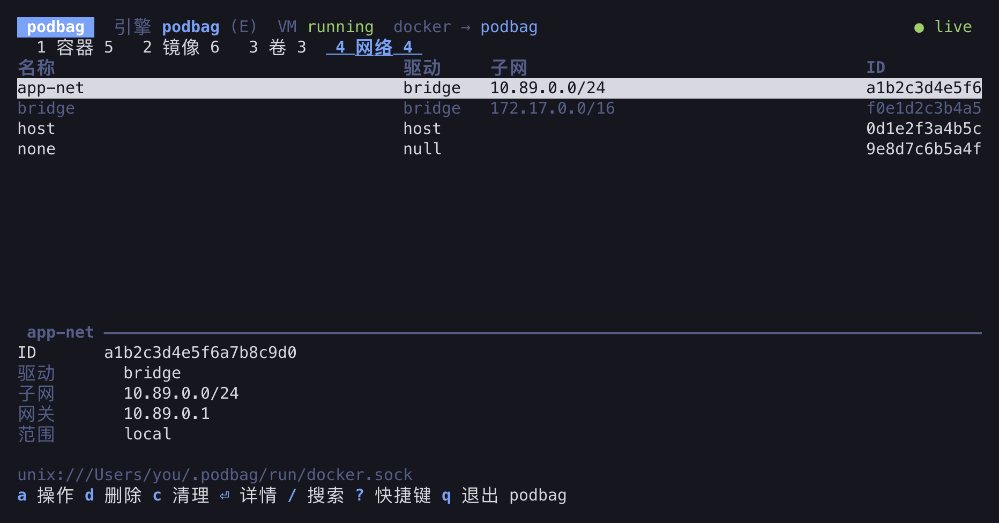

卷在容器之外保存文件。网络把容器连接起来。TUI 为它们各提供一个列表。

**预计用时** 5 分钟。

## 查看卷

按 `3`。卷列表显示每个卷的名称、驱动和创建时间。详情中显示卷存放文件的路径。



## 创建卷

1. 在卷列表中按 `v`。操作菜单（`a`）中的**创建卷**也可以。
2. 输入名称，例如 `uploads`。
3. 按 `Enter`。



新卷会出现在列表中。

## 删除卷

- `d` 删除选中的卷。TUI 会先询问你。卷中的文件也会一起删除。
- `c` 用于清理：它删除没有任何容器使用的卷。TUI 会先询问你。

## 查看网络

按 `4`。网络列表显示每个网络的名称、驱动、子网和 ID。详情中显示网关和范围。



`bridge`、`host` 和 `none` 是引擎自带的网络。它们显示为灰色，不能删除。

## 删除网络

- `d` 删除选中的网络。TUI 会先询问你。
- `c` 用于清理：它删除没有任何容器使用的网络。

要创建网络，请使用 CLI。

```sh
podbag network create app-net
```

## 下一篇

[切换引擎和迁移](../tui-engines/)。
