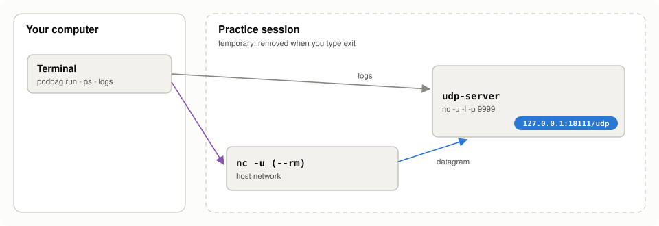

Most servers use TCP, but some use UDP. DNS and many games are examples. UDP sends single messages, called datagrams, without a connection. You publish a UDP port with `/udp` at the end of `-p`. In this module, you run a small UDP server and send it a message.

**Time** 10 minutes.



## Start the module

Open **Training** in Podbag Desktop and select **Publish a UDP port**. New modules appear after **Refresh**. Or run this command in a terminal:

```sh
podbag lab start udp-ports
```

You need a Podbag build with the Training catalog (after v0.3.2). Continue at the `training $` prompt.

## Pull the busybox image

```sh
podbag pull docker.io/library/busybox:1.37.0
```

Podbag checks that the image is there.

## Run a UDP server

`nc -u -l -p 9999` waits for UDP datagrams on port `9999` and prints what it gets. `-p 127.0.0.1:18111:9999/udp` publishes that port on your computer. Without `/udp`, the port would be TCP.

```sh
podbag run -d --name udp-server -p 127.0.0.1:18111:9999/udp docker.io/library/busybox:1.37.0 nc -u -l -p 9999
```

The commands below use this port. If `18111` is in use, Training shows the commands with another port; copy them from Training. Podbag checks that `udp-server` runs.

## See the UDP port

```sh
podbag ps
```

The **PORTS** column shows `127.0.0.1:18111->9999/udp`. Podbag checks for this text.

## Send a datagram

The client is another container. `--network host` puts it on the network of the engine's host. There, `127.0.0.1:18111` is the published port, as for a program on your computer. `nc -u -w 1` sends one line and stops after one second.

```sh
podbag run --rm --network host docker.io/library/busybox:1.37.0 sh -c 'echo "Hello over UDP" | nc -u -w 1 127.0.0.1 18111'
```

UDP gives no reply, so this command prints nothing. Podbag checks that the server still runs.

## Read the datagram in the logs

The server printed what it got. The logs show it.

```sh
podbag logs udp-server
```

The output is `Hello over UDP`. Podbag checks for this line.

On macOS, a published UDP port also answers on the Mac's `localhost`, like a TCP port. A UDP client's flow ends after 90 seconds without traffic.

## Clean up and finish

Remove the server. It is still running, so `-f` stops it first.

```sh
podbag rm -f udp-server
exit
```

The temporary practice session is removed. Training shows the module as complete.
