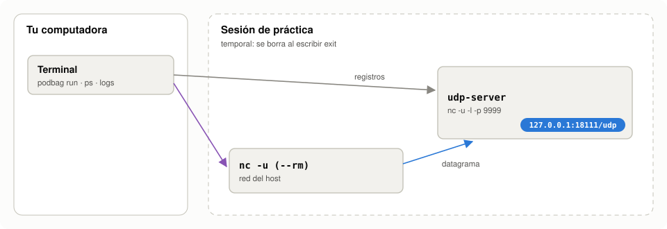

La mayoría de los servidores usan TCP, pero algunos usan UDP. DNS y muchos juegos son ejemplos. UDP envía mensajes sueltos, llamados datagramas, sin una conexión. Publicas un puerto UDP con `/udp` al final de `-p`. En este módulo, ejecutas un pequeño servidor UDP y le envías un mensaje.

**Tiempo** 10 minutos.



## Inicia el módulo

Abre **Training** en Podbag Desktop y selecciona **Publica un puerto UDP**. Los módulos nuevos aparecen después de **Actualizar**. O ejecuta este comando en una terminal:

```sh
podbag lab start udp-ports
```

Necesitas una versión de Podbag con el catálogo de Training (después de v0.3.2). Continúa en el prompt `training $`.

Para hacer los pasos en la TUI en lugar de Podbag Desktop, añade `--tui`.

```sh
podbag lab start udp-ports --tui
```

En la TUI, pulsa `:` para abrir la shell de Training cuando un paso pida un comando, escribe `exit` para volver a la TUI y pulsa `q` para terminar la sesión.

## Descarga la imagen busybox

```sh
podbag pull docker.io/library/busybox:1.37.0
```

- **En Podbag Desktop:** Selecciona **Contenedores de práctica → Descargar docker.io/library/busybox:1.37.0**.
- **En la TUI:** Abre **Imágenes**, pulsa `p`, escribe `docker.io/library/busybox:1.37.0` y pulsa `Enter`.

Podbag comprueba que la imagen está ahí.

## Ejecuta un servidor UDP

`nc -u -l -p 9999` espera datagramas UDP en el puerto `9999` y muestra lo que recibe. `-p 127.0.0.1:18111:9999/udp` publica ese puerto en tu computadora. Sin `/udp`, el puerto sería TCP.

```sh
podbag run -d --name udp-server -p 127.0.0.1:18111:9999/udp docker.io/library/busybox:1.37.0 nc -u -l -p 9999
```

Los comandos siguientes usan este puerto. Si `18111` está en uso, Training muestra los comandos con otro puerto. Cópialos desde Training. Podbag comprueba que `udp-server` está en ejecución.

## Mira el puerto UDP

```sh
podbag ps
```

La columna **PORTS** muestra `127.0.0.1:18111->9999/udp`. Podbag busca este texto.

## Envía un datagrama

El cliente es otro contenedor. `--network host` lo pone en la red del host del motor. Allí, `127.0.0.1:18111` es el puerto publicado, igual que para un programa de tu computadora. `nc -u -w 1` envía una línea y se detiene después de un segundo.

```sh
podbag run --rm --network host docker.io/library/busybox:1.37.0 sh -c 'echo "Hello over UDP" | nc -u -w 1 127.0.0.1 18111'
```

UDP no da respuesta, así que este comando no muestra nada. Podbag comprueba que el servidor sigue en ejecución.

## Lee el datagrama en los registros

El servidor mostró lo que recibió. Los registros (logs) lo muestran.

```sh
podbag logs udp-server
```

- **En Podbag Desktop:** Selecciona **Contenedores de práctica → udp-server → Registros**.
- **En la TUI:** Selecciona `udp-server` en **Contenedores** y pulsa `l`.

La salida es `Hello over UDP`. Podbag busca esta línea.

En macOS, un puerto UDP publicado también responde en el `localhost` del Mac, como un puerto TCP. El flujo de un cliente UDP termina después de 90 segundos sin tráfico.

## Elimina el servidor y termina

Elimina el servidor. Sigue en ejecución, así que `-f` lo detiene primero.

- **En Podbag Desktop:** Selecciona **Contenedores de práctica → udp-server → Eliminar** y confirma.
- **En la TUI:** Selecciona `udp-server` en **Contenedores**, pulsa `d` y luego `y`.

```sh
podbag rm -f udp-server
exit
```

Se elimina la sesión de práctica temporal. Training muestra el módulo como completado.
