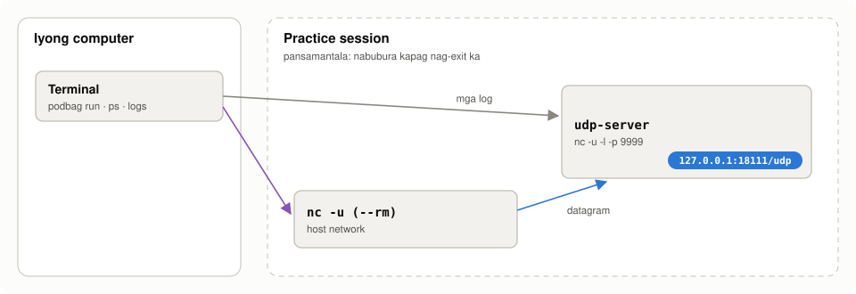

Karamihan ng server ay gumagamit ng TCP, pero may ilang gumagamit ng UDP. Mga halimbawa ang DNS at maraming laro. Nagpapadala ang UDP ng mga solong mensahe, na tinatawag na datagram, nang walang koneksyon. Magpa-publish ka ng UDP port gamit ang `/udp` sa dulo ng `-p`. Sa module na ito, magpapatakbo ka ng maliit na UDP server at magpapadala ka rito ng mensahe.

**Oras** 10 minuto.



## Simulan ang module

Buksan ang **Training** sa Podbag Desktop at piliin ang **Mag-publish ng UDP port**. Lalabas ang mga bagong module pagkatapos ng **I-refresh**. O patakbuhin ang command na ito sa terminal:

```sh
podbag lab start udp-ports
```

Kailangan mo ng build ng Podbag na may Training catalog (pagkatapos ng v0.3.2). Magpatuloy sa prompt na `training $`.

## I-pull ang image na busybox

```sh
podbag pull docker.io/library/busybox:1.37.0
```

Sinusuri ng Podbag na nandoon ang image.

## Magpatakbo ng UDP server

Naghihintay ang `nc -u -l -p 9999` ng mga UDP datagram sa port na `9999` at ipinapakita nito ang natatanggap. Ipina-publish ng `-p 127.0.0.1:18111:9999/udp` ang port na iyon sa computer mo. Kung walang `/udp`, TCP ang port.

```sh
podbag run -d --name udp-server -p 127.0.0.1:18111:9999/udp docker.io/library/busybox:1.37.0 nc -u -l -p 9999
```

Ginagamit ng mga command sa ibaba ang port na ito. Kung gamit na ang `18111`, ipapakita ng Training ang mga command na may ibang port. Kopyahin ang mga ito mula sa Training. Sinusuri ng Podbag na tumatakbo ang `udp-server`.

## Tingnan ang UDP port

```sh
podbag ps
```

Ipinapakita ng column na **PORTS** ang `127.0.0.1:18111->9999/udp`. Hinahanap ng Podbag ang text na ito.

## Magpadala ng datagram

Ang client ay isa pang container. Inilalagay ito ng `--network host` sa network ng host ng engine. Doon, ang `127.0.0.1:18111` ang na-publish na port, tulad ng para sa programang nasa computer mo. Nagpapadala ang `nc -u -w 1` ng isang linya at humihinto pagkalipas ng isang segundo.

```sh
podbag run --rm --network host docker.io/library/busybox:1.37.0 sh -c 'echo "Hello over UDP" | nc -u -w 1 127.0.0.1 18111'
```

Walang sagot ang UDP, kaya walang ipinapakita ang command na ito. Sinusuri ng Podbag na tumatakbo pa ang server.

## Basahin ang datagram sa mga log

Ipinakita ng server ang natanggap nito. Makikita ito sa mga log.

```sh
podbag logs udp-server
```

Ang output ay `Hello over UDP`. Hinahanap ng Podbag ang linyang ito.

Sa macOS, sumasagot din sa `localhost` ng Mac ang na-publish na UDP port, tulad ng TCP port. Natatapos ang daloy ng UDP client pagkatapos ng 90 segundo na walang trapiko.

## Maglinis at tapusin

Burahin ang server. Tumatakbo pa ito, kaya inihihinto muna ito ng `-f`.

```sh
podbag rm -f udp-server
exit
```

Naaalis ang pansamantalang practice session. Ipinapakita ng Training na tapos na ang module.
