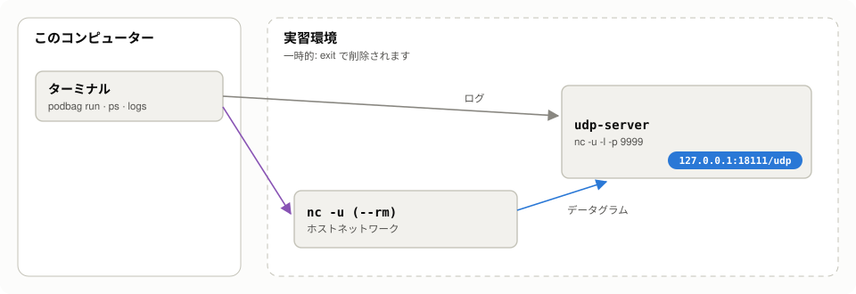

ほとんどのサーバーは TCP を使いますが、UDP を使うものもあります。DNS や多くのゲームがその例です。UDP は、接続を作らずに、データグラムという 1 通ずつのメッセージを送ります。UDP のポートを公開するには、`-p` の最後に `/udp` を付けます。このモジュールでは、小さな UDP サーバーを実行し、メッセージを送ります。

**所要時間** 10 分。



## モジュールを開始する

Podbag Desktop で **Training** を開き、**UDP ポートを公開する**を選びます。新しいモジュールは**更新**の後に表示されます。ターミナルで次のコマンドを実行しても開始できます。

```sh
podbag lab start udp-ports
```

Training カタログがある Podbag のビルドが必要です(v0.3.2 より後)。`training $` プロンプトが表示されたら続けます。

## busybox イメージを取得する

```sh
podbag pull docker.io/library/busybox:1.37.0
```

Podbag はイメージがあることを確認します。

## ポートを公開して UDP サーバーを実行する

`nc -u -l -p 9999` は、ポート `9999` で UDP のデータグラムを待ち、受け取った内容を表示します。`-p 127.0.0.1:18111:9999/udp` は、そのポートをお使いのコンピューターで公開します。`/udp` がないと、ポートは TCP になります。

```sh
podbag run -d --name udp-server -p 127.0.0.1:18111:9999/udp docker.io/library/busybox:1.37.0 nc -u -l -p 9999
```

この後のコマンドは、このポートを使います。`18111` が使われている場合、Training は別のポートでコマンドを表示します。そのときは Training からコマンドをコピーします。Podbag は `udp-server` が実行中であることを確認します。

## ps で UDP ポートを確認する

```sh
podbag ps
```

**PORTS** 列に `127.0.0.1:18111->9999/udp` が表示されます。Podbag はこの文字列があることを確認します。

## 公開ポートにデータグラムを送る

クライアントは、別のコンテナーです。`--network host` は、クライアントをエンジンのホストのネットワークに置きます。そこでは、お使いのコンピューター上のプログラムと同じように、`127.0.0.1:18111` が公開ポートです。`nc -u -w 1` は 1 行を送り、1 秒後に止まります。

```sh
podbag run --rm --network host docker.io/library/busybox:1.37.0 sh -c 'echo "Hello over UDP" | nc -u -w 1 127.0.0.1 18111'
```

UDP は返事を返さないので、このコマンドは何も表示しません。Podbag はサーバーがまだ実行中であることを確認します。

## サーバーのログでデータグラムを読む

サーバーは、受け取った内容を表示しました。ログで確認できます。

```sh
podbag logs udp-server
```

出力は `Hello over UDP` です。Podbag はこの行があることを確認します。

macOS では、公開した UDP ポートは、TCP ポートと同じように、Mac の `localhost` でも応答します。UDP クライアントのフローは、通信がないまま 90 秒たつと終わります。

## 片付けて終了する

サーバーを削除します。まだ実行中なので、`-f` で先に停止します。

```sh
podbag rm -f udp-server
exit
```

一時的な実習環境が削除されます。Training にモジュールの完了が表示されます。
