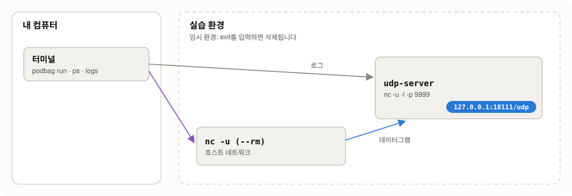

대부분의 서버는 TCP를 쓰지만 UDP를 쓰는 서버도 있습니다. DNS와 많은 게임이 그 예입니다. UDP는 연결 없이 메시지를 하나씩 보냅니다. 이 메시지를 데이터그램이라고 합니다. UDP 포트는 `-p` 끝에 `/udp`를 붙여 공개합니다. 이번 트레이닝에서는 작은 UDP 서버를 실행하고 메시지를 보냅니다.

**예상 시간** 10분.



## 실습 시작

Podbag Desktop에서 **Training**을 열고 **UDP 포트 공개하기**를 선택합니다. 새 모듈은 **새로 고침** 후에 나타납니다. 터미널에서 다음 명령을 실행해도 됩니다.

```sh
podbag lab start udp-ports
```

Training 카탈로그를 지원하는 Podbag 빌드가 필요합니다(v0.3.2 이후). `training $` 프롬프트가 나오면 다음 단계로 진행합니다.

## busybox 이미지 받기

```sh
podbag pull docker.io/library/busybox:1.37.0
```

Podbag은 이미지가 있는지 확인합니다.

## UDP 서버 실행하기

`nc -u -l -p 9999`는 `9999` 포트에서 UDP 데이터그램을 기다리고, 받은 내용을 출력합니다. `-p 127.0.0.1:18111:9999/udp`는 이 포트를 내 컴퓨터에 공개합니다. `/udp`가 없으면 TCP 포트가 됩니다.

```sh
podbag run -d --name udp-server -p 127.0.0.1:18111:9999/udp docker.io/library/busybox:1.37.0 nc -u -l -p 9999
```

아래 명령도 이 포트를 씁니다. `18111`이 이미 사용 중이면 Training이 다른 포트로 바꾼 명령을 보여 줍니다. 명령은 Training에서 복사합니다. Podbag은 `udp-server`가 실행 중인지 확인합니다.

## UDP 포트 보기

```sh
podbag ps
```

**PORTS** 열에 `127.0.0.1:18111->9999/udp`가 나옵니다. Podbag은 이 문구가 있는지 확인합니다.

## 데이터그램 보내기

클라이언트도 컨테이너입니다. `--network host`는 이 컨테이너를 엔진이 실행되는 호스트의 네트워크에 둡니다. 거기서 `127.0.0.1:18111`은 내 컴퓨터의 프로그램처럼 공개 포트로 연결됩니다. `nc -u -w 1`은 한 줄을 보내고 1초 뒤에 멈춥니다.

```sh
podbag run --rm --network host docker.io/library/busybox:1.37.0 sh -c 'echo "Hello over UDP" | nc -u -w 1 127.0.0.1 18111'
```

UDP는 답을 보내지 않으므로 이 명령은 아무것도 출력하지 않습니다. Podbag은 서버가 아직 실행 중인지 확인합니다.

## 로그에서 데이터그램 읽기

서버는 받은 내용을 출력했습니다. 로그에서 그 내용을 볼 수 있습니다.

```sh
podbag logs udp-server
```

출력은 `Hello over UDP`입니다. Podbag은 이 줄을 확인합니다.

macOS에서는 공개한 UDP 포트도 TCP 포트처럼 Mac의 `localhost`에서 응답합니다. UDP 클라이언트의 흐름은 90초 동안 오가는 데이터가 없으면 끝납니다.

## 정리 및 실습 종료

서버를 삭제합니다. 아직 실행 중이므로 `-f`가 먼저 멈춥니다.

```sh
podbag rm -f udp-server
exit
```

임시 실습 환경이 삭제됩니다. Training에 모듈이 완료됨으로 표시됩니다.
