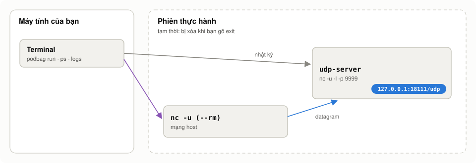

Hầu hết máy chủ dùng TCP, nhưng một số dùng UDP. DNS và nhiều trò chơi là ví dụ. UDP gửi từng thông điệp riêng lẻ, gọi là datagram, mà không cần kết nối. Bạn công bố cổng UDP bằng `/udp` ở cuối `-p`. Trong mô-đun này, bạn chạy một máy chủ UDP nhỏ và gửi thông điệp cho nó.

**Thời gian** 10 phút.



## Bắt đầu mô-đun

Mở **Training** trong Podbag Desktop và chọn **Công bố cổng UDP**. Mô-đun mới xuất hiện sau khi chọn **Làm mới**. Hoặc chạy lệnh này trong terminal:

```sh
podbag lab start udp-ports
```

Bạn cần bản Podbag có danh mục Training (sau v0.3.2). Tiếp tục tại dấu nhắc `training $`.

## Kéo image busybox

```sh
podbag pull docker.io/library/busybox:1.37.0
```

Podbag kiểm tra rằng image đã có.

## Chạy máy chủ UDP

`nc -u -l -p 9999` chờ các datagram UDP ở cổng `9999` và in những gì nhận được. `-p 127.0.0.1:18111:9999/udp` công bố cổng đó trên máy tính của bạn. Nếu không có `/udp`, cổng sẽ là TCP.

```sh
podbag run -d --name udp-server -p 127.0.0.1:18111:9999/udp docker.io/library/busybox:1.37.0 nc -u -l -p 9999
```

Các lệnh bên dưới dùng cổng này. Nếu `18111` đang được dùng, Training hiển thị các lệnh với cổng khác. Hãy sao chép lệnh từ Training. Podbag kiểm tra rằng `udp-server` đang chạy.

## Xem cổng UDP

```sh
podbag ps
```

Cột **PORTS** hiển thị `127.0.0.1:18111->9999/udp`. Podbag tìm đoạn chữ này.

## Gửi một datagram

Client là một container khác. `--network host` đặt nó vào mạng của máy chứa engine. Ở đó, `127.0.0.1:18111` là cổng đã công bố, giống như với một chương trình trên máy tính của bạn. `nc -u -w 1` gửi một dòng và dừng sau một giây.

```sh
podbag run --rm --network host docker.io/library/busybox:1.37.0 sh -c 'echo "Hello over UDP" | nc -u -w 1 127.0.0.1 18111'
```

UDP không trả lời, nên lệnh này không in gì. Podbag kiểm tra rằng máy chủ vẫn đang chạy.

## Đọc datagram trong nhật ký

Máy chủ đã in những gì nó nhận được. Nhật ký hiển thị điều đó.

```sh
podbag logs udp-server
```

Kết quả là `Hello over UDP`. Podbag tìm dòng này.

Trên macOS, cổng UDP đã công bố cũng trả lời trên `localhost` của máy Mac, giống như cổng TCP. Luồng của một client UDP kết thúc sau 90 giây không có dữ liệu.

## Dọn dẹp và kết thúc

Xóa máy chủ. Nó vẫn đang chạy, nên `-f` dừng nó trước.

```sh
podbag rm -f udp-server
exit
```

Phiên thực hành tạm thời đã được xóa. Training hiển thị mô-đun đã hoàn thành.
